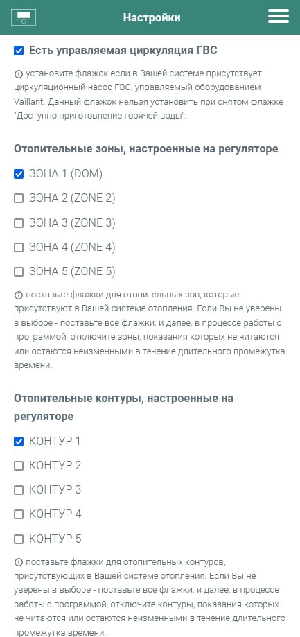
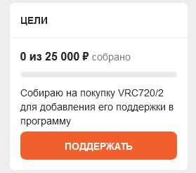
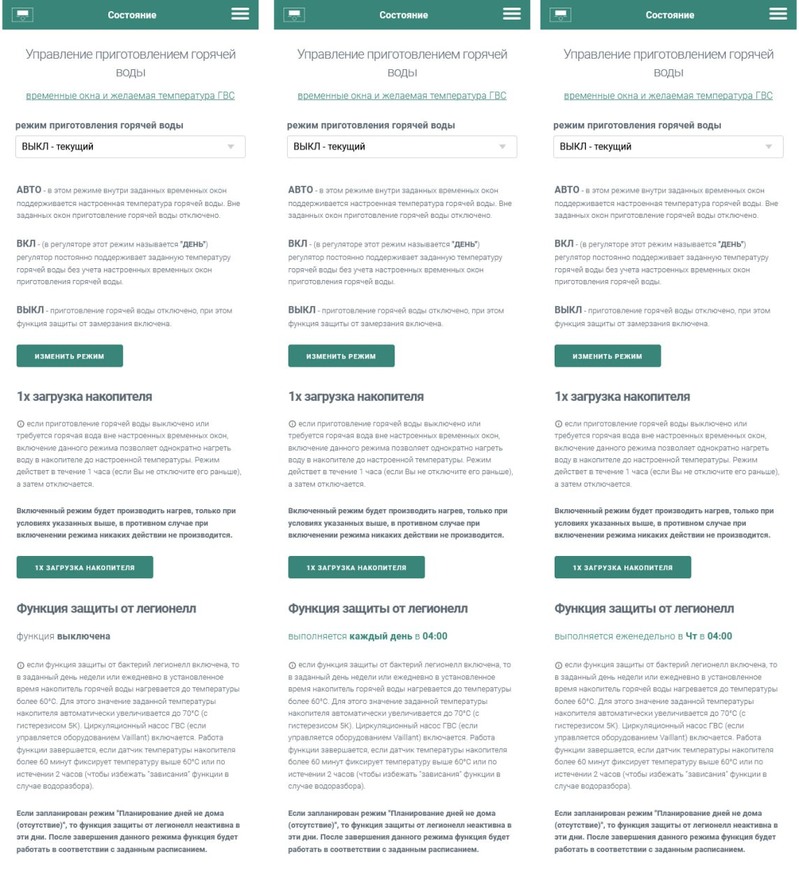
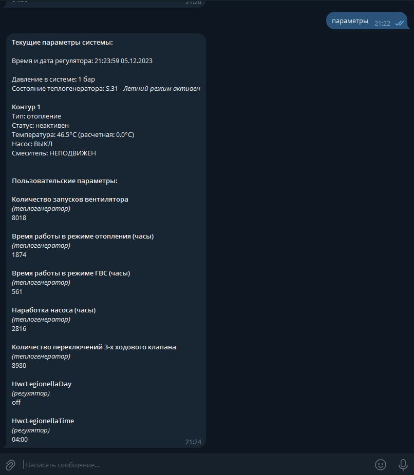
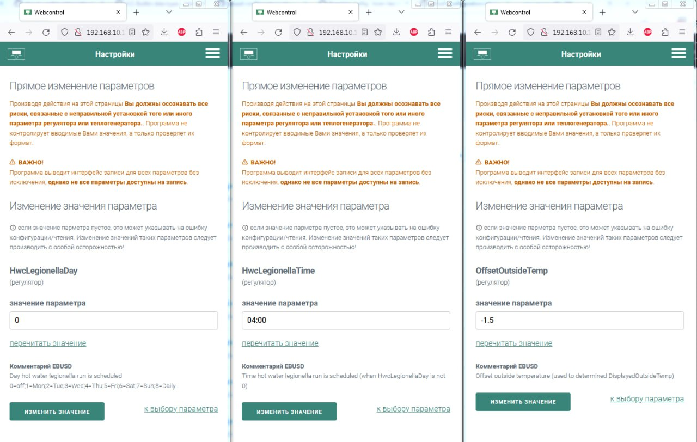
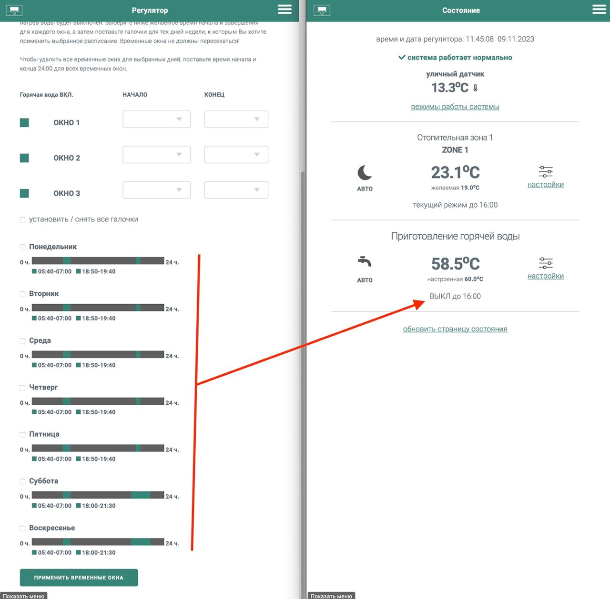

## Новости Webcontrol — 2023 год

[← Свежие новости](./) | [Главная страница Webcontrol](https://stadid.github.io/webcontrol/) | [Репозиторий GitHub](https://github.com/stadid/webcontrol/)

---

### 2023-12-28

Расширение количества поддерживаемых отопительных зон и контуров.

Недавно, один из подписчиков использующий VRC700/6 столкнулся с ситуацией, когда в программе  потребовалось настроить 4-ю отопительную зону и посмотреть параметры соответствующего контура. 

Во-первых, конфигурация на github поддерживает только 3 зоны, поэтому пришлось методом интерполяции подбирать адреса переменных отвечающих за 4 и 5 зону и 4 и 5 контур (а их там немало).

А во-вторых пришлось обновлять код в программе для поддержки этих двух зон и контуров. 

Сегодня подписчик проверил на своей системе - все корректно читается, так что программа теперь поддерживает до 5 отопительных зон и до 5 контуров.

Обновление будет доступно, скорее всего, в следующем году на Boosty.

[Открыть в Telegram](https://t.me/webcontrol_app/85)

---

### 2023-12-25

Владельцы 720 регуляторов, а вы правда желаете увидеть его поддержку в программе? Судя по тому что я вижу - меня терзают смутные сомнения.

Без регулятора сделать разработку невозможно, а у меня совершенно нет желания еще и покупать за свои деньги этот регулятор.

Да, жизнь к вам несправдлива - в отличие от владельцев 700-х регуляторов, которые получили все считай забесплатно. Но, чтобы хоть чего-нибудь достичь, надо, наверное, хоть что-нибудь для этого сделать?

Сбор на покупку регулятора: https://boosty.to/webcontrol_app/about

[Открыть в Telegram](https://t.me/webcontrol_app/84)

---

### 2023-12-25

Заметки для тех, кто делает свое решение на основе EBUSD.

По возможности, всегда используйте локальную конфигурацию EBUSD. Если не хотите веселых приключений - не обновляйте конфигурацию из репозитория [ebusd-configuration] автоматически. Если хватает знаний - сравнивайте ключевые файлы конфигурации для просмотра изменений. Судя по тому, что там творится, системного подхода там нет, каждый предлагает кусок, который у него работает на его железе, но в ситуации, когда в нескольких конфигурациях задействован общий шаблон типа переменных, это может привести к тому что ранее работающая у Вас конфигурация после обновления может просто перестать работать.

[Открыть в Telegram](https://t.me/webcontrol_app/83)

---

### 2023-12-20

Для тех, кто хочет купить готовый адаптер.

Если Вы хотите использовать программу, но Вас останавливает сложность заказа и сборки адаптера - представляю Вам подписчиков, которые взвалили на себя этот тяжкий труд.
Вы можете обратится к ним напрямую и договориться об изготовлении адаптера.

Итак: 

Евгений (Тюмень) 
Телеграм: [https://t.me/mevgen72](https://t.me/mevgen72)

На момент размещения данного поста у Евгения есть в наличии 2 готовых адаптера. Есть возможность собрать ещё 5 адаптеров в ближайшее время (в течении недели). Можно заказать как плату адаптера шины, так и адаптер целиком (и даже напечатать корпус). 
Также отправляет адаптеры по РОССИИ (за счет заказчика). Для производства следующей партии адаптеров (от 5 штук) сроки приблизительно такие же (2-3 месяца).

Антон (Московский регион)
Телеграм: [https://t.me/Patamushta99](https://t.me/Patamushta99)

У Антона есть в наличии готовые и оттестированные платы адаптеров, а также готовые адаптеры в корпусе.  Антон готов отправить адаптеры по России за счет заказчика.

Константин (Московский регион)
[https://t.me/+feL6JaACwl4xYjEy](https://t.me/+feL6JaACwl4xYjEy)

Собирает заказы и затем заказывает у контрактного производителя минимально возможную партию платы адаптера шины (5 штук).
Вы оплачиваете заказ только после того как набирается минимальное количество желающих заказать адаптер.
Также Константин предоставляет счет от контрактного производителя. Предоплата 100% после получения счета от контрактного производителя.
Сроки изготовления зависят от наличия и сроков заказа компонентов и загруженности контрактного производителя и составляют в среднем 2-3 месяца, т.е. Вы должны понимать что мгновенно Вы адаптер не получите.
Поскольку адаптер состоит из двух плат: преобразователя USB-RS232 (готовая плата, покупается, например, в Чип и Дипе) и платы собственно адаптера шины (ebus) - та которая заказывается, то при размещении заказа Вы должны уточнить нужна ли Вам только плата адаптера шины, или Вам необходим адаптер целиком.
За разумные деньги Константин готов собрать и протестировать у себя готовый адаптер. Отправка по РФ СДЭКОМ (за счет заказчика).

Хотелось бы ОСОБЕННО обратить внимание, что изготовление адаптеров при таких объемах - это вовсе не про заработок, люди тратят свое время чтобы помочь другим в изготовлении адаптера, за что они должны быть вознаграждены в разумных пределах. Также хочется отметить, что я никак финансово не связан с людьми взявшими на себя изготовление адаптеров, однако благодарен им, так как они делают использование программы доступнее.

[Открыть в Telegram](https://t.me/webcontrol_app/81)

---

### 2023-12-19

Поскольку у ряда пользователей  возникли сложности при настройке VPN на телефоне с android, пришлось сделать короткую инструкцию по установке и настройке SSTP VPN клиента для удаленного доступа к интерфейсу программы через VPN. Эта инструкция дополняет [ранее размещенную инструкцию](https://t.me/webcontrol_app/78) по организации удаленного доступа при помощи сервиса VPNKI.ru

#настройка

📎 **Вложение:** [Open_SSTP_client_android_VPNKI.pdf](./files/80_Open_SSTP_client_android_VPNKI.pdf)

[Открыть в Telegram](https://t.me/webcontrol_app/80)

---

### 2023-12-17

Обновление программы [до версии 2023.12.12](https://boosty.to/webcontrol_app/posts/d169f88a-bb34-4f44-aca8-913c5c613629)
добавляет отображение состояния функции защиты от легионелл.
Требует установки [обновления конфигурации EBUSD 2023.12.08](https://t.me/webcontrol_app/74) 

[Список изменений](https://t.me/webcontrol_app/29)

[Открыть в Telegram](https://t.me/webcontrol_app/79)

---

### 2023-12-16

Наконец-то написал инструкцию по настройке удаленного доступа к Web-Интерфейсу Webcontrol при помощи встроенного VPN-клиента.

Данная инструкция актуальна для тех, у кого НЕТ ТЕХНИЧЕСКОЙ ВОЗМОЖНОСТИ самостоятельно организовать удаленный доступ  к устройству Webcontrol.

#настройка

📎 **Вложение:** [VPN_client_config_VPNKI.pdf](./files/78_VPN_client_config_VPNKI.pdf)

[Открыть в Telegram](https://t.me/webcontrol_app/78)

---

### 2023-12-14

Какие бывают разновидности VRC720 
(c проводным подключением - не по радиоканалу)

(указаны идентификаторы устройств, встречающиеся у пользователей ebusd на github):
ID=72000 - судя по всему первое поколение VRC720. упоминается всего один раз
ID=CTLV2 - второе поколение т.е. VRC720/2 - самое распространенное устройство (часто встречается у пользователей)
ID=CTLV3 - третье поколение т.е. VRC720/3 - упоминается всего один раз

для справки
ID=CTLV0 - это VRT380 - по сути урезанная версия VRC720

[Открыть в Telegram](https://t.me/webcontrol_app/77)

---

### 2023-12-12

Из приятных мелочей: поскольку ранее я нашел [элементы конфигурации VRC 700, связанные с функцией защиты от легионелл](https://t.me/webcontrol_app/74), то глупо было бы не добавить в программу отображение состояния этой функции, что и было мною добавлено на страницу "Состояние" - "Управление приготовлением горячей воды". Появится в следующей версии на Boosty.

[Открыть в Telegram](https://t.me/webcontrol_app/76)

---

### 2023-12-11

[Обновление конфигурации EBUSD 2023.12.08](https://boosty.to/webcontrol_app/posts/9d4bb7e0-610c-4c0b-9724-f0a2d4765a66)
Обновлена конфигурация VRC700 в которую добавлены следующие параметры:
HwcLegionellaTime - время запуска функции защиты от легионелл
HwcLegionellaDay - расписание выполнения функции защиты от легионелл
OffsetOutsideTemp - сдвиг НТ (корректировка показаний датчика наружной температуры воздуха)

[Открыть в Telegram](https://t.me/webcontrol_app/74)

---

### 2023-12-11

Обновление программы [до версии 2023.12.08](https://boosty.to/webcontrol_app/posts/cf5e6dcf-b35b-402a-9453-9e151c6b1996)
добавляет команду Телеграм бота "[параметры](https://t.me/webcontrol_app/69)".[Список изменений](https://t.me/webcontrol_app/29)

[Открыть в Telegram](https://t.me/webcontrol_app/73)

---

### 2023-12-11

Как ранее было анонсировано, все обновления кода программы и конфигурации EBUSD будут доступны пользователям, которые сделали добровольные пожертвования на развитие программы. Так вот, я [сделал страницу на сервисе Boosty](https://boosty.to/webcontrol_app/about), где желающие  могут пожертвовать определенную сумму, поддержав развитие программы и скачать обновления. Сумма пожертвований пока фиксированная.

Анонсы обновлений будут выходить здесь  с  прямой ссылкой на посты в Boosty.
Список изменений также будет обновляться и здесь и на Boosty.

По поддержке 720 регулятора: добавление поддержки завершено, проходит тестирование.

СООБЩЕНИЕ ПОТЕРЯЛО АКТУАЛЬНОСТЬ.
Обновление теперь происходит через интернет. На Boosty  размещен только установочный образ

[Открыть в Telegram](https://t.me/webcontrol_app/72)

---

### 2023-12-11

Обновил [образ программы](https://t.me/webcontrol_app/13) до версии 2023.11.26. Эта версия прежде всего решает задачу уменьшения объемов записи в eMMC  (что должно увеличить ее срок службы и повысить надежность работы системы). Как вы понимаете, задача решается путем изменения настроек самой ОС, поэтому обновление и вышло в виде образа. Обновление кода добавляет одну ссылку в интерфейсе и все. Никаких изменений кода это обновление не содержит. 

[Список изменений](https://t.me/webcontrol_app/29)

[Открыть в Telegram](https://t.me/webcontrol_app/71)

---

### 2023-12-06

Уважаемые пользователи!

Посмотрев на проделанную мною огромную работу и текущий функционал программы, я пришел к выводу, что задача-минимум по обеспечению БЕСПЛАТНОЙ ПОЛНОФУНКЦИОНАЛЬНОЙ замены удаленного управления Valliant (по крайней мере для регулятора VRC700) мною выполнена  
(да что там говорить - такого уровня решения, использующего родной регулятор, на данный момент нет вообще ни у кого).

В связи с этим я более не стану выкладывать в открытый доступ обновления, расширяющие функционал ПО, т.к. это во многом обесценивает мои усилия по его развитию. В какой форме будут предлагаться будущие обновления как кода, так и базы ebusd я еще не решил. Возможно, доступ к скачиванию будет обеспечиваться после пожертвования определенной суммы, таким образом, пользователи жертвующие на развитие ПО получат возможность использовать расширенный функционал программы. 

Тем не менее, я буду обновлять общедоступную версию с точки зрения улучшения надежности ее работы и исправления ошибок, если таковые обнаружатся. Инструкции по настройке останутся в открытом доступе и, надеюсь, будут пополняться.

ОБНОВЛЕНО: информация устарела. В настоящий момент ознакомительная версия не имеет ограничений по функционалу, а имеет ограничение по количеству отображаемых зон/контуров.

[Открыть в Telegram](https://t.me/webcontrol_app/70)

---

### 2023-12-05

В телеграм-бот добавлена команда "параметры" выводящая информацию о параметрах системы аналогичную той, что представлена в веб-интерфейсе программы на странице "Параметры".

[Открыть в Telegram](https://t.me/webcontrol_app/69)

---

### 2023-12-05

Удалось обнаружить адреса еще для 3 параметров конфигурации VRC700:
Сдвиг датчика наружной температуры
Защита от легионелл день
Защита от легионелл время

[Открыть в Telegram](https://t.me/webcontrol_app/68)

---

### 2023-11-23

Т.к. есть предположение что подобные ситуации возникают при взаимодействии системы с eMMC памятью (в моменты, когда система пытается массово записать что-то на диск), то было принято решение создать рабочий образ на новой версии ядра, для понимания насколько это изменит ситуацию с зависаниями. Если Вы сталкивались с зависаниями, рекомендую поставить этот образ, чтобы понять изменит ли это ситуацию.

Выше в сообщении был образ системы для тестирования на обновленной ОС Debian 12 (ядро  6.1.0-13). Для справки: все предыдущие образы базировались на Debian 11 (последняя версия Webcontrol на ядре 5.10.0-25).

[Открыть в Telegram](https://t.me/webcontrol_app/61)

---

### 2023-11-23

Уважаемые пользователи программы!
Те, кто уже пользуется ей продолжительное время. 

Мне необходима обратная связь по надежности работы программы.

В особенности, мне важно знать сколько работает у вас программа без перезагрузки и сталкивались ли вы с “зависаниями” – ситуациями, когда включенный мини-компьютер становится недоступен по сети, и начинает работать нормально только после перезагрузки.

Некоторые пользователи сообщили мне о случайно возникающих подобных “зависаниях” мини-компьютера во время работы. Эти зависания носят несистемный характер и пока не удалось достоверно выяснить их причину. Вся техническая информация будет размещена в комментарии к этому сообщению. Если вы являетесь специалистом в области низкоуровневого взаимодействия ОС Linux с железом, можете в комментарии оставить свое мнение и предложения по устранению подобных ситуаций.

[продолжение](https://t.me/webcontrol_app/61)

📎 **Вложение:** [readme.txt](./files/60_readme.txt)

[Открыть в Telegram](https://t.me/webcontrol_app/60)

---

### 2023-11-15

Представляю очередную версию  [2023.11.15](https://t.me/webcontrol_app/13)  которая добавляет возможность обновления программы путем загрузки файла обновления через  веб-интерфейс . НАСТОЯТЕЛЬНО рекомендую всем обновиться до этой версии, т.к. следующие обновления планирую по возможности выпускать только в виде файла-обновления кода, а не образа.  [Список изменений](https://t.me/webcontrol_app/29).

[Открыть в Telegram](https://t.me/webcontrol_app/57)

---

### 2023-11-11

Все-таки доделал обновление кода через загрузку файла, хотя это было хлопотно. Часть кода программы и структуру служебных каталогов из-за обновления пришлось менять. В первом приближении протестировал и оно даже работает. Теперь надо тестировать более тщательно.  И потом выложить образ.

📎 **Вложение:** [CU.png](./files/55_CU.png)

[Открыть в Telegram](https://t.me/webcontrol_app/55)

---

### 2023-11-09

Благодаря пользователю программы Вадиму  удалось обнаружить и устранить ошибку в отображении окончания текущего временного окна для 2 и 3 отопительной зоны и зоны приготовления ГВ. Большое Спасибо ему за это! Исправление войдет в следующую версию программы.

[Открыть в Telegram](https://t.me/webcontrol_app/53)

---

### 2023-10-30

По обновлению ПО.
Сейчас работаю над добавлением возможности обновлять код программы через загрузку файла в веб-интерфейсе без переустановки через образ.

Политика обновлений будет следующая:
- если производятся изменения в самой ОС, то обновление выходит в виде образа.
- если только обновление кода, то через файл.

Таким образом, Вы скачиваете последний образ и затем (если требуется) ставите обновление программного кода, для получения актуальной версии. Обновления кода постараюсь сделать кумулятивными, т.е. актуальное обновление кода будет содержать все обновления  вышедшие ранее. 

Надеюсь добавить механизм обновлений уже в следующую версию, хотя, на мой взгляд, для бесплатного ПО этот функционал уже несколько перебор.

[Открыть в Telegram](https://t.me/webcontrol_app/52)

---

### 2023-10-27

Один из первых пользователей программы Константин предложил реализовать полезную функцию - отправлять уведомления Telegram пользователям, если кто-то из них меняет через бота настройки системы.

Эта функция мною реализована и войдет в следующую версию программы. Кому она не требуется - просто могут ее не включать (функция по умолчанию отключена).

📎 **Вложение:** [Screenshot 2023-10-27 at 16-00-06 Webcontrol.png](./files/51_Screenshot 2023-10-27 at 16-00-06 Webcontrol.png)

[Открыть в Telegram](https://t.me/webcontrol_app/51)

---

### 2023-10-24

Вышла версия 2023.10.17 позволяющая использовать  Wi-FI в разных модификациях мини-компьютера Beelink T4-PRO.  Список изменений  можно посмотреть [вот тут](https://t.me/webcontrol_app/29).

[Открыть в Telegram](https://t.me/webcontrol_app/49)

---

### 2023-10-16

Также благодаря Евгению удалось обнаружить что существует несколько разновидностей модели Beelink T4 PRO отличающихся друг от друга используемыми WiFi модулями и версией BIOS (пока не удалось обнаружить признаки по которым их можно отличить друг от друга без просмотра списка оборудования в ОС или, возможно, версии BIOS). В другой разновидности мини-компьютера из-за ошибки в BIOS не работает WiFi под linux. Эту проблему удалось победить и, после проверок на своей тестовой машине надеюсь, в следующей версии Webcontrol WiFi будет работать в обеих разновидностях Beelink T4 -PRO. Технические подробности [тут](https://forum.bee-link.com/forum.php?mod=viewthread&tid=87248&extra=) и вот [тут](https://bugzilla.kernel.org/show_bug.cgi?id=215715).

[Открыть в Telegram](https://t.me/webcontrol_app/48)

---

### 2023-10-16

Благодаря подписчику канала Евгению удалось исправить неточность в архиве с документацией на EBUS адаптер. Исправлено обозначение выводов EBUS адаптера на печатной плате. Архив  обновлен.

[Открыть в Telegram](https://t.me/webcontrol_app/47)

---

### 2023-10-10

Уважаемые посетители и подписчики канала!
Для добавления поддержки в программе 720 регулятора мне необходим этот регулятор. Если удастся со временем накопить с [добровольных пожертвований](https://boosty.to/webcontrol_app/about) сумму для его покупки, я займусь написанием кода для него.

[Открыть в Telegram](https://t.me/webcontrol_app/45)

---

### 2023-10-06

Настройка BIOS компьютера Beelink T4-PRO для автоматического включения компьютера после аварийного отключения питания.

#установка
#настройка

📎 **Вложение:** [Beelink_T4PRO_BIOS_power_restore_settings.pdf](./files/44_Beelink_T4PRO_BIOS_power_restore_settings.pdf)

[Открыть в Telegram](https://t.me/webcontrol_app/44)

---

### 2023-09-29

Вышла новая версия 2023.09.28 с поддержкой подключения по  Wi-FI. Список изменений  можно посмотреть [вот тут](https://t.me/webcontrol_app/29).  Также в первом сообщении в канале добавил [ссылку](https://pay.mysbertips.ru/42446581) для приема благодарностей от признательных пользователей. ))))

[Открыть в Telegram](https://t.me/webcontrol_app/42)

---

### 2023-09-28

С учетом изменений в программе обновил инструкцию по созданию и подключению Telegram-бота и настройкам для Telegram-пользователей. Эта инструкция доступна в самой программе и будет обновлена при выходе следующей версии ПО.

#настройка

📎 **Вложение:** [Telegram_bot_creation_and_commands.pdf](./files/41_Telegram_bot_creation_and_commands.pdf)

[Открыть в Telegram](https://t.me/webcontrol_app/41)

---

### 2023-09-26

https://github.com/john30/ebusd-configuration/pull/299/files
Не прошло и года (точнее 9 месяцев), как мой commit  относительно специальных режимов работы VRC700 был добавлен в конфигурационные файлы EBUSD. Учитывая опенсорсность во всей красе, очень даже неплохо.

[Открыть в Telegram](https://t.me/webcontrol_app/40)

---

### 2023-09-19

Как мне видится развитие программы:

Ниже представлен список того, что хотелось бы реализовать в программе, чтобы считать свою миссию выполненной (совершенно не факт что все из этого будет реализовано):

- поддержка регулятора  VRC720
- поддержка регулятора VRT380 (урезанная версия VRC720)
- поддержка не очень распространенных регуляторов старых серий (370, 470)

Развитие программы видится мне в направлении поддержки новых регуляторов,  улучшения удобства использования и устранения ошибок  в уже написанном.

[Открыть в Telegram](https://t.me/webcontrol_app/36)

---

### 2023-09-12

В порядке эксперимента добавил возможность комментировать сообщения (увы, недоступно для сообщений размещенных в канале ранее).  Посмотрим, выйдет ли из этого что-то толковое.

[Открыть в Telegram](https://t.me/webcontrol_app/35)

---

### 2023-09-07

Управление пользователями Webcontrol
(доступ через web - интерфейс).

Для телеграм-пользователей есть [инструкция](https://t.me/webcontrol_app/41).

#настройка

[Открыть в Telegram](https://t.me/webcontrol_app/32)

---

### 2023-09-07

Установка даты и времени Webcontrol. Выбор часового пояса.
(Не путать с установкой даты и времени регулятора!)

#настройка

[Открыть в Telegram](https://t.me/webcontrol_app/31)

---

### 2023-08-26

Список изменений в программе.
https://disk.360.yandex.ru/d/rdZbEPWTJkDPvw/changelog.txt

📎 **Вложение:** [url.txt](./files/29_url.txt)

[Открыть в Telegram](https://t.me/webcontrol_app/29)

---

### 2023-08-22

Подключение мини-компьютера и Ebus адаптера вместо интернет-модуля Vaillant

#установка

[Открыть в Telegram](https://t.me/webcontrol_app/27)

---

### 2023-08-17

Краткий путеводитель по программе: страницы интерфейса и пункты меню (одна из первых версий).

#настройка

[Открыть в Telegram](https://t.me/webcontrol_app/25)

---

### 2023-08-17

Проведение диагностики в случае, если оборудование не найдено. 

#настройка

[Открыть в Telegram](https://t.me/webcontrol_app/23)

---

### 2023-08-17

Первые шаги по настройке программы (краткое руководство)  

#настройка

[Открыть в Telegram](https://t.me/webcontrol_app/21)

---

### 2023-08-15

Простой способ определения ip адреса компьютера с установленным ПО Webcontrol  

#установка
#настройка

[Открыть в Telegram](https://t.me/webcontrol_app/19)

---

### 2023-08-15

Установка Webcontrol при помощи загрузочного USB накопителя на мини-компьютер Beelink T4-PRO/T5.

Мини компьютер Beelink T4-PRO/T5 можно купить, например, тут: https://aliexpress.ru/item/1005004000588273.html?sku_id=12000032601416205&spm=a2g2w.productlist.search_results.2.4c544aa6Iw7K1d

#установка

[Открыть в Telegram](https://t.me/webcontrol_app/17)

---

### 2023-08-15

Создание загрузочного USB-накопителя. Видео для ОС Windows. 

ВНИМАНИЕ! 
Если Вы устанавливаете  Webcontrol на компьютер, bios которого поддерживает UEFI ( Beelink T4-PRO/T5), то второй шаг описанный в видео (запуск makeboot.bat) необязателен! 

При установке на Beelink T4-PRO/T5 убедитесь, что в настройках BIOS на закладке [Boot] значение параметра [Boot mode select] установлено в "UEFI".

#установка

[Открыть в Telegram](https://t.me/webcontrol_app/15)

---

### 2023-08-15

Архив с содержимым установочного USB-накопителя программы Webcontrol

Версия ПО: 2025.02.01  ([список изменений](https://disk.360.yandex.ru/d/rdZbEPWTJkDPvw/changelog.txt))
[Обновление до актуальной версии](https://disk.360.yandex.ru/d/rdZbEPWTJkDPvw).

Размер файла: 1 045 242 756 байт
Контрольная сумма SHA1:  dab598cc1652f36fc3c06e92052c78af578517f2

*** ДЛЯ УСТАНОВКИ ТРЕБУЕТСЯ USB-НАКОПИТЕЛЬ ОБЪЕМОМ БОЛЕЕ 1Гб ***

Поддерживаются системы ГДЕ УСТАНОВЛЕНЫ СЛЕДУЮЩИЕ РЕГУЛЯТОРЫ: 

VRC700
VRC700/2
VRC700/4
VRC700/5
VRC700/6 
VRC720
VRC720/2
VRC720/3

Остальные модели регуляторов не поддерживаются!

Конфигурация системы, тип теплогенератора и наличие каскада / дополнительных модулей (VR70, VR71) не имеет значения т.к. все управление происходит через регулятор.

*** АВТОМАТИЧЕСКАЯ УСТАНОВКА ПРОГРАММЫ ПРЕДНАЗНАЧЕНА ДЛЯ МИНИ-КОМПЬЮТЕРА Beelink T4-PRO/T5 ***

ВЕБ-ИНТЕРФЕЙС ПРОГРАММЫ НЕ ПРЕДНАЗНАЧЕН ДЛЯ ПРЯМОГО ДОСТУПА ИЗ ИНТЕРНЕТА!!!

Только из локальной сети или через VPN!

[Инструкции по установке и настройке](https://t.me/webcontrol_app/152)
[Документация на e-bus адаптер](https://t.me/webcontrol_app/9)  или [купить готовый адаптер](https://t.me/webcontrol_app/81)

[Купить готовый комплект](https://t.me/webcontrol_app/204)

[Открыть в Telegram](https://t.me/webcontrol_app/13)

---

### 2023-08-08

Документ для технически подготовленных товарищей. Проливает свет на некоторые аспекты разработки ПО Webcontrol. Обычному пользователю не интересен совсем, ну разве что картинки посмотреть. 

#документация

📎 **Вложение:** [Технические_комментарии_по_программе_Webcontrol.pdf](./files/11_Технические_комментарии_по_программе_Webcontrol.pdf)

[Открыть в Telegram](https://t.me/webcontrol_app/11)

---

### 2023-08-08

Короткое видео по соединению плат ebus адаптера.

#установка

[Открыть в Telegram](https://t.me/webcontrol_app/10)

---

### 2023-08-06

Архив с полной документацией для изготовления EBUS адаптера (принципиальная схема, печатная плата, компоненты, корпус). Подробности в файле readme.txt внутри архива. 

В этом же файле представлена информация о том, где можно заказать изготовление адаптера.

#документация

📎 **Вложение:** [Webcontrol_EBUS_adapter.zip](./files/9_Webcontrol_EBUS_adapter.zip)

[Открыть в Telegram](https://t.me/webcontrol_app/9)

---

### 2023-08-06

Вводное видео по программе. Извиняюсь за некоторую сумбурность, но думаю для получения первого впечатления достаточно.

Кому будет полезна программа:

если у Вас уже есть регулятор от Vaillant (поддерживается VRC700 и VRC720 любого поколения), и Вы хотите удаленно управлять своей системой отопления (и получать уведомления об ошибках) без какого либо стороннего "облака" - то это решение для Вас.

Хоть решение и максимально упрощено, требуется определенный уровень знаний, для установки и настройки ПО и "железной" части, поэтому если Вы не понимаете о чем идет речь - попросите знакомых / друзей / коллег, которые обладают нужными знаниями Вам помочь.

[Открыть в Telegram](https://t.me/webcontrol_app/8)

---

### 2023-03-16

Канал посвящен замене системы удаленного управления Vaillant, после того как оригинальное приложение от производителя перестало работать.

ЧТО УМЕЕТ ПРОГРАММА?
 ([описание программы в виде pdf файла](https://t.me/webcontrol_app/121))

- Полностью независимое решение (Вы сами себе "облако")
- Понятный интерфейс на Русском языке с пояснениями производимых настроек и изменяемых режимов.
- Полный аналог родного приложения (в части отопления*):  поддерживается максимальное количество отопительных зон и отопительных контуров для выбранной модели регулятора  
 настройка временных окон, желаемых температур и специальных режимов работы регулятора.
- Не зависит от конфигурации системы, типа теплогенератора и наличия дополнительных модулей (VR70,VR71 и т.д.) - все будет работать т.к. управление происходит через регулятор.
- Расшифровка кодов состояния и кодов ошибок для поддерживаемых семейств теплогенераторов (turboTEC, atmoTEC, eloBLOCK, ecoTEC, ecoVIT, ecoCRAFT)
- Поддержка каскада теплогенераторов (для теплогенераторов в каскаде читаются следующие параметры: код состояния, температура подающей и обратной линии, код ошибки. Отправка уведомлений в случае аварии теплогенераторов в каскаде).
- Отображение выбранных пользователем параметров системы (до 10 параметров)
- Отправка уведомлений об ошибках, отчетов о текущем состоянии и удаленное управление системой через Telegram-бота.
- Встроенный L2TP/IPsec VPN клиент для организации удаленного доступа к web-интерфейсу программы.
- Возможность напрямую изменять доступные настройки регулятора и теплогенератора (экспериментальная функция для опытных пользователей).
- Автоматическое поддержание точного времени и даты регулятора.
- Поддерживается как подключение по проводу (Ethernet) так и WiFi-соединение
- Реализация в виде веб-интерфейса позволяет осуществлять удаленный доступ с любого устройства (телефон, планшет, ПК).
- Возможность обновления программы через интернет.

* управление охлаждением и вентиляцией поддерживается только в режиме прямого изменения параметров

Канал будет использоваться в виде своеобразного веб-сайта, где будут выкладываться как сама программа, так и различные инструкции по ее установке и настройке.

УВАЖАЕМЫЕ ПОСЕТИТЕЛИ КАНАЛА!

Если Вы пользуетесь программой и она Вам полезна, или Вы желаете поблагодарить автора за сделанную работу и мотивировать его к дальнейшему развитию программы, то вот [ссылка](https://pay.mysbertips.ru/42446581). Также это можно сделать на [странице программы в Boosty](https://boosty.to/webcontrol_app/about).

[Открыть в Telegram](https://t.me/webcontrol_app/6)

---

**Архив по годам:** [2026](./2026.html) (41) • [2025](./2025.html) (24) • [2024](./2024.html) (85) • **2023 (49)**

  &times;
  

