## Новости Webcontrol — 2024 год

[← Свежие новости](./) | [Главная страница Webcontrol](https://stadid.github.io/webcontrol/) | [Репозиторий GitHub](https://github.com/stadid/webcontrol/)

---

### 2024-12-31

Друзья! Не хотелось бы писать Новогодние поздравления "для галочки". 

Позвольте сформулировать это так: если сейчас Вы спокойны за свою систему отопления благодаря Webcontrol, и усилиям многих хороших людей участвующих в развитии программы - это лучший новогодний подарок всем нам!
Хотелось бы чтобы таких людей в  Новом Году стало больше))

[Открыть в Telegram](https://t.mewebcontrol_app/191)

---

### 2024-12-20

Добавил в программу обновление через интернет

Совершенно ненужная функция. С текущей поддержкой от пользователей – абсолютно невостребованная, но меня попросили, и я не смог отказать, потому что просили люди принявшие активное участие в развитии и продвижении программы. Вот сделал, и теперь думаю как этот функционал лучше использовать.

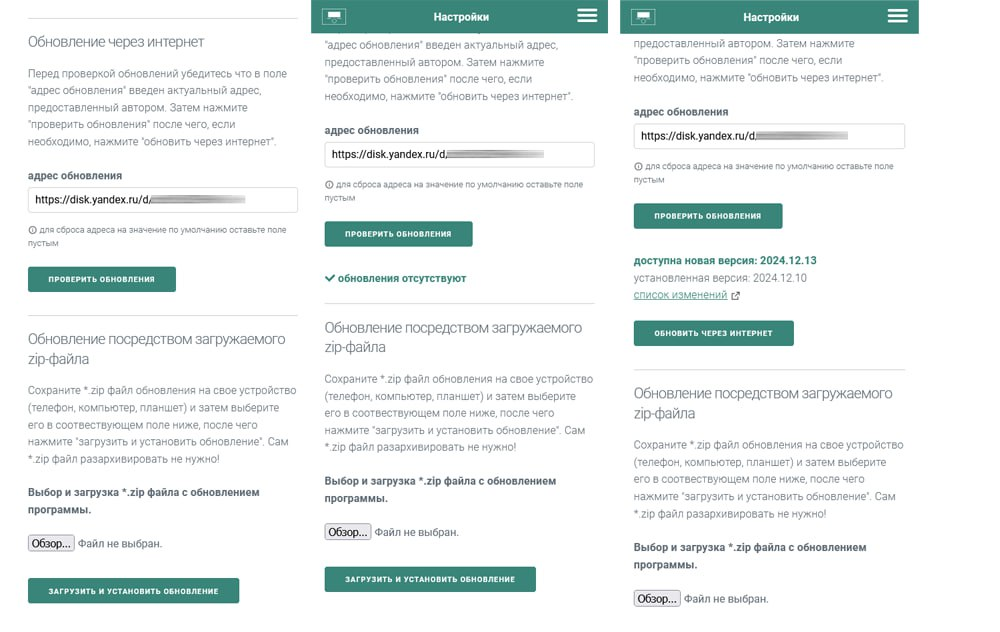

[Открыть в Telegram](https://t.mewebcontrol_app/189)

---

### 2024-12-20

Отображение относительной влажности воздуха для зон, привязанных к VR91

Так случилось, что у меня появился VR91, и почти сразу возникло желание отобразить в моей программе показания относительной влажности воздуха из него. (в меню VR91 они же присутствуют). Кстати, в родном приложении MyVaillant влажность воздуха не отображается для зон, привязанных к VR91 (лично проверил несколько недель тому назад). Т.е. посмотреть, как это сделано в родном приложении не получилось, пришлось взяться за анализ трафика по шине e-bus между VR91 и VRC700. В результате почти недельной возни узнал много интересного о том, как работает связка VRC700-VR91. В частности, определение “прибор дистанционного управления” дано 91-му не просто так. Он действительно является по сути выносным пультом управления от 700-го со встроенным датчиком температуры и влажности. В результате, мое приложение в настоящий момент по конкретно этому параметру (отображение влажности для 91-х) превосходит родное.

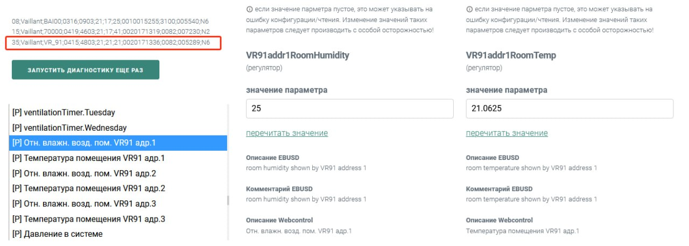

[Открыть в Telegram](https://t.mewebcontrol_app/188)

---

### 2024-12-18

О необычных схемах настройки VRC700

За время моей работы над программой, я познакомился со многими схемами настройки 700-го регулятора, и мне казалось, что у меня в программе предусмотрено почти все…, ну почти ))))

Однако реальность всегда преподносит сюрпризы. Как оказалось, есть еще схема, не отраженная у меня. Тот самый редкий случай, когда в системе нет привязки вообще ни у одной зоны. Т.е. регулятор есть, он исправно рулит отопительными контурами по уличной температуре и отопительной кривой с учетом желаемой температуры для каждой из зон. А сама температура воздуха в отопительных зонах ему не интересна. Фактически она используется только в режиме защиты от замерзания.

Ну а программа штука логичная: нет привязки – нет отображения фактической температуры воздуха помещения. Вот для этого случая и пришлось добавить настройку для отображения температуры и влажности, которые читаются из 700-го в независимости от того привязан он к какой-либо зоне или нет.

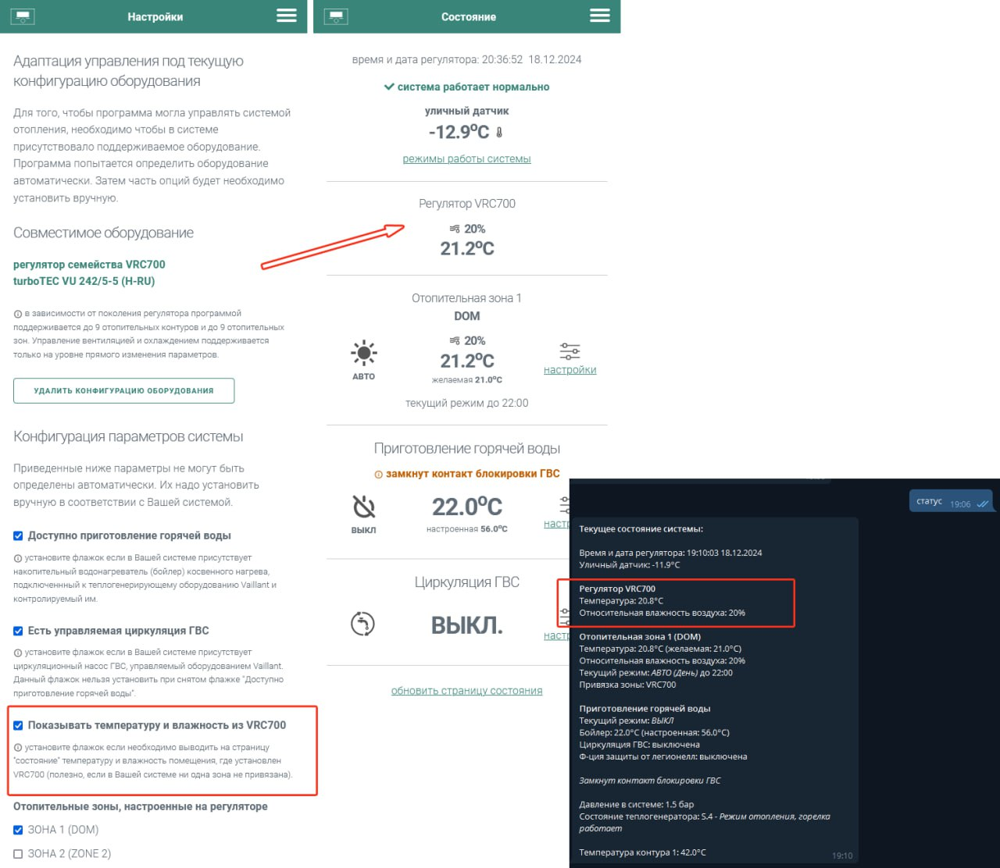

[Открыть в Telegram](https://t.mewebcontrol_app/187)

---

### 2024-12-14

Новости по “железу” для Webcontrol.

Насколько я могу видеть, модель мини-пк Beelink T4-PRO практически пропала из продаж, ей на смену пришла модель Beelink T5 на более новом процессоре. 

В настоящий момент мне известно о двух модификациях модели T5: одна из которых имеет контроллер WiFi Realtek 8822CE, а другая Realtek 8821CE. 

На модификацию Beelink T5 на контроллере 8821CE недавно был успешно установлен последний образ от T4 PRO (выложенный тут в канале) и WiFi-соединение успешно заработало. Предполагаю, что с высокой долей вероятности и другая модификация T5 на 8822CE также заработает “из коробки”.

Если Вы ставили Webcontrol на Beelink T5 c WiFi контроллером на 8822CE пожалуйста отпишитесь в комментариях к этому сообщению, все ли работает.

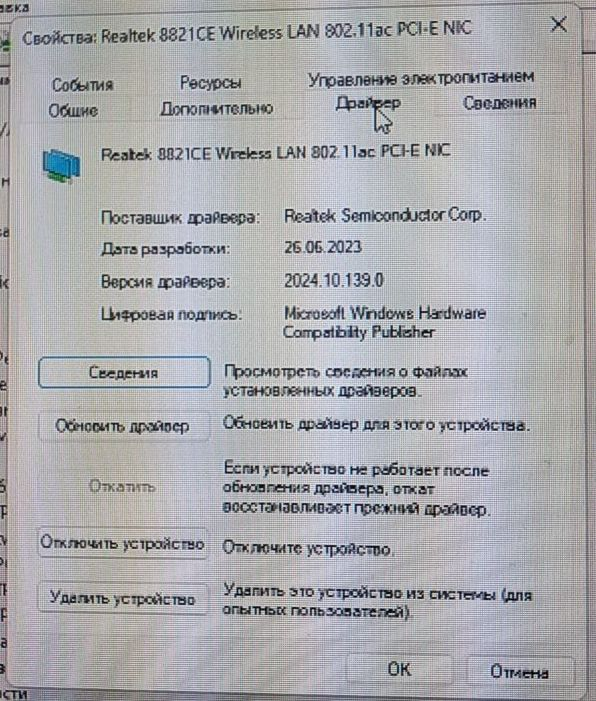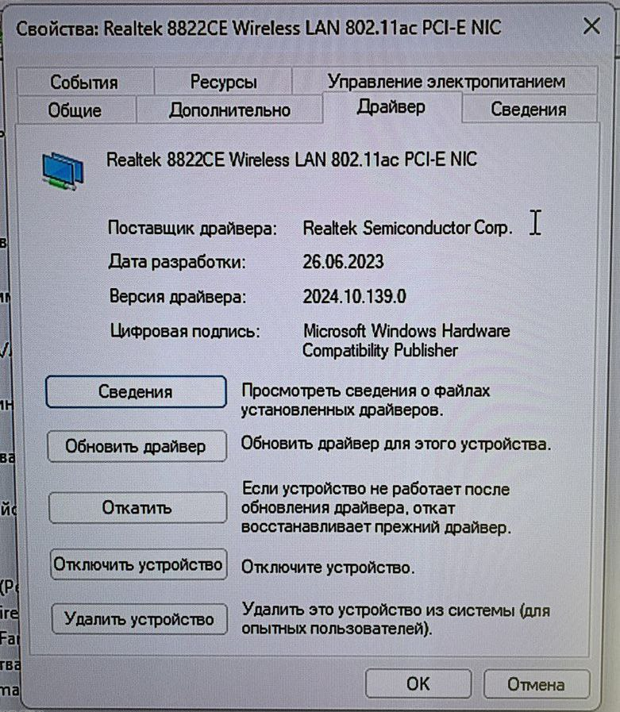

[Открыть в Telegram](https://t.mewebcontrol_app/185)

---

### 2024-12-03

Разъяснения по поводу лицензионных ключей

Лицензионный ключ привязывается к серийному номеру регулятора и не имеет окончания срока действия (т.е. пока регулятор не сломался или Вы его не сменили на другой - у Вас полная версия программы). Все остальные компоненты системы (включая приборы дистанционного управления VR91/VR92) можно менять и удалять/добавлять без ограничений.

Мне бы очень хотелось, чтобы перед покупкой лицензионного ключа пользователи были уверены в качестве и надежности работы программы, в чем можно убедиться, только воспользовавшись ознакомительной версией на протяжении некоторого времени (хотя бы 3-х недель).  Поэтому я не хотел бы сразу предоставлять ключи пользователям, еще не пользовавшимся программой. 

Мне важно, чтобы покупая лицензию Вы делали осознанный выбор, понимая на что Вы тратите деньги, а не в порыве эмоций (пусть даже и положительных).

[Открыть в Telegram](https://t.mewebcontrol_app/184)

---

### 2024-12-03

Разъяснения по поводу ознакомительной версии Webcontrol

Хотелось бы пояснить некоторые моменты, связанные с ознакомительной версией.

Начну с того, что ознакомительная версия, хоть так и называется, не имеет существенных ограничений по функционалу. Т.е. если у Вас один контур + ГВС, то все что нужно рядовому пользователю: – регулировка температур и режимов + уведомления об ошибках через Telegram - бота работает также, как и в полной версии, таким образом Вы можете сколько угодно пользоваться бесплатной ознакомительной версией (она не ограничивается по сроку использования). 

Такие функции, как отображение пользовательских параметров и отправка данных на Narodmon нужны крайне ограниченному числу пользователей и ограничение на количество параметров в этих функциях в бесплатной версии почти ни на что не влияет.

Вы можете пользоваться бесплатной версией даже для многоконтурной/многозональной конфигурации. В бесплатной версии жесткого ограничения на НОМЕР зоны нет, есть ограничение на КОЛИЧЕСТВО зон. Т.е. чтобы посмотреть все зоны / контура теоретически можно каждый раз залезать в настройки и переставлять галочки с зоны 1 на зону 2 и т.д. Неудобно,  зато бесплатно)))))

[Открыть в Telegram](https://t.mewebcontrol_app/183)

---

### 2024-11-22

Небольшое обновление в интерфейсе управления временными окнами для 700-го регулятора. 

Поскольку многие пользователи упускают при настройке отопительной зоны связанный параметр соответствующего зоне отопительного контура "Режим авто отключения", то натыкаются на непонятное для них поведение регулятора вне временных окон. Чтобы, по возможности, избежать этого добавил в интерфейс программы подсказку и немного поменял сопроводительный текст раздела "Настройка временных окон отопления".

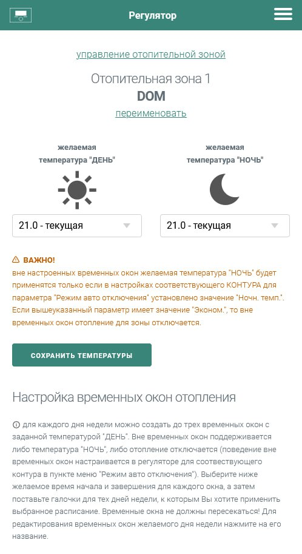

[Открыть в Telegram](https://t.mewebcontrol_app/182)

---

### 2024-11-17

Для регуляторов семейства VRC700 на странице “параметры” добавлены ссылки на изменение значений параметров контура.

Вообще, я не сторонник давать пользователю простой способ редактировать значения “не пользовательских” параметров, изменяя которые пользователь должен ОЧЕНЬ ХОРОШО понимать, что он делает (таковых в общей массе пользователей очень немного). Тем не менее, в MyVaillant разработчики открыли возможность редактировать часть параметров (например, отопительную кривую), о чем мне сообщили пользователи родного приложения. 
Я еще раз хочу напомнить, что в Webcontrol это БЫЛО ИЗНАЧАЛЬНО (режим прямого изменения параметров), просто это СПЕЦИАЛЬНО было сделано не в очень удобной форме чтобы шаловливые ручки пользователей случайно не поломали настройки своей системы.

Поскольку добавление этого функционала, не было очень сложным, то решил все-таки сделать, тем более что у меня в программе есть несколько ролей пользователей (уровней доступа) что позволяет запретить доступ к изменению этих параметров.

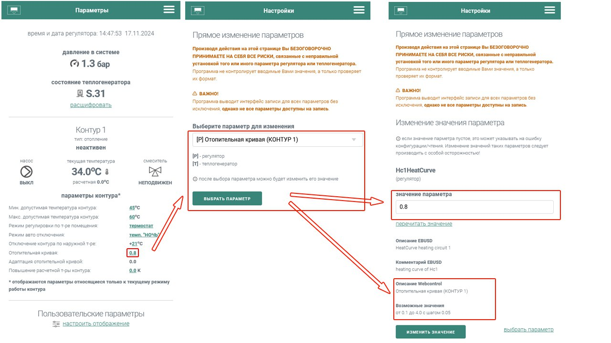

[Открыть в Telegram](https://t.mewebcontrol_app/181)

---

### 2024-11-12

Улучшение интерфейса программы для работы с временными окнами для 700-го регулятора.

Внес небольшие улучшения в интерфейс настройки временных окон отопления, ГВС и циркуляции ГВС для 700-го регулятора.  Теперь можно, как и в 720-м редактировать временные окна для выбранного дня недели. Достаточно выбрать его название, представленное в виде ссылки. При этом в выпадающие списки времени начала и завершения временных окон устанавливаются значения из соответствующего дня и устанавливается галочка для этого дня. Достаточно внести необходимые изменения и нажать кнопку [применить временные окна].

Используя этот режим можно легко скопировать расписание из одного дня в другой (другие).

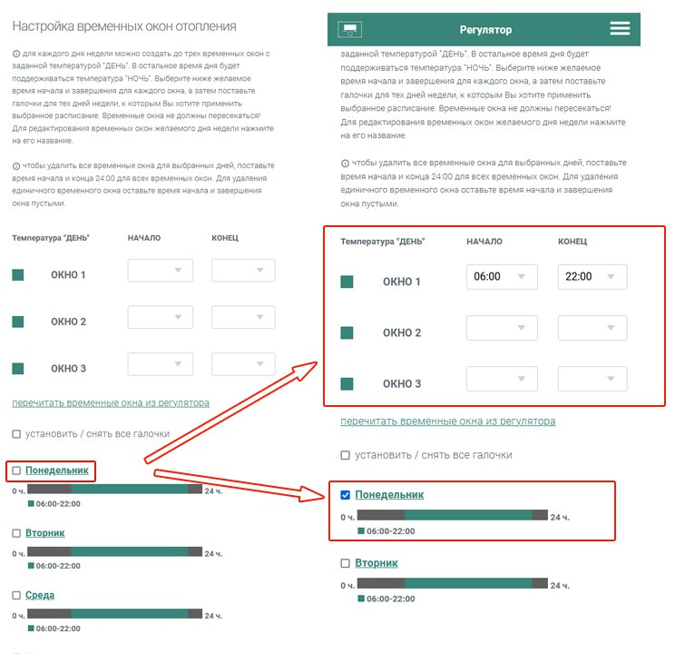

[Открыть в Telegram](https://t.mewebcontrol_app/180)

---

### 2024-10-20

Небольшое обновление системы - установка GPIO адаптера.

Если Вы внимательно читали канал, то наверное помните что в программе была реализована функция внешнего управления при помощи замыкания/размыкания внешнего контакта. Во многих конфигурациях с VR70/71 это реализовано производителем, но выбор действий жестко задан, а во вторых что делать тем, у кого нет VR70/71?

В общем,  алгоритм управления для включения / выключения ГВС вышел весьма объемным, хотя действие совсем простое: выключить приготовление ГВ при замыкании управляющего контакта.

Железочная часть реализована при помощи GPIO USB адаптера и реле давления, но вот GPIO адаптер без корпуса и без разъема для подключения управляющих контактов. В результате пришлось придумывать нечто вроде переходника и отдать хорошим знакомым для сборки и печати корпуса под подобный адаптер.  Наконец, (спустя 5 месяцев) получил готовый адаптер и подключил к системе. Еще раз проверил - все работает по заданному алгоритму. Большинству, конечно, этот функционал не нужен.

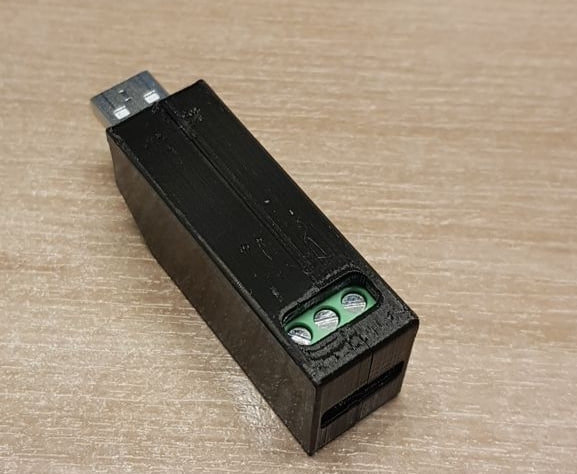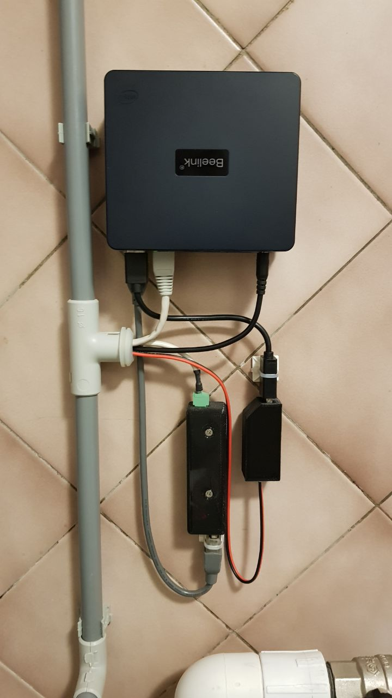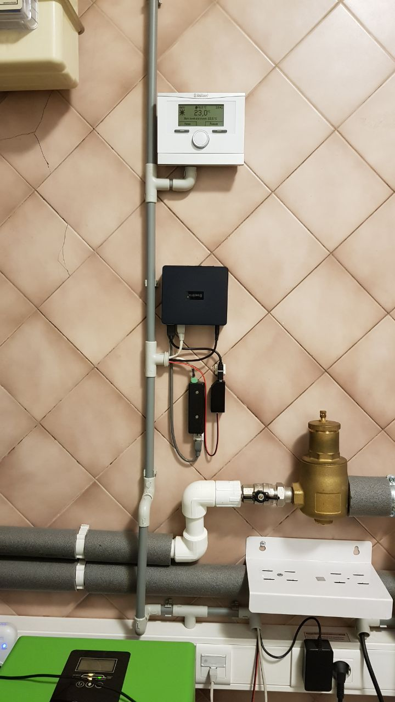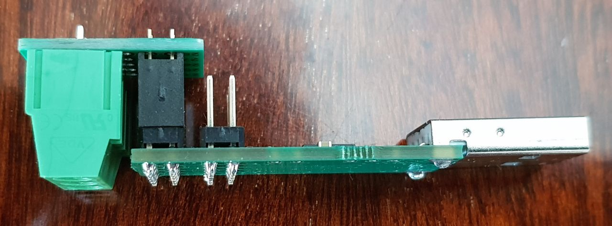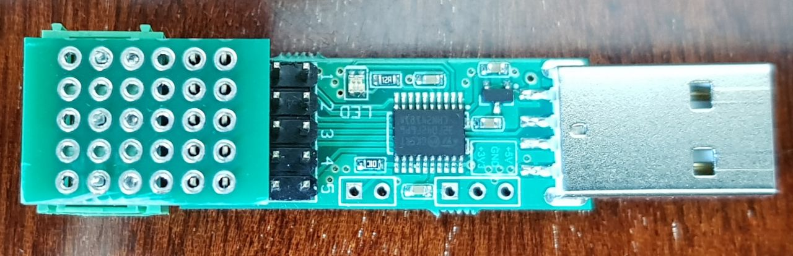

[Открыть в Telegram](https://t.mewebcontrol_app/175)

---

### 2024-08-30

Webcontrol теперь в каталоге приборов на сайте проекта Narodmon.

Рад сообщить, что Webcontrol был добавлен в каталог приборов проекта Narodmon ([narodmon.ru](https://narodmon.ru/)).

Хотелось бы надеяться, что размещение в каталоге Narodmon позволит привлечь новых пользователей, и послужит делу популяризации программы.

Вообще, взаимодействовать с командой Narodmon не очень просто, что ни разу не умаляет их огромного вклада в развитие отечественных ГИС и IoT.

Подробнее зачем в программу была добавлена поддержка Narodmon можно прочитать [вот в этом сообщении.](https://t.me/webcontrol_app/91)

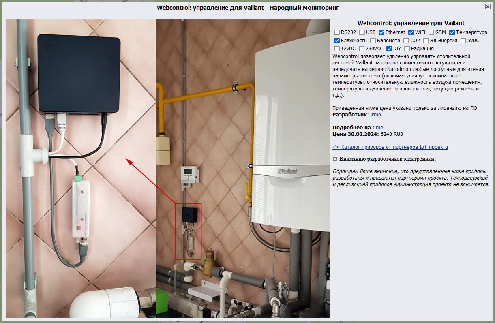

[Открыть в Telegram](https://t.mewebcontrol_app/173)

---

### 2024-08-21

Доступна новая версия Webcontrol!

Итак, друзья, рад сообщить что доступна для загрузки [новая версия Webcontrol](https://t.me/webcontrol_app/13).

Из основного: 
расширена поддержка 700-го регулятора
добавлена поддержка 720-го регулятора
добавлено несколько полезных команд Telegram - бота. 

В посте по ссылке пытливые пользователи могут найти подробный список изменений.

Как обычно, обратная связь от тех, кто установил и пользуется Webcontrol приветствуется.

[Открыть в Telegram](https://t.mewebcontrol_app/172)

---

### 2024-08-14

Обновление по программе

Завершил тестирование 720-го. Все работает стабильно. Переключился на 700-й, продолжаю тестирование.

[Открыть в Telegram](https://t.mewebcontrol_app/171)

---

### 2024-08-12

О дальнейшем развитии программы.

Давно хотел написать про развитие программы, тем более что скорый выход новой версии – это значительный шаг вперед, но, в целом, я настроен пессимистично. И вот почему: за почти два года что я тащу этот проект, активную помощь мне оказали суммарно не более 10 человек. Структуры, которые сейчас занимаются оборудованием Vaillant моей разработкой не заинтересовались. Помимо этого, появившаяся не так давно возможность заново зарегистрировать заблокированные шлюзы снизила количество потенциальных пользователей. Вкладывать в разработку значительные ресурсы у меня возможности нет. В этой ситуации дальнейшее развитие программы будет сильно зависеть от поддержки пользователей (фактически от того, сколько лицензий мне удастся реализовать).  Мне неоднократно говорили про создание собственного “облака”, что в отрыве от текущей ситуации логично, но при мизерном количестве пользователей совершенно не оправдано с экономической точки зрения. В связи со всем вышесказанным, серьезных нововведений в программе в ближайшее время не будет, возможно исправление мелких недочетов, которые обнаружатся при работе новой версии. А дальше - посмотрим…

[Открыть в Telegram](https://t.mewebcontrol_app/170)

---

### 2024-08-08

Обновление по программе

Вышел на финишную прямую с новой версией. Создал установочный образ программы, записал на флешку и провел установку на свой тестовый комплект и сейчас проверяю на 720 регуляторе. Если все будет штатно, через несколько дней переключусь на 700-й регулятор и продолжу тестирование.  Если вопросов не возникнет, то до конца августа выложу новую версию здесь на канале и на бусти.

[Открыть в Telegram](https://t.mewebcontrol_app/169)

---

### 2024-07-31

Посмотрел ради любопытства как развивается родное приложение MyVaillant. ))

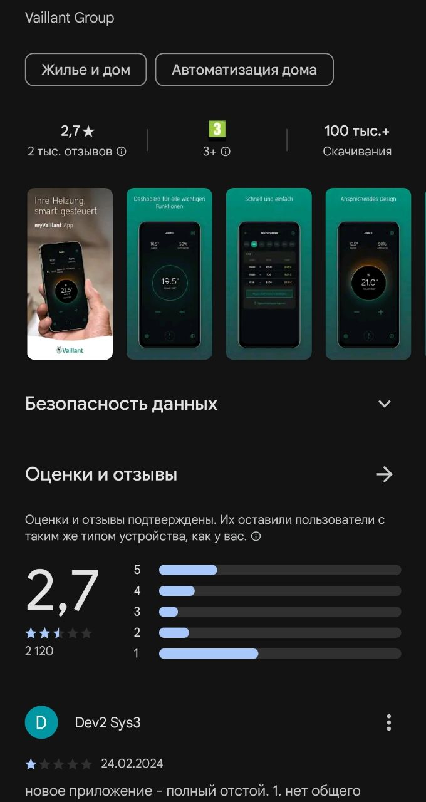

[Открыть в Telegram](https://t.mewebcontrol_app/168)

---

### 2024-07-31

Небольшое обновление по программе

Добавил еще одну сервисную команду Telegram – бота: “впн” и ее разновидность “впн вкл”. Команда бота “впн” выводит информацию о состоянии VPN подключения устройства Webcontrol, а команда “впн вкл” включает VPN соединение.

Команда не очень часто используемая, но в редком случае, когда пользователь по рассеянности отключил VPN соединение на устройстве Webcontrol и потерял удаленный доступ к Web-интерфейсу позволяет включить это соединение через Telegram-бота и восстановить доступ.

[Открыть в Telegram](https://t.mewebcontrol_app/167)

---

### 2024-07-30

Из опыта эксплуатации Webcontrol

Со мной связался один из первых пользователей программы. У него случилась беда: после удара молнии пропало подключение к Web-интерфейсу программы и мини-компьютер перестал подключаться к локальной сети (был подключен через ethernet). 

Опытным путем было установлено что в мини-ПК выгорел ethernet порт и как минимум один из USB портов (скорее всего вместе с USB хабом на материнской плате). Пришлось через командную строку включать WiFi, и подключать его к сети, после чего Web-интерфейс заработал, однако подключение к шине так и не появилось. Пришлось разбираться с адаптером. 

Как выяснилось, в адаптере погорел преобразователь USB-serial, выгорели оптроны и пострадала вся правая сторона (относящаяся к шине e-bus). К счастью, сама шина и регулятор/котел не пострадали.  После ремонта адаптера все заработало. Вот такая история.

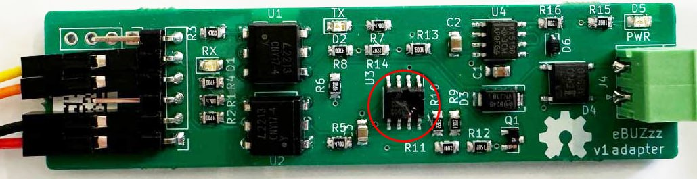

[Открыть в Telegram](https://t.mewebcontrol_app/166)

---

### 2024-07-23

Сравнение возможностей
ознакомительной и полной версии программы.

📎 **Вложение:** [Webcontrol_versions_explained.pdf](./files/165_Webcontrol_versions_explained.pdf)

[Открыть в Telegram](https://t.mewebcontrol_app/165)

---

### 2024-07-18

Обновление по программе

Несмотря на летнее затишье, готовлю ознакомительную версию программы для всех поддерживаемых регуляторов (VRC700, VRC700/2, VRC700/4, VRC700/5, VRC700/6, VRC720, VRC720/2, VRC720/3). Основная часть работы уже сделана, но и осталось тоже немало.

Ознакомительная версия будет полнофункциональной, но будет поддерживать отображение данных только одной зоны и одного контура, плюс имеет ограничение на количество отображаемых пользовательских параметров и на количество параметров отправляемых на Narodmon. При помощи лицензионного ключа будет превращаться в полную версию.
Надеюсь, в начале - середине августа все будет готово.

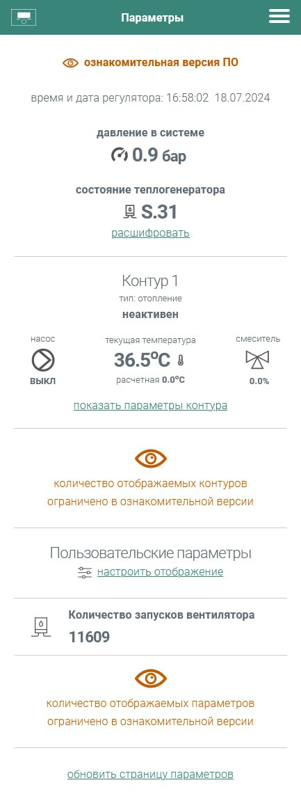

[Открыть в Telegram](https://t.mewebcontrol_app/164)

---

### 2024-06-15

Отзыв от первого стороннего пользователя программы с регулятором VRC720

Уважаемые подписчики!
Как и было обещано, первый сторонний пользователь с регулятором VRC720 оставил краткий отзыв о работе программы. 

Прочитать сам отзыв можно перейдя по [ссылке](https://t.me/c/1887595475/822). 
Там же в комментариях можно задать свои вопросы.  Надеюсь,  Максим не откажет и ответит на вопросы подписчиков, если они появятся.

[Открыть в Telegram](https://t.mewebcontrol_app/163)

---

### 2024-06-03

Маленькая хитрость для владельцев 700-го регулятора и полной версии программы:  установка времени окончания режима отсутствие / отпуск.

Как известно, в 700-м регуляторе окончание режима отсутствие (отпуск) нельзя настроить на определенное время – можно указать только дату окончания и режим отключится в 23:59:59 указанной даты. Однако это ограничение можно легко обойти при помощи моей программы и Telegram.

Если у Вас 700-й регулятор и полная версия моей программы и необходимо отменить режим отсутствие (отпуск) в определенное время, то можно воспользоваться отложенной отправкой сообщений в Telegram. 

Например, Вам необходимо отменить режим в 12-00 01.04.2025. В самом регуляторе или моей программе Вы ставите дату окончания 01.04.2025, а затем в Телеграме делаете запланированную отправку Вашему боту на 12-00 01.04.2025 команды “обычный режим”. Таким образом, в 12 часов дня 1 апреля режим отпуск будет отключен.

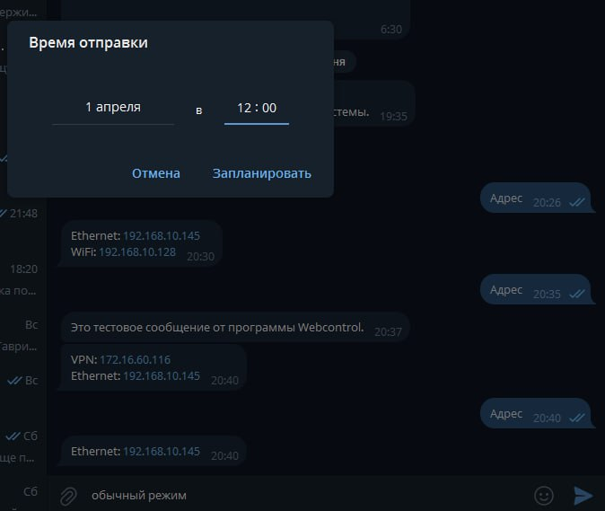

[Открыть в Telegram](https://t.mewebcontrol_app/162)

---

### 2024-06-03

Расширение количества поддерживаемых зон/контуров до максимально возможного.

Благодаря подписчику канала с 700-м регулятором и очень редкой системой на 9 (!) контуров, программа была доработана для поддержки максимального количества зон / контуров, и сейчас проходит тестирование. Предварительно все работает штатно.

Таким образом, программа поддерживает максимально возможное количество зон / контуров для совместимых моделей регуляторов:

700 – 2 зоны / контура
700/2 – 3 зоны / контура
700/4 – 3 зоны / контура
700/5 – 9 зон / контуров
700/6 – 9 зон / контуров

720 (любое поколение) – 9 зон /контуров

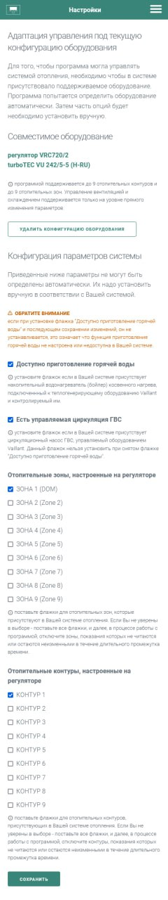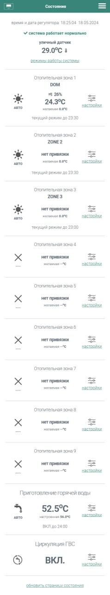

[Открыть в Telegram](https://t.mewebcontrol_app/160)

---

### 2024-05-25

Обновление по VRC720. Первые результаты стороннего тестирования.

Сегодня первый сторонний пользователь версии для 720-го регулятора подключил мини-пк с Webcontrol к своей системе и удалось предварительно оценить как работает программа. 

По тем результатам, что доступны мне сейчас (очень предварительно) все работает штатно. У подписчика 720-й регулятор первого поколения (идентифицируется по шине как 72000).

Таким образом, сейчас в программе поддерживаются 2 поколения 720-го. Есть еще 720/3 с идентификатором ctlv3, но его поддержку добавить достаточно легко. 

По прошествии некоторого времени и когда у подписчика появится возможность, он подготовит небольшой отчет, который выложит  в комментариях к этому посту. Надеюсь, подписчик будет столь любезен, что ответит на вопросы других подписчиков канала, если таковые появятся.

[Открыть в Telegram](https://t.mewebcontrol_app/159)

---

### 2024-05-23

Небольшое обновление по программе

Для удобства настройки, в некоторых случаях необходимо знать какие адреса получил Webcontrol. Если настроен телеграм-бот, то теперь можно узнать все  IP-адреса, которое получило устройство, отправив боту команду "адрес" или "адреса".

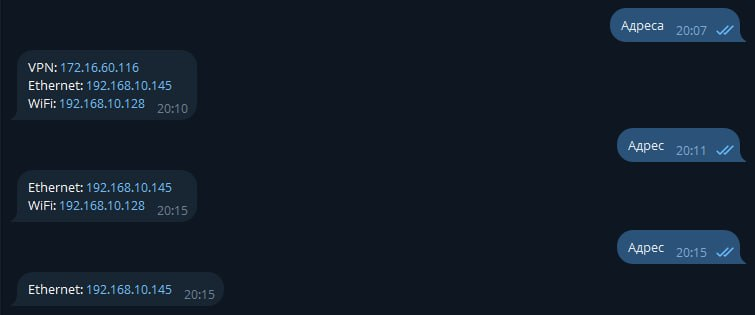

[Открыть в Telegram](https://t.mewebcontrol_app/158)

---

### 2024-05-20

Кратко о приложении MyVaillant

В выходные дошли руки подключить шлюз и посмотреть новое приложение MyVaillant. И телефон с установленной программой (андроид), и шлюз были подключены без VPN. Весь процесс подключения шлюза (VR900) также проходил без VPN. Подключен был 720 регулятор.

Постараюсь кратко и по возможности беспристрастно оценить приложение.
Итак: 

Плюсы:
- без вложений (если есть шлюз)
- родное приложение
- приложение и шлюз работают без VPN
- приемлемая скорость обновления параметров

Минусы:
- никакой гарантии что снова не отключат
- нет и скорее всего не будет Русского языка (вообще нет, разобрал apk файл для андроид, посмотрел ресурсы) 
- совершенно не понятно, от какого времени данные в приложении
- нельзя посмотреть / настроить время и дату регулятора
- крайне бедный набор отображаемых параметров/настроек

Т.е. как решение для пользователей, у которых уже есть шлюз (который можно подключить) и которым вообще ничего не нужно кроме температуры в помещении, на улице и ошибок котла, сойдет.

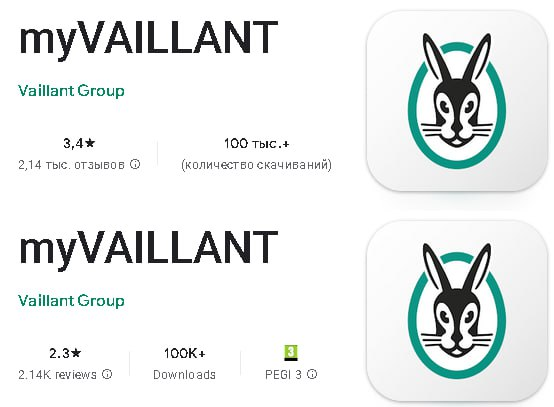

[Открыть в Telegram](https://t.mewebcontrol_app/157)

---

### 2024-05-16

Зарегистрировал свою программу и свое авторство. 

Теперь я не просто широко известный  в весьма узких кругах разработчик весьма специфического ПО, теперь я -   зарегистрированный разработчик и правообладатель этого самого ПО.

Спасибо большое всем, кто так или иначе помогал и помогает мне в развитии программы!

[Открыть в Telegram](https://t.mewebcontrol_app/156)

---

### 2024-05-12

Если кратко, то мои предположения таковы: в 720 регуляторе регистр находится в группе регистров отопительной зоны, и в случае закрепления за этой зоной самого регулятора VRC720, в нем появляется значение влажности от датчика регулятора. Если за этой зоной закреплен не сам регулятор, а дополнительный прибор управления (VR92), то регулятор сам опрашивает VR92 и хранит у себя значение влажности, которое потом отдает по запросу родному приложению.

В 700-м картина другая.  Регистр для чтения влажности находится по не встречавшемуся ранее мною адресу вне групп регистров отопительных зон и контуров. Информация от Олега косвенно подтверждает мое предположение что 700 сам не запрашивает влажность у VR91, чтобы потом передать ее по запросу приложению, на данный момент, мне вообще непонятно можно ли считать по шине влажность из 91-го напрямую. 

Это значит, что в моем приложении для 700-го регулятора влажность будет отображаться только для зоны, закрепленной за самим регулятором. Для зон, закрепленных за VR91 влажность отображаться не будет.  Фактически отображение влажности воздуха будет работать как в родном приложении.

ПОТЕРЯЛО АКТУАЛЬНОСТЬ
После анализа взаимодействия регулятора VRC700 c VR91 удалось найти и вывести показания влажности для зон, закрепленных за VR91

[Открыть в Telegram](https://t.mewebcontrol_app/155)

---

### 2024-05-12

Найден регистр для чтения влажности воздуха в 700-м регуляторе.

Благодаря неоценимой помощи подписчика канала Антона, и ценной информации от подписчика канала Олега был найден регистр в VRC700 отвечающий за чтение относительной влажности воздуха, а также прояснена ситуация со странной адресацией этого регистра.

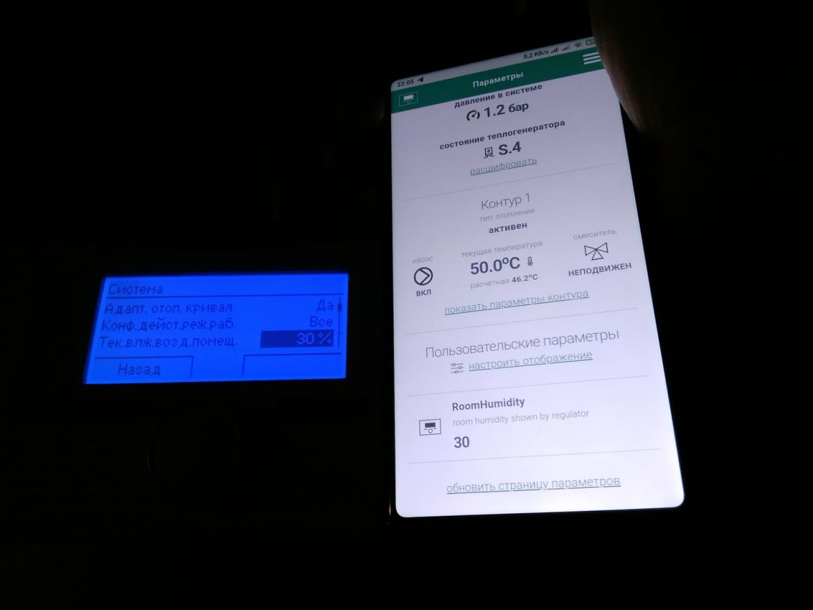

[Открыть в Telegram](https://t.mewebcontrol_app/154)

---

### 2024-05-10

Пошаговое описание процесса установки и настройки программы + все инструкции в одном месте:

https://boosty.to/webcontrol_app/posts/4921dbfc-b06e-4ec1-bae1-1166b2044c2e

а также:

 https://boosty.to/webcontrol_app/posts/53ce344d-06df-4843-a474-9898e77bae6a

[Открыть в Telegram](https://t.mewebcontrol_app/152)

---

### 2024-05-10

Вопрос к подписчикам

Если среди подписчиков есть те, кто настроил приложение MyVaillant, и у которых система на регуляторе VRC700 c несколькими отопительными зонами и есть VR91 привязанный к отопительной зоне – посмотрите пожалуйста, отображается ли в программе влажность помещения для зоны, к которой привязан VR91.

Спасибо!

[Открыть в Telegram](https://t.mewebcontrol_app/151)

---

### 2024-05-02

Еще несколько видов экранов, показывающих тестирование телеграм-бота.

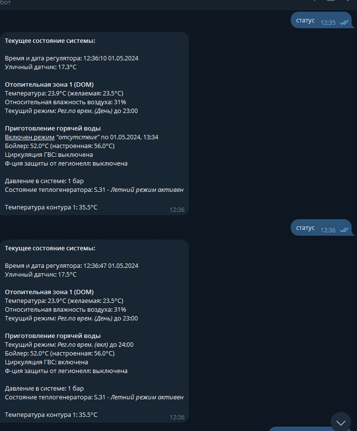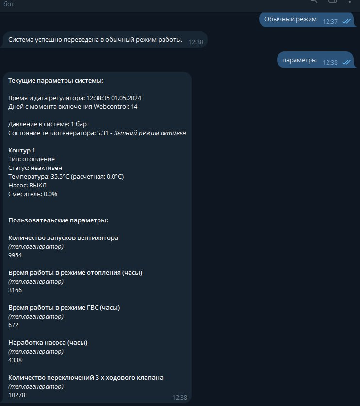

[Открыть в Telegram](https://t.mewebcontrol_app/149)

---

### 2024-05-02

Обновление по VRC720

Фактически вышел на финишную прямую с добавлением поддержки 720 в программу. Из последнего - переписал обработку команд телеграм- бота под новый регулятор. Планирую в середине месяца передать на тестирование первому стороннему пользователю.

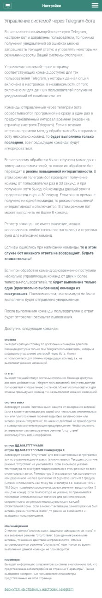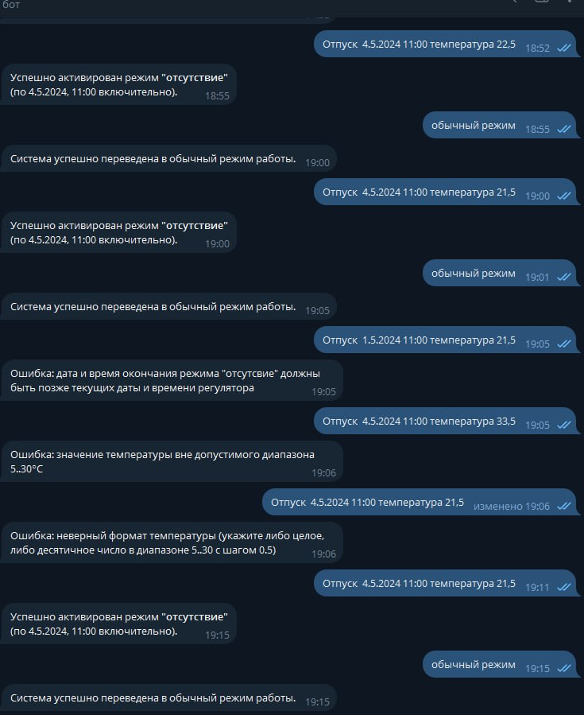

[Открыть в Telegram](https://t.mewebcontrol_app/147)

---

### 2024-04-24

Обновление по VRC720

Вот так выглядят все текущие настройки VRC720 сохраненные в *.txt файл. Чтобы не перегружать шину запросами, процесс сохранения всех настроек занимает 12 минут.

Вообще, функция сохранения всех настроек регулятора не очень нужна рядовому пользователю. Автоматизированной процедуры восстановления настроек  регулятора нет, и  я осознанно делать ее не стану, т.к. вероятность что что-то пойдет не так при восстановлении очень велика.  А вот для понимающих людей восстановить настройки регулятора по этому файлу не составит труда.

📎 **Вложение:** [ctlv2_params_2024_04_24_1358_yteybc.txt](./files/146_ctlv2_params_2024_04_24_1358_yteybc.txt)

[Открыть в Telegram](https://t.mewebcontrol_app/146)

---

### 2024-04-23

📎 **Вложение:** [Screenshot 2024-04-23 at 14-03-53 Webcontrol.png](./files/145_Screenshot 2024-04-23 at 14-03-53 Webcontrol.png)

[Открыть в Telegram](https://t.mewebcontrol_app/145)

---

### 2024-04-23

📎 **Вложение:** [Screenshot 2024-04-23 at 14-04-10 Webcontrol.png](./files/144_Screenshot 2024-04-23 at 14-04-10 Webcontrol.png)

[Открыть в Telegram](https://t.mewebcontrol_app/144)

---

### 2024-04-23

📎 **Вложение:** [Screenshot 2024-04-23 at 14-02-20 Webcontrol.png](./files/143_Screenshot 2024-04-23 at 14-02-20 Webcontrol.png)

[Открыть в Telegram](https://t.mewebcontrol_app/143)

---

### 2024-04-23

📎 **Вложение:** [Screenshot 2024-04-23 at 14-02-42 Webcontrol.png](./files/142_Screenshot 2024-04-23 at 14-02-42 Webcontrol.png)

[Открыть в Telegram](https://t.mewebcontrol_app/142)

---

### 2024-04-23

📎 **Вложение:** [Screenshot 2024-04-23 at 14-03-24 Webcontrol.png](./files/141_Screenshot 2024-04-23 at 14-03-24 Webcontrol.png)

[Открыть в Telegram](https://t.mewebcontrol_app/141)

---

### 2024-04-23

Обновление по VRC720

Завершил очередной этап - управление временными окнами отопления, гвс и циркуляции. Из-за другой структуры команд  почти весь управляющий код пришлось писать заново. Так же как и создавать страницы интерфейса для управления временными окнами отопления.

Как обычно, копии экрана интерфейса прилагаю.

[Открыть в Telegram](https://t.mewebcontrol_app/140)

---

### 2024-04-16

Заметки на полях

Мне тут стало интересно, а сколько всего строк кода написано мною в проекте. Я давно как-то  прикидывал и получалось что количество превышает 5 тысяч, а сейчас решил подсчитать точно. 

Так вот, на данный момент в проекте всего 25906 строк кода на Perl в 51 скрипте, это я еще не считаю HTML шаблоны интерфейса, где одних файлов 126 штук. Поскольку на каждую ветку регулятора код свой, то не весь код был написан с нуля, часть строк кода для 720 была  скопирована из кода 700, но тем не менее суммарный объем получился совсем немаленький. Вот такая арифметика.

[Открыть в Telegram](https://t.mewebcontrol_app/139)

---

### 2024-04-11

Обновление по VRC720

Завершил большой кусок кода  (пришлось писать с нуля), посвященный управлению режимами регулятора высокого уровня. 

Много возни было с режимом "отсутствие", т.к. в 720-м его можно раздельно активировать для каждой зоны. Пришлось придумывать новую логику работы и вид интерфейса. Результат на скриншотах.

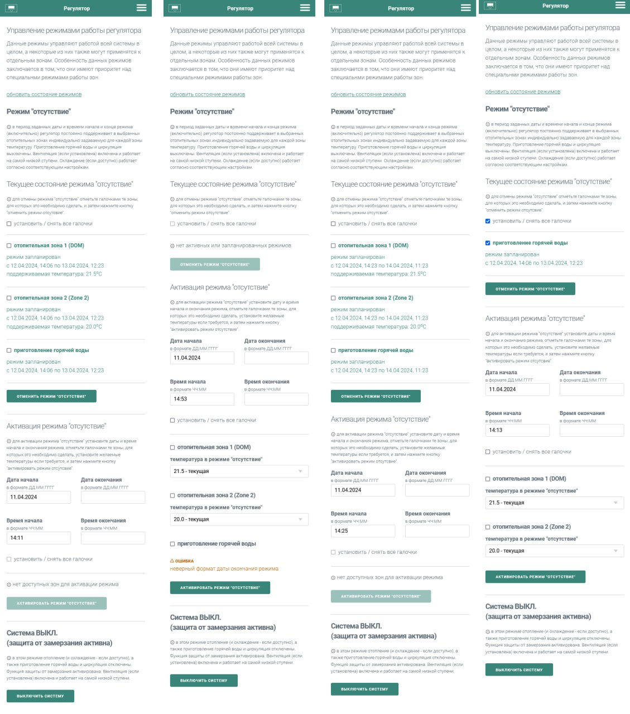

[Открыть в Telegram](https://t.mewebcontrol_app/135)

---

### 2024-04-07

Для пользователей с заблокированными шлюзами.

Появилась информация от подписчика (за что ему большое спасибо), что в связи с переходом на новое приложение MyVaillant заблокированный шлюз из РФ удалось успешно зарегистрировать заново, и таким образом восстановить удаленное управление через приложение MyVaillant. 

При регистрации и во время работы шлюз подключен через VPN с точкой выхода в Европе! 

Во время регистрации приложение также должно быть подключено через ВПН  с  адресом той страны, на которую Вы будете регистрировать учетную запись! 

В дальнейшем приложение работает без VPN. 

Сам не проверял, но по информации пользователя все работает, так что можете попробовать.

[Открыть в Telegram](https://t.mewebcontrol_app/134)

---

### 2024-04-02

Появилась расшифровка артикулов VRC 720

BE/CH/FR/IT/NL: 0020260913 или 0020260929
AT/DE: 0020260914
HU/INT/RO/RU/TR: 0020260915
DK/NO/PL/SE: 0020260916
CZ/SI/SK: 0020260919
INT/UA: 0020260920
BA/ES/HR/INT/RS/UK: 0020260921
UK: 0010036819 или 0010036821

Таким образом, артикул не связан с поколением, а определяет регион для продажи в котором предназначен регулятор. Поколение как и в 700 определяется версией железа / прошивки.

[Открыть в Telegram](https://t.mewebcontrol_app/133)

---

### 2024-04-02

Еще несколько видов страницы "состояние" для 720-го. 

Как можно видеть, тестируются различные режимы работы отопительной зоны.

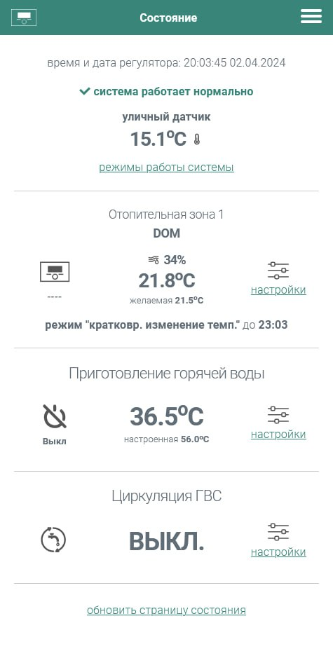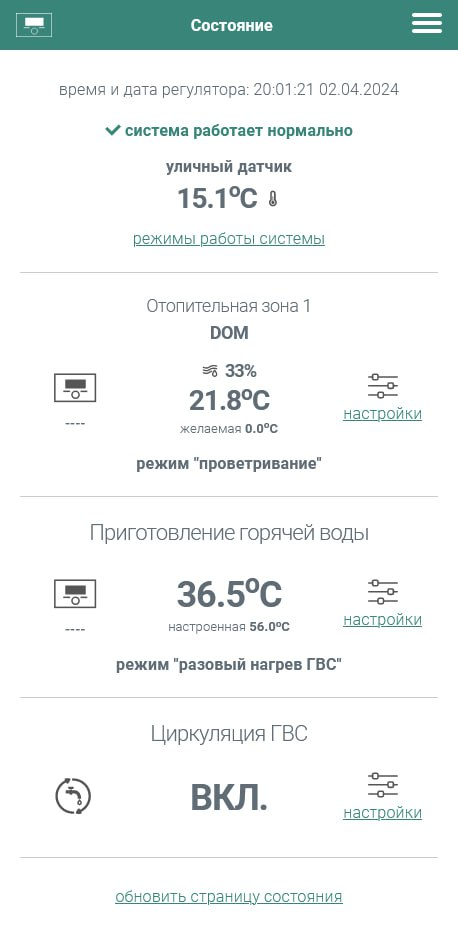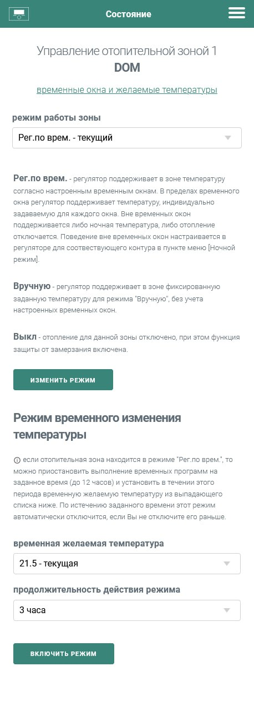

[Открыть в Telegram](https://t.mewebcontrol_app/129)

---

### 2024-03-31

Обновление по 720 регулятору

Потратил все выходные для того, чтобы начать переписывать управляющий код под новый регулятор. Из-за другой логики работы и управляющих регистров, много кода приходится писать с нуля.

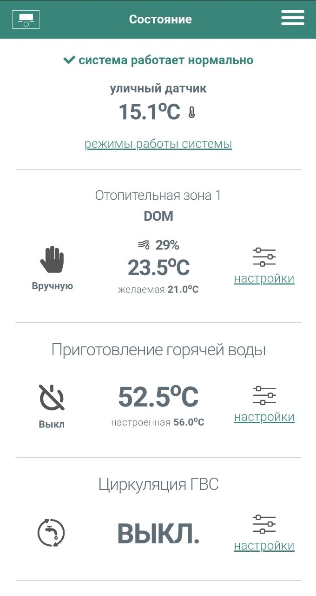

[Открыть в Telegram](https://t.mewebcontrol_app/128)

---

### 2024-03-29

Вопрос к обладателям VRC720

У вас также "машинка с турецким акцентом" т.е. у буквы "Ы" нет правой палки? Или это "эксклюзив" 720/2?

Отпишитесь в комментариях.

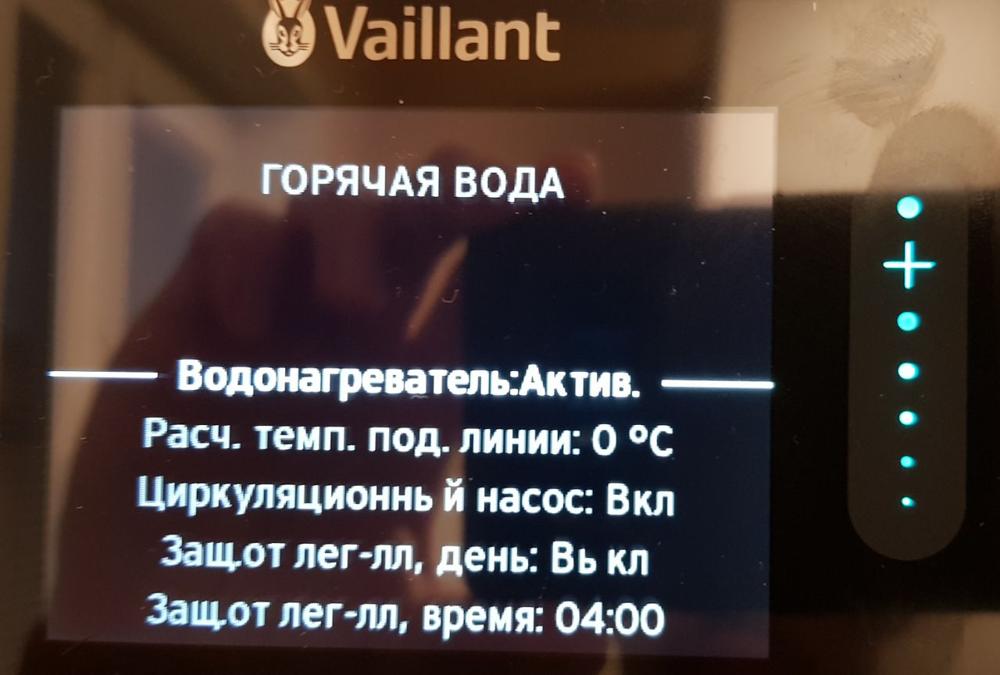

[Открыть в Telegram](https://t.mewebcontrol_app/127)

---

### 2024-03-19

И еще одно обновление по адаптерам

У [Антона](https://t.me/Patamushta99) есть 9 готовых протестированных плат, т.е. при возникновении потребности адаптеры могут быть собраны очень быстро.

[Открыть в Telegram](https://t.mewebcontrol_app/126)

---

### 2024-03-19

Обновление по адаптерам

[Евгений](https://t.me/mevgen72) постепенно закупает компоненты, необходимые для изготовления 50 адаптеров. По мере поступления запросов будет производить сборку.

[Открыть в Telegram](https://t.mewebcontrol_app/125)

---

### 2024-03-16

Подключил 720 к своей системе. Пока временно. Посмотрел как работает текущая  конфигурация. (Прочитал / записал около 10 параметров.) По первому впечатлению - работает)).

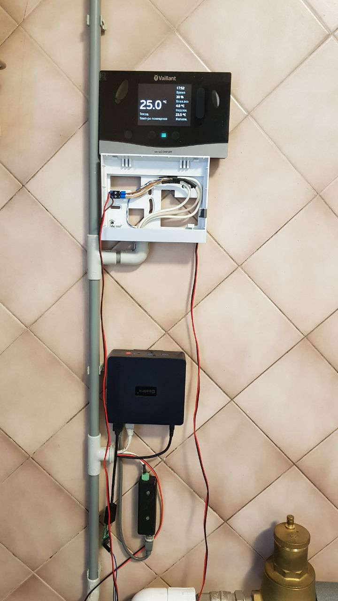

[Открыть в Telegram](https://t.mewebcontrol_app/124)

---

### 2024-03-10

Кстати, любопытная деталь: входящий в комплект 720-го уличный датчик  имеет в своем составе приемник радиосигналов точного времени DCF77. Посмотрите на ферритовую антенну на плате (горизонтальный черный цилиндр с намотанной слева катушкой). И подключается этот датчик 3-мя проводами, тогда как обычный 2-мя. Для нас с вами  пользы от этого нет. Во-первых, при подключении клеммы DCF возможно перестанет вручную выставляться время/дата, а во-вторых сигнал зашумлен и слабоват уже в районе Москвы, а дальше на восток его уровень еще больше падает (передатчик в Германии). Во-вторых европейцы переходят на летнее /зимнее время а мы нет, так что даже при условии что удалось поймать сигнал, часы могут показывать неправильное время.

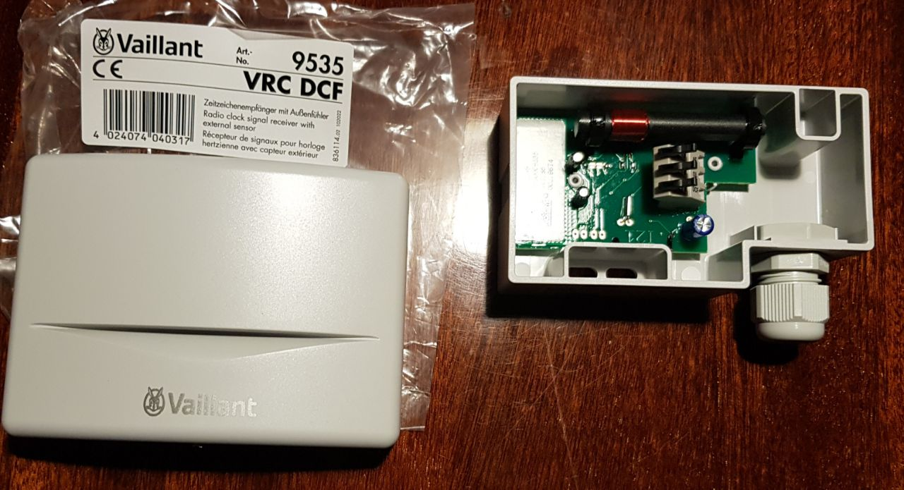

[Открыть в Telegram](https://t.mewebcontrol_app/123)

---

### 2024-03-10

Обновление по добавлению поддержки VRC720

Итак, благодаря упорству и реальной поддержке ВСЕГО ОДНОГО подписчика канала (это я сейчас про добавление поддержки 720-го регулятора говорю) и [хорошим людям из Питера](https://t.me/teplon98) у меня появился регулятор VRC720/2, наличие которого необходимо для добавления его поддержки в программе, т.к. необходимо тщательное тестирование управляющего кода. 

В настоящий момент мною завершен анализ некоторых частей конфигурации для этого регулятора: глобальные и зональные режимы работы регулятора (+ их иерархия и взаимодействие), параметры управления отопительными зонами (различные температуры и режимы) и запись / чтение временных окон для отопления.

[Открыть в Telegram](https://t.mewebcontrol_app/122)

---

### 2024-03-06

Краткое описание возможностей программы в виде pdf файла.

📎 **Вложение:** [Краткое_описание_программы_Webcontrol.pdf](./files/121_Краткое_описание_программы_Webcontrol.pdf)

[Открыть в Telegram](https://t.mewebcontrol_app/121)

---

### 2024-03-05

[Для тех, кому необходим ebus адаптер](https://t.me/webcontrol_app/81) текущее (05.03.24) состояние следующее:

- У [Евгения](https://t.me/mevgen72) есть 1 адаптер готовый, 2 спаянных но без корпуса, ещё 3 в несобранном виде.
- У [Антона](https://t.me/Patamushta99) 10 адаптеров в самом начале процесса сборки.
- У [Константина](https://t.me/+feL6JaACwl4xYjEy) идет набор желающих для заказа минимальной партии (5штук).

[Открыть в Telegram](https://t.mewebcontrol_app/120)

---

### 2024-03-05

📎 **Вложение:** [Screenshot 2024-03-05 at 15-34-56 Webcontrol.png](./files/119_Screenshot 2024-03-05 at 15-34-56 Webcontrol.png)

[Открыть в Telegram](https://t.mewebcontrol_app/119)

---

### 2024-03-05

📎 **Вложение:** [Screenshot 2024-03-05 at 15-34-41 Webcontrol.png](./files/118_Screenshot 2024-03-05 at 15-34-41 Webcontrol.png)

[Открыть в Telegram](https://t.mewebcontrol_app/118)

---

### 2024-03-05

📎 **Вложение:** [Screenshot 2024-03-05 at 15-34-29 Webcontrol.png](./files/117_Screenshot 2024-03-05 at 15-34-29 Webcontrol.png)

[Открыть в Telegram](https://t.mewebcontrol_app/117)

---

### 2024-03-05

📎 **Вложение:** [Screenshot 2024-03-05 at 15-34-13 Webcontrol.png](./files/116_Screenshot 2024-03-05 at 15-34-13 Webcontrol.png)

[Открыть в Telegram](https://t.mewebcontrol_app/116)

---

### 2024-03-05

📎 **Вложение:** [Screenshot 2024-03-05 at 15-32-28 Webcontrol.png](./files/115_Screenshot 2024-03-05 at 15-32-28 Webcontrol.png)

[Открыть в Telegram](https://t.mewebcontrol_app/115)

---

### 2024-03-05

📎 **Вложение:** [Screenshot 2024-03-05 at 15-32-17 Webcontrol.png](./files/114_Screenshot 2024-03-05 at 15-32-17 Webcontrol.png)

[Открыть в Telegram](https://t.mewebcontrol_app/114)

---

### 2024-03-05

📎 **Вложение:** [bot_contact_management.png](./files/113_bot_contact_management.png)

[Открыть в Telegram](https://t.mewebcontrol_app/113)

---

### 2024-03-05

📎 **Вложение:** [algo_reference.jpg](./files/112_algo_reference.jpg)

[Открыть в Telegram](https://t.mewebcontrol_app/112)

---

### 2024-03-05

Управление системой при помощи внешнего контакта – результаты.

Не так давно в рамках своей программы[ я взялся решить задачу по выключению приготовления горячей воды при падении давления в водопроводе](https://t.me/webcontrol_app/98).
Задача на первый взгляд не казалась сложной, но ее решение вылилось в три недели, несколько сотен строк кода и главное – муторного анализа взаимодействия регулятора и управляющего контакта и построения алгоритма управления. Дело в том, что управлять через регулятор включением / выключением приготовления ГВ не просто т. к. надо учитывать 3 глобальных режима работы регулятора и еще 6 зональных, и их возможные комбинации + непосредственно режим работы ГВС т.к. все это влияет на то будет ли в результате включено ГВС или нет. Но все же справился. На приложенных скриншотах различные страницы интерфейса, связанные с управлением при помощи внешнего контакта. Также тестирование уведомлений от Телеграм-бота и рабочие черновики с алгоритмом на 3 страницы по обработке комбинаций состояния регулятора / состояния контакта.

[Открыть в Telegram](https://t.mewebcontrol_app/111)

---

### 2024-02-28

Для новых подписчиков канала

Для новых подписчиков канала, и тех кому сложно прочитать все сообщения здесь, а  также для тех у кого есть вопросы для чего нужна программа и как ее поставить и что для этого нужно, вот ссылка на пост где я постарался кратко все изложить: https://boosty.to/webcontrol_app/posts/4921dbfc-b06e-4ec1-bae1-1166b2044c2e Там же,  в конце поста,  есть ссылка на следующий пост с инструкциями.  Все это есть  и здесь, но  в менее упорядоченной форме.

[Открыть в Telegram](https://t.mewebcontrol_app/109)

---

### 2024-02-24

Прислал один из пользователей программы, обладатель GalaxyWatch3.

Как мне сообщил пользователь, управление работает. Способ, конечно, немного экзотический, но вполне работоспособный.

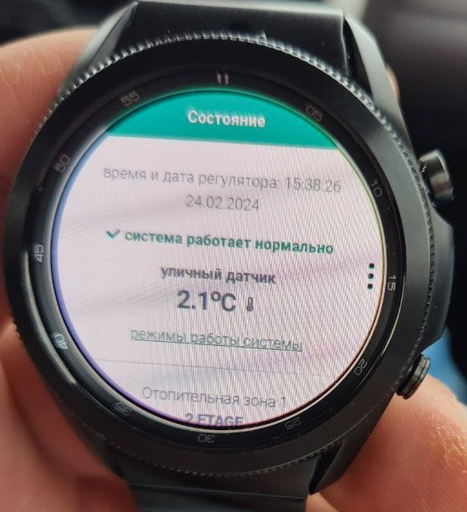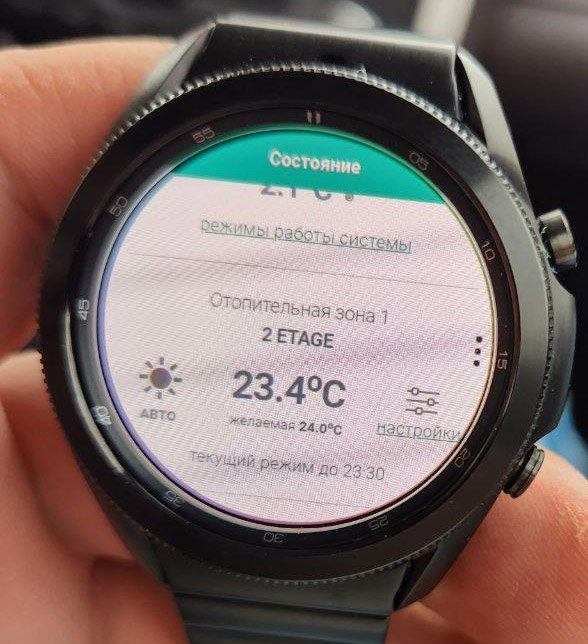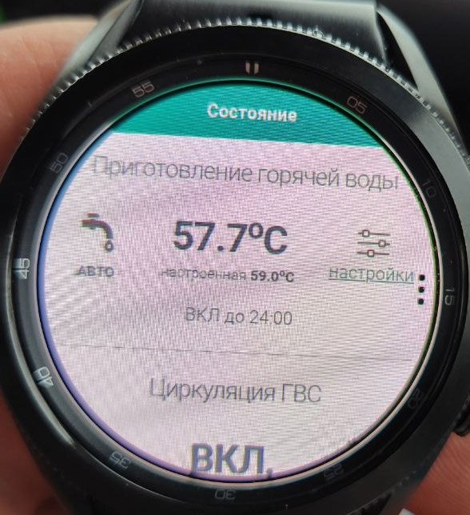

[Открыть в Telegram](https://t.mewebcontrol_app/106)

---

### 2024-02-24

Способ как выяснить какое у Вас поколение 720 регулятора.

См. коробку от регулятора, поколение указывается через косую черту.
Если косой черты нет, то это первое поколение. 
т.е.
VRC720 - первое поколение
VRC720/2 - второе поколение
и т.д.

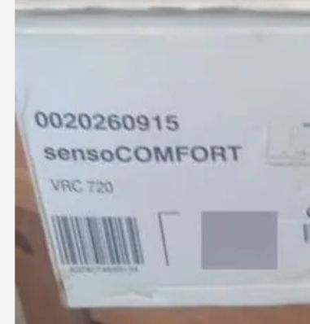

[Открыть в Telegram](https://t.mewebcontrol_app/104)

---

### 2024-02-21

Важное объявление по поддержке регулятора VRC720.

Несмотря на пассивность 99,9% подписчиков канала и отсутствие поддержки с их стороны, я все-таки начал добавление поддержки 720 регулятора в программу. 

Пока это первые шаги по анализу и доработке конфигурации EBUSD для этого регулятора. Только после этого имеет смысл писать код в программе. 

Как быстро будет реализована поддержка я не знаю и давать прогнозы тоже не стану. По мере продвижения разработки буду публиковать краткие сводки.

[Открыть в Telegram](https://t.mewebcontrol_app/103)

---

### 2024-02-14

📎 **Вложение:** [Screenshot 2024-02-14 at 13-35-48 Webcontrol.png](./files/102_Screenshot 2024-02-14 at 13-35-48 Webcontrol.png)

[Открыть в Telegram](https://t.mewebcontrol_app/102)

---

### 2024-02-14

📎 **Вложение:** [Screenshot 2024-02-14 at 13-35-32 Webcontrol.png](./files/101_Screenshot 2024-02-14 at 13-35-32 Webcontrol.png)

[Открыть в Telegram](https://t.mewebcontrol_app/101)

---

### 2024-02-14

📎 **Вложение:** [Screenshot 2024-02-14 at 13-35-14 Webcontrol.png](./files/100_Screenshot 2024-02-14 at 13-35-14 Webcontrol.png)

[Открыть в Telegram](https://t.mewebcontrol_app/100)

---

### 2024-02-14

📎 **Вложение:** [usb-gpio-extender.pdf](./files/99_usb-gpio-extender.pdf)

[Открыть в Telegram](https://t.mewebcontrol_app/99)

---

### 2024-02-14

Анонс: добавление управления системой при помощи внешнего контакта.

Решил добавить возможность, которая вряд ли будет сильно востребована пользователями, но поскольку нужна мне, так почему бы не сделать?

Задача: при падении давления в водопроводе выключать режим приготовления горячей воды (чтобы не греть бойлер без давления и не гонять циркуляционный насос без воды т.к. у меня управляемая оборудованием Vaillant циркуляция ГВС), и затем восстанавливать состояние режима ГВС (запоминается состояние на момент замыкания управляющего контакта) при поднятии давления в водопроводе.

Для того чтобы считывать давление в водопроводе используем реле давления, а для мониторинга состояния его контактов нам понадобится устройство, подключаемое к компьютеру и позволяющее считывать состояние контактов.

Совершенно случайно нашел такое устройство за 850рублей (по состоянию на февраль 2024) у отечественных разработчиков: [USB GPIO Extender](https://open-dev.ru/interface/tproduct/179899148-603994150506-usb-gpio-extender). Данное устройство подключается по USB и позволяет отслеживать состояние 5 дискретных входов (замкнут/разомкнут), а также имеет 5 дискретных выходов, которые можно программно включать/выключать (нам пока не надо, но потенциал для реализации – это хорошо).

Поддержал отечественных разработчиков, купил это устройство и после ряда экспериментов добавил его поддержку в программе. Показываю рабочие скриншоты, из того что сделано: можно назначить действие (из списка доступных) выполняемое при размыкании /замыкании управляющего контакта. Состояние контактов опрашивается с той же периодичностью что и отправка уведомлений, и обработка команд телеграм-бота (сейчас - раз в 10минут). Сейчас работаю над логикой работы этой функции при нештатных ситуациях: невозможности считать состояние контакта и т.д.

[Открыть в Telegram](https://t.mewebcontrol_app/98)

---

### 2024-02-06

Благодаря обратной связи, полученной от одного из пользователей был немного доработан ответ телеграм-бота на команду "статус". 

В ситуации когда отопительная зона не привязана к регулятору или дополнительному устройству управления не отображалась желаемая температура отопительной зоны (воздух). Теперь отображается.

На мой взгляд, смысл отображаения этой настройки сомнителен, т.к. отопительная зона не знает какая у нее текущая температура (нет привязки=нет считывания температуры воздуха отопительной зоны), и поэтому  эта настройка скорее всего не используется в такой конфигурации, поскольку температура зоны определяется уличным датчиком и отопительной кривой соответствующего контура.

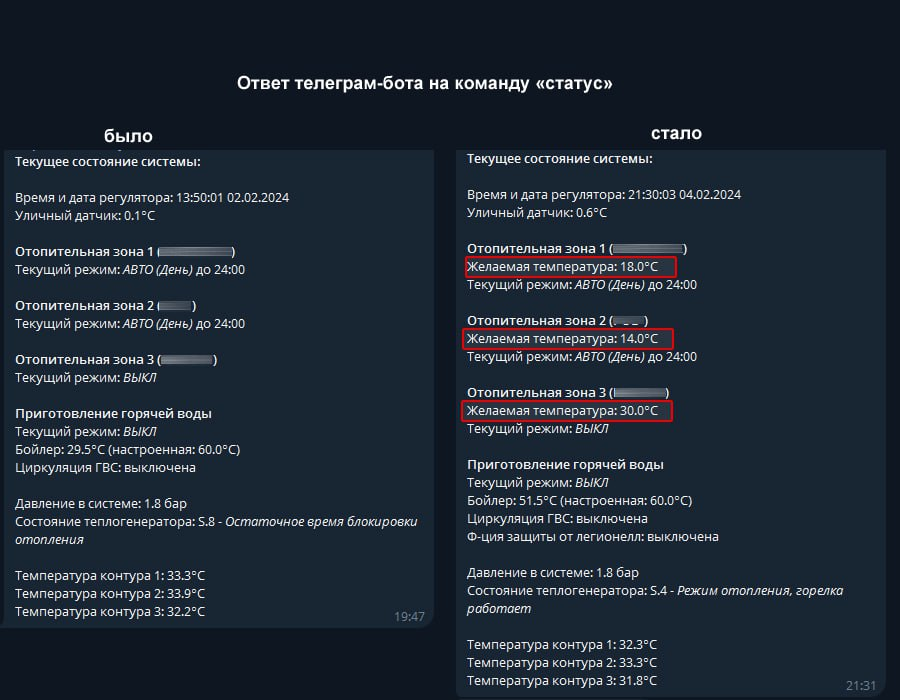

[Открыть в Telegram](https://t.mewebcontrol_app/97)

---

### 2024-02-04

Сейчас тестирую новый образ системы где предпринял дополнительные меры по предотвращению подобных ситуации. По результатам тестирования буду решать заменять ли текущий образ на новый.

[Открыть в Telegram](https://t.mewebcontrol_app/96)

---

### 2024-02-04

Добавил в программу полезную опцию для пользователей, которые имеет привычку благополучно забывать пароли.  Теперь, помимо восстановления пароля через код восстановления, можно (имея физический доступ к мини-ПК) восстановить пароль для системного пользователя путем включения и отключения ebus адаптера, следуя подсказкам в веб интерфейсе (см. изображение). Функция по умолчанию отключена.

Войдет в следующее обновление.

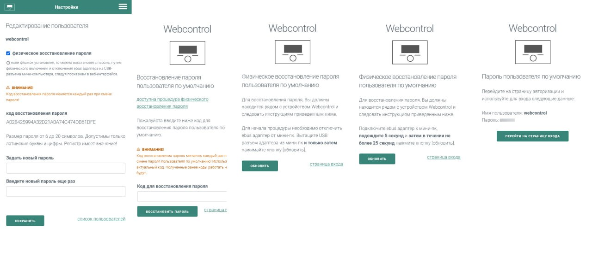

[Открыть в Telegram](https://t.mewebcontrol_app/95)

---

### 2024-02-01

По случайным зависаниям.

Благодаря пользователю удалось понять причину зависания в его случае. Как видно из сообщений, причиной "зависания" стала ошибка  записи в emmc, после чего файловая система ОС перешла в режим "только для чтения".

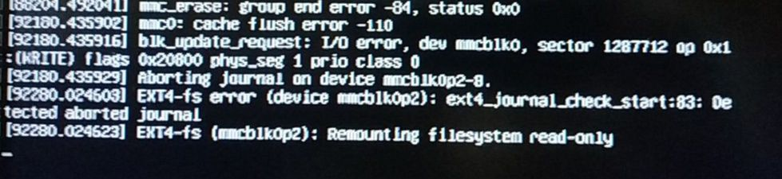

[Открыть в Telegram](https://t.mewebcontrol_app/94)

---

### 2024-01-29

Обновление по ситуации со случайными зависаниями мини-ПК

Итак, ситуация со случайными зависаниями мини ПК получила свое развитие. После первых сообщений и предпринятых мною мер по устранению потенциальных причин зависания (уменьшение объемов записи в eMMC) сообщений о новых случаях зависания не поступало. Однако, недавно я получил сообщения от двух пользователей о зависании и меня насторожила похожая последовательность действий, приводящая к зависанию, а именно: после продолжительной стабильной работы мини-пк (в одном случае – месяц, в другом около недели) мини ПК был штатно выключен кратковременным нажатием на кнопку (штатное выключение ОС), после чего через некоторое время был включен, и затем в течение первых суток работы после включения завис.

Подобное поведение мне непонятно. Оно точно не может быть связано с эффектами “утечки памяти”, т.к. они проявляются при длительной работе. Маловероятно, что это связано с ошибками ОЗУ, т.к. эти ошибки также проявляют себя при длительной работе, чего не наблюдается. Это не может быть драйвер wifi т.к. у одного из пользователей этот модуль (iwlwifi) не был загружен в ядро.

Вместе с тем, судя по отсутствию многочисленных жалоб от пользователей, эта проблема не носит массовый характер, и хотелось бы составить более полную картину происходящего.

Для этого все кто пользуется программой напишите в комментариях к этому сообщению следующую информацию:
- Модель мини-ПК с наклейки внизу устройства должна выглядеть примерно так:
 T4PRO-A-464KICW64PRO-B
- Текущее время непрерывной работы в днях (можно посмотреть в настройках-инструменты разработчика)
- Используете ли Вы wifi подключение 

Собрав эту информацию можно хотя бы понять связаны ли зависания с какой-то конкретной модификацией T4PRO или нет.

[Открыть в Telegram](https://t.mewebcontrol_app/93)

---

### 2024-01-20

[Обновление программы до версии  2024.01.19](https://boosty.to/webcontrol_app/posts/07c1a5eb-7627-40c2-a3c5-f22ccdadd509) 
([список изменений](https://t.me/webcontrol_app/29))

Из основного - расширено количество поддерживаемых отопительных зон и контуров (с 3 до 5),  добавлена возможность отправки значений параметров системы на Narodmon и дополнена база автоматически определяемых теплогенераторов. 

ВНИМАНИЕ!
Для правильного применения данного обновления, обновление кода необходимо установить два раза подряд!

Для избежания ошибок при попытке чтения параметров 4 и 5 зон / контуров,  рекомендуется установить обновление конфигурации  EBUSD, добавляющее поддержку этих зон / контуров (входит в комплект обновления).

[Открыть в Telegram](https://t.mewebcontrol_app/92)

---

### 2024-01-20

Для чего в программу была добавлена поддержка Narodmon.ru?

Казалось бы, какая связь между управлением системой отопления и сервисом отображения погоды на карте (а именно так большинство и воспринимает этот сервис).

На самом деле сервис Narodmon, помимо вывода погоды на улице имеет весьма обширный функционал – в частности, на него можно передавать различные данные для последующего построения графиков и анализа (при этом необязательно разрешать сторонний доступ к этим данным) . Делать это на устройстве я не хочу т.к. встроенная emmc память (используется в качестве "жесткого диска") при таком использовании будет деградировать быстрее, а с учетом того что она распаяна на материнской плате, ее замена – хлопотное и дорогое занятие. Да и не нужны графики подавляющему большинству пользователей программы.

Теперь мы подходим, к основной причине добавления поддержки сервиса Narodmon. Дело в том, что, реализуя концепцию полной независимости устройства, и подключения внешних сервисов исключительно по необходимости, желательно добавить механизм, АВТОМАТИЧЕСКИ уведомляющий пользователя о том, что с устройством что-то случилось. Без внешнего сервиса понять, что с устройством Webcontrol что-то не так можно лишь по косвенным признакам (телеграм-бот не отвечает, не активен VPN-туннель от устройства и т.д.). Используя же функцию уведомления от Narodmon (о том, что устройство перестало передавать данные), мы фактически добавляем еще один уровень безопасности, который позволяет более оперативно реагировать, если с устройством что-то не так.

[Открыть в Telegram](https://t.mewebcontrol_app/91)

---

### 2024-01-20

Благодаря обратной связи, полученной от подписчика канала Антона удалось улучшить автоматическое опознавание модели теплогенератора. В базу данных программы добавлены модели atmoTec и turboTec 3-го поколения (артикулы представлены на рисунке).  Будет включено в следующее обновление ПО.

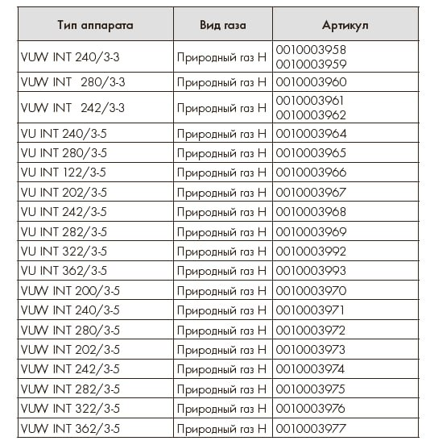

[Открыть в Telegram](https://t.mewebcontrol_app/90)

---

### 2024-01-16

Совсем вылетело из головы.

В одном из прошлых обновлений добавил в веб-интерфейс отображение состояния функции защиты от легионелл. Теперь эта информация также добавлена в ответ бота на команду "статус" (подраздел "Приготовление Горячей воды").

Войдет в следующее обновление на Boosty.

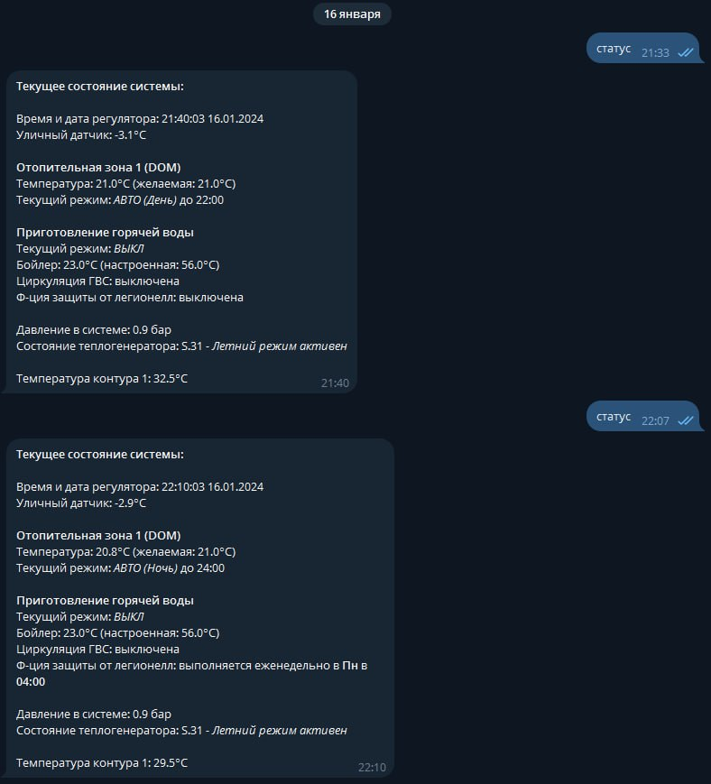

[Открыть в Telegram](https://t.mewebcontrol_app/89)

---

### 2024-01-16

Полку людей, готовых помочь остальным с изготовлением адаптера прибыло!

Один из первых подписчиков канала Антон готов оказать желающим помощь в изготовлении адаптера. Ниже более подробная информация. Также добавил эту информацию в [закрепленном посте](https://t.me/webcontrol_app/81), для тех, кто желает купить готовый адаптер. 

Антон (Московский регион)
Телеграм: [https://t.me/Patamushta99](https://t.me/Patamushta99)

По состоянию на 16.01.2024 у Антона есть 4 готовые и оттестированные платы адаптеров, и он готов достаточно быстро собрать желающим 4 готовых адаптера в корпусе.  Также Антон готов отправить адаптеры по России за счет заказчика. Изготовление новой партии адаптеров (5 штук) не является для Антона приоритетным, однако он готов рассмотреть такую возможность, если будут обращения.

[Открыть в Telegram](https://t.mewebcontrol_app/88)

---

### 2024-01-14

Анонс

Сегодня доделал и теперь тестирую передачу показаний системы на сервис Narodmon.ru Позволяет отправлять до 5 любых доступных параметров системы. Для наиболее распространенных параметров (температура улицы, температуры зон и контуров и т.д.) сделаны шаблоны настроек для упрощения настройки отправки.

По завершению тестирования, будет выпущено обновление, включающее этот функционал.

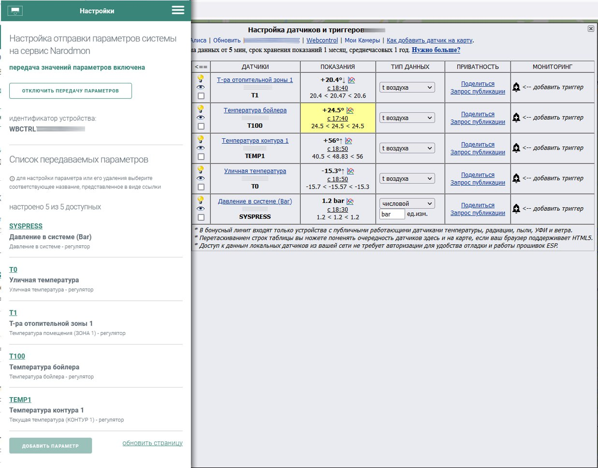

[Открыть в Telegram](https://t.mewebcontrol_app/87)

---

### 2024-01-03

Сегодня прислал пользователь программы.

Ну что сказать - я искренне рад что моя программа помогает людям сохранить свой дом (в данном случае - как только котел встал в ошибку, пользователю пришло уведомление и он своевременно перезапустил котел).

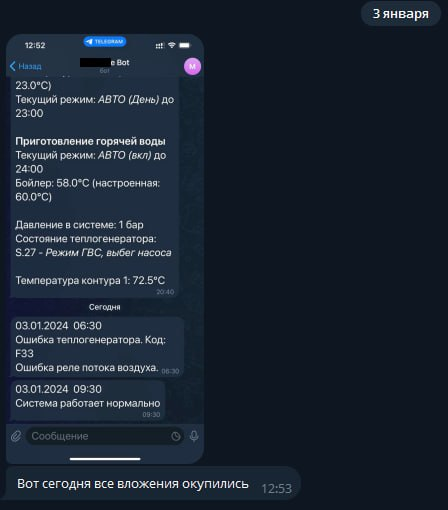

[Открыть в Telegram](https://t.mewebcontrol_app/86)

---

  &times;
  

