## Новости Webcontrol — 2025 год

[← Свежие новости](./) | [Главная страница Webcontrol](https://stadid.github.io/webcontrol/) | [Репозиторий GitHub](https://github.com/stadid/webcontrol/)

---

### 2025-12-31

С Наступающим!

В череде приятных предновогодних хлопот настало время подвести итоги уходящего года. Итак, активная фаза разработки Webcontrol завершилась.  Не хотелось бы останавливаться на достигнутом, но отсутствие интереса со стороны пользователей  совершенно не располагает к добавлению чего-то нового. С другой стороны, отсутствие негативных отзывов от пользователей показывает что текущая версия работает стабильно и содержит все необходимые функции.

Также VGR запустили в этом году свою систему удаленного управления, так что у пользователей расширился выбор, что хорошо.

Vaillant продолжили доводить до ума свою систему, и она (судя по отображаемым параметрам) смогла приблизится к Webcontrol.
По крайней мере я сделал такой вывод посмотрев на интерфейс в одной из последних версий их приложения. 

Вот такой был год...

Желаю всем в Новом Году тепла и беспроблемной работы инженерных систем!

С Наступающим!

[Открыть в Telegram](https://t.me/webcontrol_app/236)

---

### 2025-11-12

Функции Webcontrol, которые планировались, но не были реализованы (продолжение).

Еще была идея реализовать отправку предупреждения через телеграм-бота о падении давления теплоносителя в системе (порог настраивается пользователем). В текущей реализации Webcontrol это можно сделать через отправку значения давления на narodmon и установить там уведомление о выходе параметра за заданный диапазон, но это хлопотно настраивать, а так был бы простой способ путем установки одной галочки и ввода значения. И пользователи с “дырявой” системой отопления или ненакачанным / прохудившимся расширительным баком были бы заранее предупреждены.

Также думал о сохранении и восстановлении настроек временных окон регулятора. В Webcontrol есть сохранение настроек регулятора в текстовый файл, но это не для обычного пользователя. Как уже не раз писал, восстанавливать все настройки регулятора надо очень аккуратно с полным пониманием что делается, так что восстановление всех настроек я и не планировал никогда, а вот временные окна – вполне.  Про восстановление желаемых температур тоже задумывался, но поверхностно.

Были еще идеи по мелкому улучшению тех или иных функций Webcontrol и доработке интерфейса, но там не особо интересно будет для широкой публики.

[Открыть в Telegram](https://t.me/webcontrol_app/235)

---

### 2025-11-12

Функции Webcontrol, которые планировались, но не были реализованы.

Разбирал недавно рабочий архив по проекту Webcontrol и наткнулся на список планируемых к добавлению функций. Сейчас, поскольку интерес аудитории к проекту минимальный, не вижу смысла разменивать свое время и здоровье на доработки, хотя некоторые из них видятся мне полезными.

Например, добавление для 700-го регулятора команд телеграм бота для управления режимами работы отопительных зон и ГВС, а также установки желаемых температур (см. картинку, там приведен формат команд бота с краткими пояснениями).  К сожалению, для 720-го такую штуку просто не провернешь т.к. там для каждого окна своя температура.  Можно, конечно, указать день недели и номер окна, но это очень громоздко, хотя и реализуемо. Остальные температуры в 720-м задаются похоже на 700-й. так что тут проблем не предполагалось.

Продолжение текста в [следующем посте](https://t.me/webcontrol_app/235).

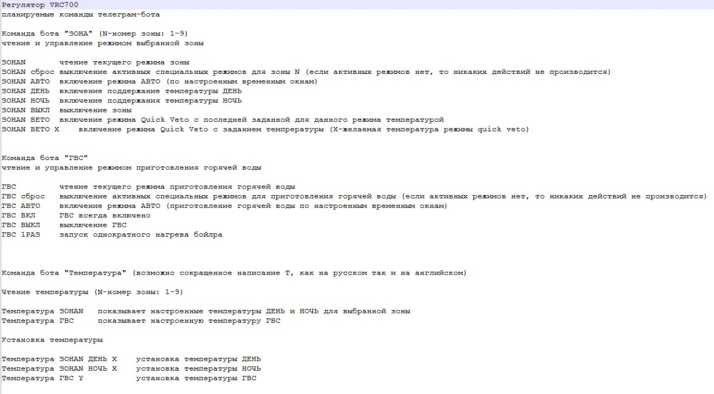

[Открыть в Telegram](https://t.me/webcontrol_app/234)

---

### 2025-10-17

Любопытное наблюдение

В ходе вебинара по vLink, вскользь затрагивалась тема конкурирующих решений в качестве которых приводились: Zont, EctoControl, MyHeat. Про Webcontrol даже не упомянули, хотя (будем честны) это единственное “конкурирующее” c Vlink отечественное решение для систем с родными регуляторами Vaillant. При этом, в подписчиках канала есть некоторое количество людей, тесно связанных с продажей и обслуживанием техники Vaillant.

[Открыть в Telegram](https://t.me/webcontrol_app/233)

---

### 2025-10-14

Заметки по итогам вебинара по VLink (дополнение)

Кстати, немного прояснилась ситуация почему в списке официально поддерживаемого оборудования не присутствуют регуляторы VRC700 2-го и 4-го поколений. На текущий момент VGR не удалось добиться стабильной работы данных регуляторов с их системой (опять-таки со слов технического специалиста VGR, ведущего вебинар). Поэтому (как я понимаю) данные регуляторы пока исключили из списка официально поддерживаемого оборудования.  

По своему опыту могу сказать, что в моей программе не было проблем ни со 2-м ни с 4-м поколением. У меня у самого 4-е поколение.  А у пользователей моей программы с которыми я общался были регуляторы 2-го поколения и никто не жаловался.

[Открыть в Telegram](https://t.me/webcontrol_app/232)

---

### 2025-10-14

Заметки по итогам вебинара по VLink

Посмотрел вебинар VGR по Vlink. По первому впечатлению - вполне достойная отечественная замена MyVaillant с акцентом на централизацию и сервисную составляющую. Но надо понимать, что VGR в самом начале развития своей системы, со всеми вытекающими последствиями.

Что мне не понравилось - шлюз Vlink все время держит открытую Wi-Fi сеть с дефолтным несменяемым паролем (работает в режиме точки доступа), необходимую для подключения шлюза к Вашей Wi-Fi сети (чтобы ввести название вашей домашней сети и пароль от нее). Как я понял со слов технического специалиста VGR, ведущего вебинар, эта сеть РАБОТАЕТ ВСЕГДА даже после успешного подключения к Вашей Wi-Fi сети. На мой взгляд это недопустимо, т.к. ГИПОТЕТИЧЕСКИ любой может подключится к шлюзу Vlink (в пределах устойчивого приема сигнала от шлюза) и сменить настройки Wi-Fi что приведет к отключению шлюза от интернета.  Правда, надо отметить, что это представляет угрозу только если шлюз Vlink подключен по Wi-Fi.  Если он подключен по кабелю (Ethernet), то это не актуально.

[Открыть в Telegram](https://t.me/webcontrol_app/231)

---

### 2025-09-08

Как (не)работает OpenSource

Недавно случились события, послужившие поводом для написания этой заметки.

Итак, начало мая этого года. Я заканчиваю ветку кода поддержки 720-го регулятора у себя в программе. Появляются сообщения о возможности использовать ранее заблокированные шлюзы с новым приложением MyVaillant.
И в MyVaillant появляется отображение влажности воздуха для 700-го регулятора. 

Ранее в сообществе ebusd не был найден регистр для влажности 700-го, но, ради справедливости, его мало кто искал. Все, в основном, просили друг-друга его найти))))) Т.к. у меня в то время родной шлюз vr900 не был подключен, мы в сотрудничестве с Антоном при помощи его шлюза сняли лог обмена по шине и путем анализа смогли найти этот регистр. После этого я разместил в сообществе ebusd краткое описание и фрагмент конфигурации файла для 700-го.
Кто-то из участников сообщества в конце июля, начале августа даже протестировал и подтвердил работоспособность найденной конфигурации. И далее тишина...

Проходит где-то полтора месяца и на github опять кто-то спрашивает, - а не нашли ли регистр влажности для 700-го? И ему дают кусок конфигурации для 720-го, которым я поделился со знакомыми участниками проекта после анализа обмена между 91-м и 700-м. (как оказалось, эта часть задействованных регистров похожа у обоих регуляторов). Мое первое майское сообщение, похоже, не смогли найти))))) И вот на днях наконец-то кто-то сделал PR в основную конфигурацию для поддержки отображения влажности. И еще когда его добавят)))) Вот так все в проекте ebusd и происходит))))))))).

Не совсем в тему. Надо отметить, что  людей, способных написать конфигурацию ebusd вообще очень мало, а людей системно анализирующих "адресное пространство" регистров того-или иного оборудования вообще единицы на весь проект.  Сейчас это стало делать труднее. После перехода проекта ebusd на TypeSpec-представление конфигурации наглядность представления "адресного пространства" значительно ухудшилась, а именно она позволила мне в свое время сильно развить конфигурацию для 700-го.

[Открыть в Telegram](https://t.me/webcontrol_app/230)

---

### 2025-06-27

Объявлен список поддерживаемого vLINK оборудования

Как я и предполагал, на старте есть ограничения по поддерживаемому оборудованию Vaillant. В частности, поддерживаются Atmo- и TurboTec только 5 поколения, VRC700 только 6-го поколения, а для VRC720 вообще не указано поколение (а их немцы, на секундочку, наклепали уже 3 поколения).

И, кстати, по анонсу: на мой взгляд неверно относить модули VR70 и VR71 в категорию "регуляторы".  Для обычных пользователей все равно, а для специалистов - заметно.

Кому интересно почитать анонс - сделал PDF, прикладываю к посту.

📎 **Вложение:** [V_link.pdf](./files/229_V_link.pdf)

[Открыть в Telegram](https://t.me/webcontrol_app/229)

---

### 2025-06-06

Появилась цена на систему удаленного управления vLiNK от VGR.

Цена на систему удаленного управления от VGR появилась на сайте vaillant.tech.  На 06.06.2025 за нее просят 23 т.р.
Вполне логичный ценник (на мой взгляд), с учетом того, что сейчас за 921-й на Авито просят где-то 25-27 т.р.

Нормального описания, руководства пользователя, как и родного приложения (если оно существует), впрочем, я не нашел.

Также остается открытым вопрос - будет ли еще дополнительная плата за использование сервиса, либо каких-либо дополнительных услуг. 

Мне любопытна работа vLINK там, где нет  регулятора, и при пропадании интернета. И есть ли у vLINK локальное управление (через веб интерфейс или приложение). 

Интерес чисто академический, т.к. локальное управление у меня есть, а безрегуляторные системы Webcontrol не поддерживает в силу особенностей применяемого решения.

[Открыть в Telegram](https://t.me/webcontrol_app/228)

---

### 2025-05-30

Поломка обновления через интернет из-за изменений в формате данных на стороне Яндекс Диска и обновление Webcontrol до версии 2025.05.30 исправляющее эту ошибку.

Случайно выяснил что перестало работать обновление программы через интернет. Оказалось, что Яндекс поменял формат данных и программа не может получить необходимую информацию об обновлении. Выпустил исправление, которое надо установить вручную, после чего обновление через интернет снова заработает.

Скачать обновление можно тут: https://disk.yandex.ru/d/rdZbEPWTJkDPvw

Ставится в том же разделе, что и обновление через интернет (в разделе "Обновление посредством загружаемого zip-файла").

Zip файл обновления разархивировать НЕ НАДО!!!

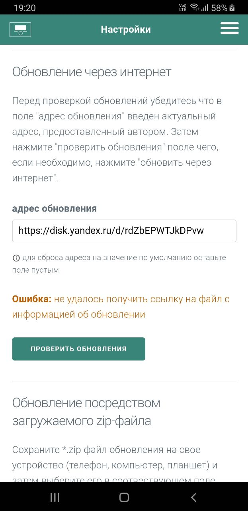

[Открыть в Telegram](https://t.me/webcontrol_app/225)

---

### 2025-05-15

Обновление Webcontrol до версии 2025.05.15

Обновление устанавливается через интернет в разделе "Настройки" - "Обновление программы".
 
[подробный список изменений.](https://disk.yandex.ru/d/rdZbEPWTJkDPvw/changelog.txt)

[Открыть в Telegram](https://t.me/webcontrol_app/224)

---

### 2025-04-23

Доступно для загрузки экспериментальное клиентское приложение Webcontrol для Android.

Поскольку Webcontrol - это по сути web-интерфейс, то его можно поставить на главный экран телефона в виде ярлыка для запуска браузера. 

Ради интереса решил попробовать создать android - приложение выполняющее эту же функцию (открытие двух настроенных адресов в браузере). Опыт в разработке под Android у меня стремится к нулю, поэтому многого не ожидайте, но по результатам тестирования все на удивление работает)))

APK ставится на android начиная с 6-й версии. 

Контрольная сумма SHA1:
e63026609b37afe9f7051fde1939bc064d9fc3c3

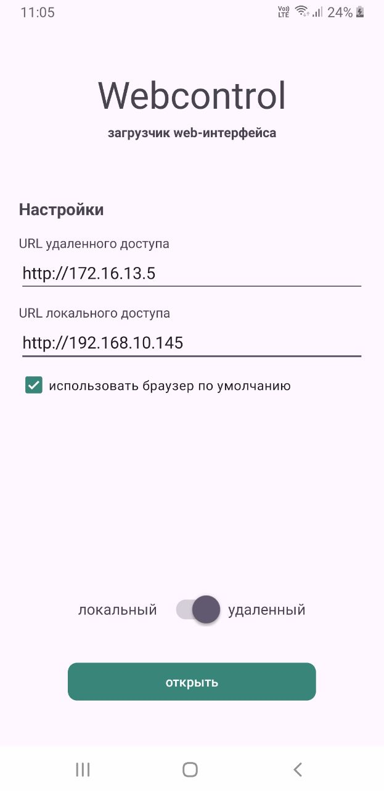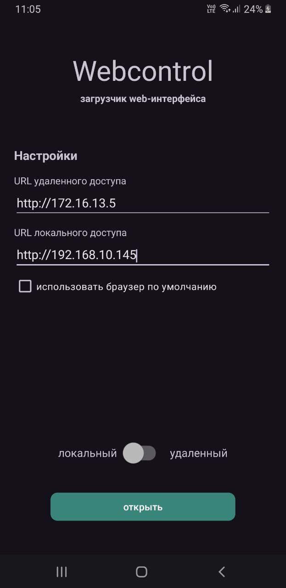

📎 **Вложение:** [Webcontrol.apk](./files/220_Webcontrol.apk)

[Открыть в Telegram](https://t.me/webcontrol_app/220)

---

### 2025-03-29

Как мог бы выглядеть Ebus-адаптер, если бы он производился серийно.

Активный участник нашего небольшого сообщества Webcontrol [Антон](https://t.me/webcontrol_app/81), потратив изрядное количество своего времени собрал одноплатный вариант адаптера и разработал под него корпус. На мой взгляд, так мог бы выглядеть Ebus-адаптер, если бы он производился серийно. Следует отметить простую и удобную конструкцию корпуса. В остальном, он ничем не отличается от двухплатного варианта.

На представленных фотографиях можно сравнить две версии адаптера.

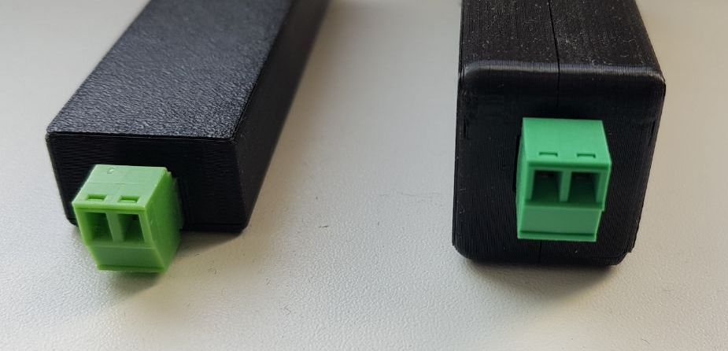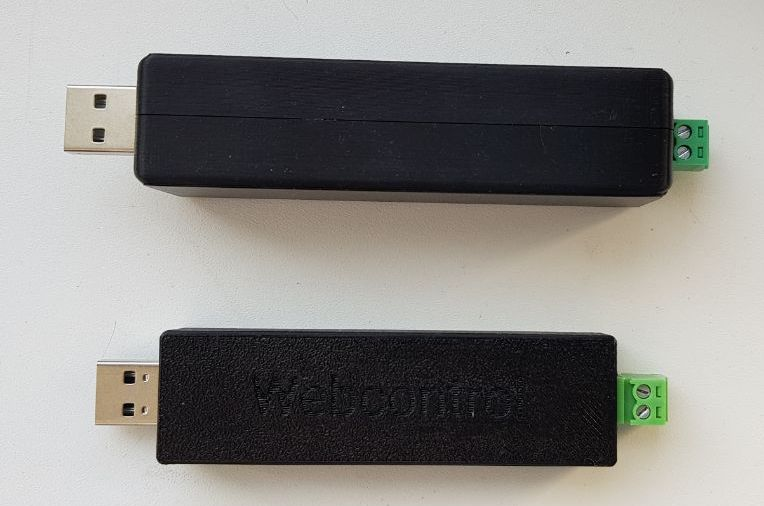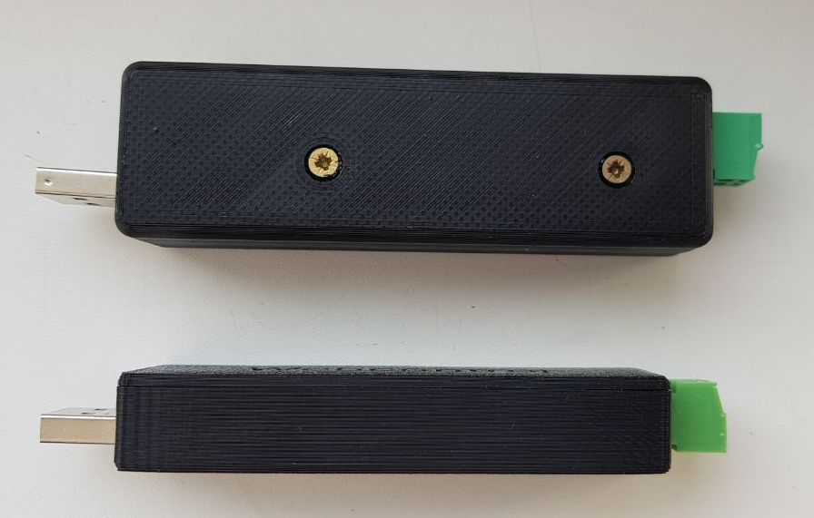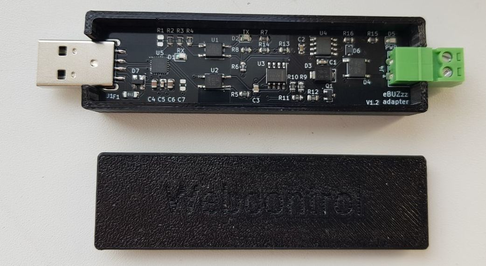

[Открыть в Telegram](https://t.me/webcontrol_app/216)

---

### 2025-03-28

📎 **Вложение:** [street_temp_vs_avg_street_temp.xlsx](./files/215_street_temp_vs_avg_street_temp.xlsx)

[Открыть в Telegram](https://t.me/webcontrol_app/215)

---

### 2025-03-28

Заметки о параметре "усредненная уличная температура".

Есть в 700-м и 720-м регуляторах такой параметр: "усредненная уличная температура". Не пытайтесь найти его через меню самого регулятора - его там нет. Он читается только по шине.  Судя по комментариям к конфигурации ebusd, считалось, что он пересчитывается каждые 3 часа, Судя по данным, которые я снял со своего регулятора за предшествующие несколько дней, при расчете этого параметра хорошо сглаживаются суточные колебания температуры "день-ночь".

Раз этот параметр был создан, значит он используется в управляющих  алгоритмах регулятора - видимо, там, где требуется не быстро изменяющаяся "основа" для входных параметров контрольного алгоритма.

Кому интересно - прикрепляю файл с исходными данными и графиком.

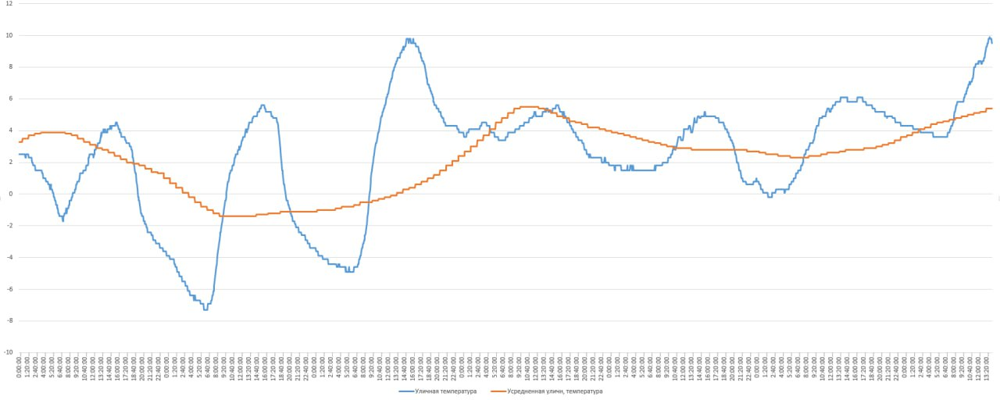

[Открыть в Telegram](https://t.me/webcontrol_app/213)

---

### 2025-03-17

Анонс отечественной системы удаленного управления оборудованием Vaillant от VGR.

Бизнес - структуры, представляющие технику Vaillant на отечественном рынке (VGR), анонсировали запуск собственной системы управления и мониторинга vLINK.

[Ссылка на новость](https://vgr-heating.ru/customer/products/soon/sistema-udalennogo-upravleniya-i-monitoringa-vlink/)

По предварительному описанию можно сделать вывод, что это будет архитектурно схоже с оригинальной системой от Vaillant. Т.е. модуль-преобразователь у клиента и управление через облако со своим приложением.

По заявленному функционалу все вполне достойно. Обещают даже поддержку 630-го регулятора. Молодцы.   

Из интересного: также обещают поддержку систем без регулятора (т.е., как я думаю, связка модуль-преобразователь + облачный сервер будут “прикидываться” регулятором). Схема рабочая, но непонятно как она себя поведет в отсутствии интернета, и насколько богатым будет функционал подобного “эмулируемого” регулятора.

Также непонятно, будет ли стоимость эксплуатации включена в стоимость оборудования (клиентского модуля), либо это будет подписка на сервис.

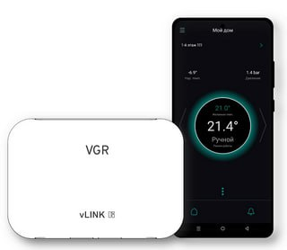

[Открыть в Telegram](https://t.me/webcontrol_app/212)

---

### 2025-03-06

Обновление Webcontrol до версии 2025.03.05

Обновление устанавливается через интернет в разделе "Настройки" - "Обновление программы".

Из основного: 
ДЛЯ ВСЕХ ПОДДЕРЖИВАЕМЫХ РЕГУЛЯТОРОВ (как 700, так и 720) - добавлена экспериментальная функция смены отопительной кривой по значению уличной температуры. 

Для семейства 720-х регуляторов добавлена опция установки единой температуры для всех настроенных временных окон всех дней недели. 
 
[подробный список изменений.](https://disk.yandex.ru/d/rdZbEPWTJkDPvw/changelog.txt)

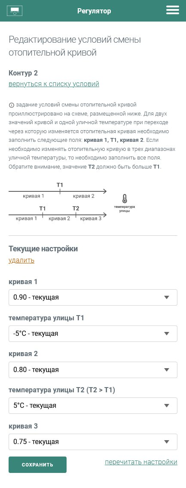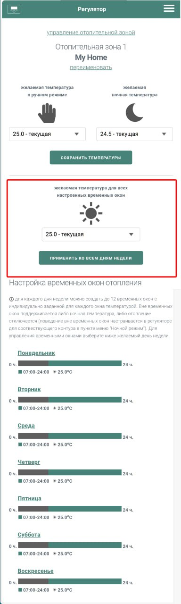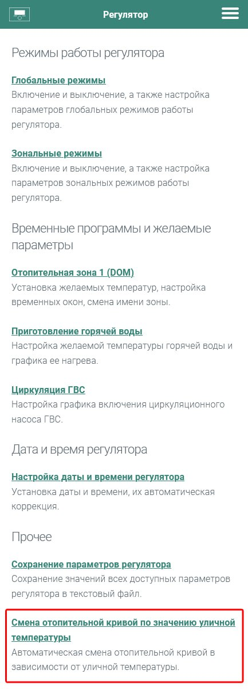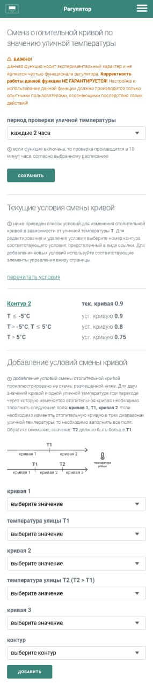

[Открыть в Telegram](https://t.me/webcontrol_app/208)

---

### 2025-02-18

Вниманию пользователей MyVaillant app!

Если Вы решите менять отопительную кривую через приложение MyVaillant - будьте внимательны! На github появился отзыв от пользователя приложения, который утверждает что при смене через приложение отопительной кривой для одного контура, она поменялась сразу для трех контуров!

[Ссылка на оригинальное сообщение.](https://github.com/john30/ebusd-configuration/pull/482#issuecomment-2664097687)

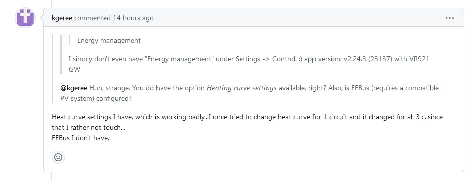

[Открыть в Telegram](https://t.me/webcontrol_app/207)

---

### 2025-02-14

Вопрос по добавлению функции установки отопительной кривой в зависимости от уличной температуры.

В процессе работы над программой, как минимум 3 совершенно разных человека упоминали что, было бы здорово, если бы можно было менять отопительную кривую автоматически в зависимости от уличной температуры.  Оставим сейчас обсуждение насколько это соответствует идеологии Vaillant по настройке регулятора. Раз это используется и позволяет обеспечить комфорт – значит даже такое “костыльное” решение имеет право на существование.

На данный момент мне видится такая реализация в рамках моей программы: 

- уличная температура для срабатывания условия по смене кривой выбирается в диапазоне от -30 до +30 с шагом 1 градус

- условие срабатывания содержит два варианта: 
 меньше или равно
больше 

- частота проверки уличной температуры настраиваемая (предлагаю следующие фиксированные значения: каждые 3 часа, каждые 6 часов, каждые 12 часов)

- пользователь сам добавляет условия смены кривой при значениях уличной температуры выше и ниже уставки (т.е. граничной температуры при которой происходит смена кривой) , т.е. придется добавлять два условия:

Если уличная температура < = уставка1 то установить для контура Х отопительную кривую Y1 
Если уличная температура > уставка2 то установить для контура Х отопительную кривую Y2

уставка1 не обязательно должна быть равна уставке2
 (таким образом мы обеспечиваем  гистерезис).

Прошу всех заинтересованных написать свои мысли в комментариях к данному сообщению. По результатам будет решен вопрос о добавлении этой функции в программу.

[Открыть в Telegram](https://t.me/webcontrol_app/206)

---

### 2025-02-07

Для тех, кто хочет приобрести готовый комплект  (мини-пк c  уже установленным ПО Webcontrol + адаптер e-bus) , а также заказать услуги по установке и настройке “под ключ”.

Два участника нашего сообщества (оба являются давними пользователями программы) оказывают такие услуги.

Андрей
https://t.me/cashic_telegramm
https://myshop-cov128.myinsales.ru/product/importozameschenie-oblachnogo-upravleniya-otopitelnyh-kotlov-vaillant

- можно приобрести готовый комплект Webcontrol с установкой и настройкой “под ключ” (только Московский регион)
- можно взять комплект Webcontrol на тестирование (только Московский регион)
- можно приобрести готовый комплект Webcontrol с отправкой транспортной компанией заказчику
- дистанционные консультации по подключению и настройке купленного комплекта
- возможна работа как с физическими, так и с юридическими лицами.

Антон
https://t.me/Patamushta99

- можно приобрести под заказ готовый комплект Webcontrol с установкой и настройкой “под ключ” (только Московский регион). 
- можно приобрести под заказ готовый комплект Webcontrol с отправкой транспортной компанией заказчику
- дистанционные консультации по подключению и настройке купленного комплекта

[Открыть в Telegram](https://t.me/webcontrol_app/204)

---

### 2025-02-06

Вышла новая версия Webcontrol 2025.02.01

Из основного: добавлена поддержка каскада и обновление программы через интернет. Из-за добавления каскада обозначения теплогенератора(ов) в программе теперь содержат номера, т.е. “основной” теплогенератор (тот, который подключается напрямую к e-bus шине) называется теперь не просто “теплогенератор”, а “теплогенератор 1”.  Желающие могут посмотреть [подробный список изменений.](https://disk.yandex.ru/d/rdZbEPWTJkDPvw/changelog.txt)

[Открыть в Telegram](https://t.me/webcontrol_app/203)

---

### 2025-02-05

Добавление поддержки каскадного подключения теплогенераторов.

В программу добавлено отображение состояния и информирование об ошибках теплогенераторов в каскаде.  Как это выглядит можно увидеть на прилагаемых изображениях.

Это не очень востребованная функция, т.к., преимущественно, в системе только один теплогенератор. Я изначально не планировал добавлять поддержку каскада, тем более, что в рамках ebusd это делается не так просто (сложности с VR32). Но благодаря подписчику канала Олегу, его усилиям и вовлеченности в процесс добавления поддержки каскада удалось реализовать и успешно протестировать эту функцию. Так что, если появятся пользователи Webcontrol - владельцы каскадов - можете сказать спасибо Олегу.  Кстати, и за поддержку полного количества зон и контуров для VRC700 - тоже.

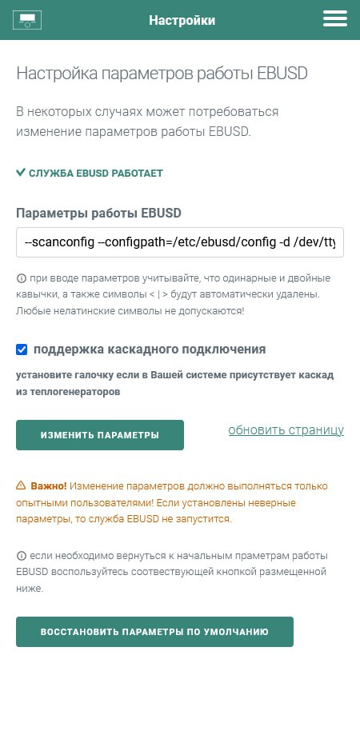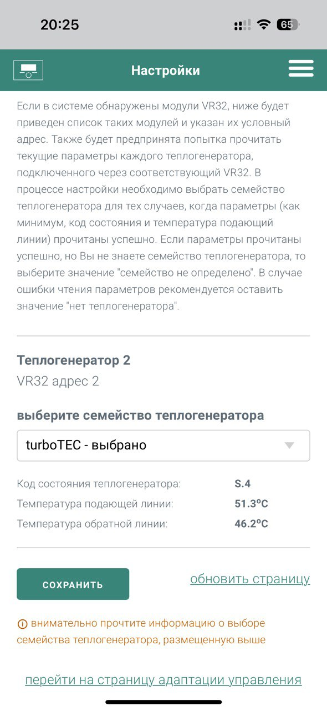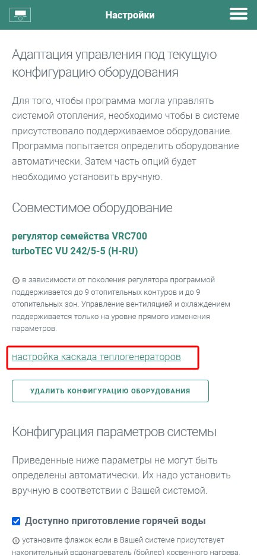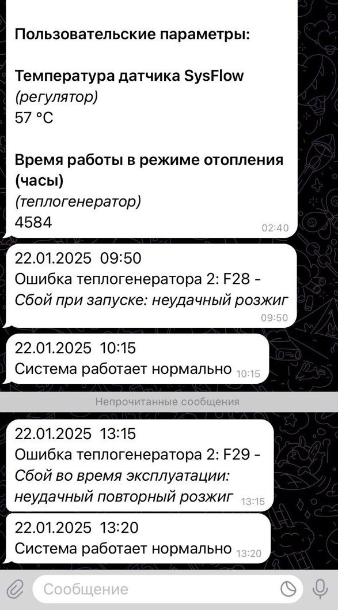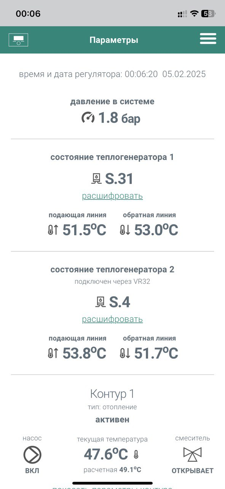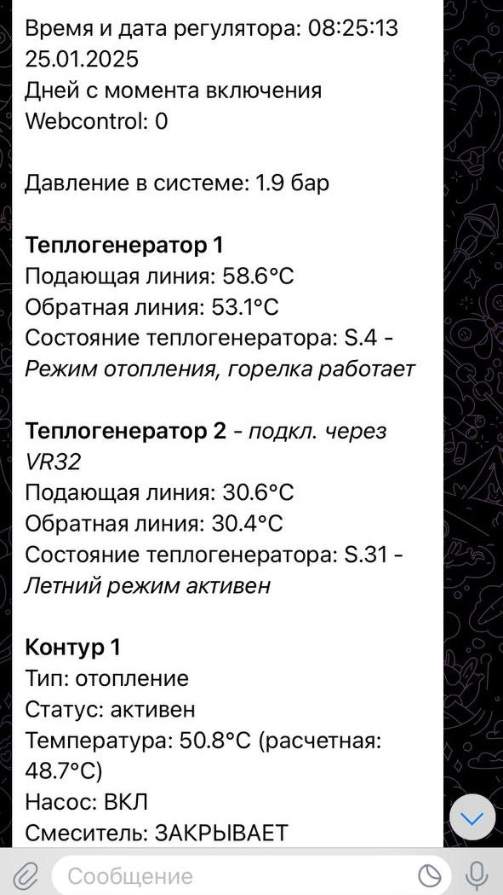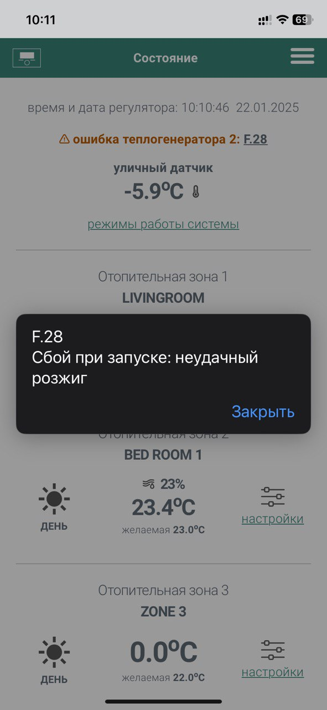

[Открыть в Telegram](https://t.me/webcontrol_app/196)

---

### 2025-01-19

Подключение VR91 используя существующую Ethernet - инфраструктуру.

Хочу поделиться свой реализацией подключения VR91 через уже проложенный Ethernet – кабель.
Итак, задача: установить VR91 в любой из комнат дома без прокладки отдельного провода e-bus шины. При наличии Ethernet-розетки в каждой комнате (у меня есть) решается использованием части пар уже проложенного Ethernet кабеля. Плюсы: не надо ничего прокладывать. Минусы: теряете скорость (только 100 Мбит), рискуете сжечь порт Ethernet-карты при подключении в розетку напрямую (без разделителя), т.к. макс. напряжение на шине e-bus 24В. Реализацию можно посмотреть на картинках.

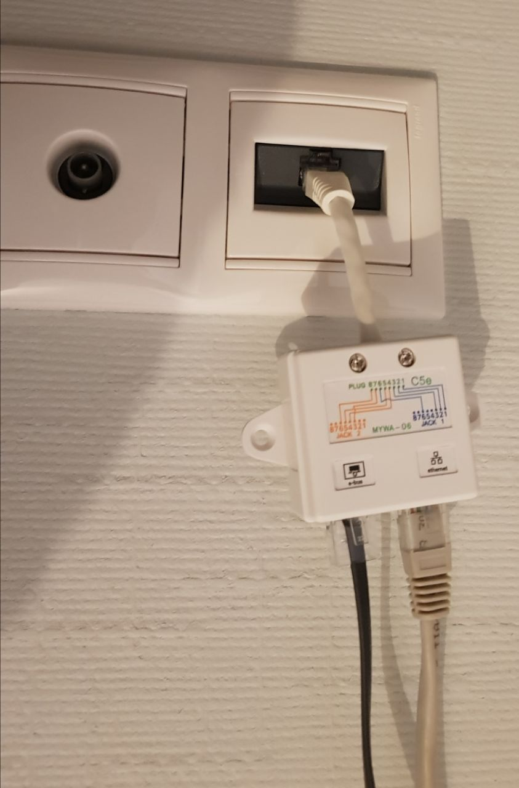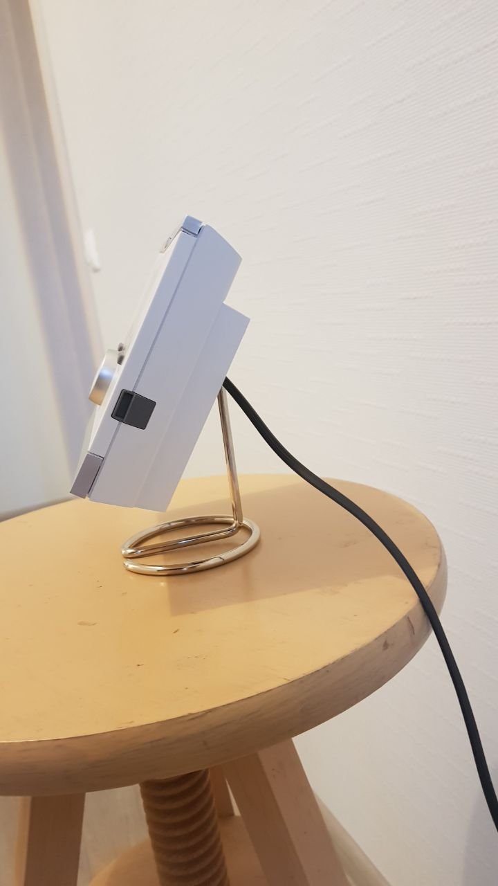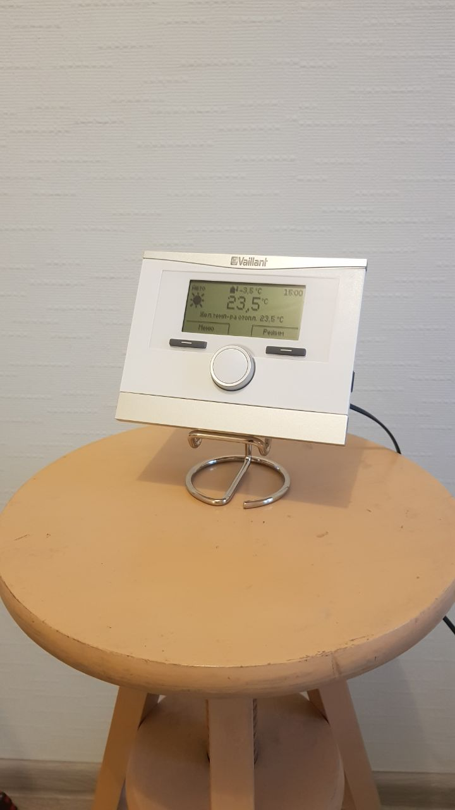

[Открыть в Telegram](https://t.me/webcontrol_app/193)

---

### 2025-01-19

Спасибо всем проголосовавшим!
Результаты голосования не стали для меня неожиданностью,  просто чуть лучше стало понимание потенциальной аудитории программы.
 
Для 30 человек (по состоянию на 19.01.2025), которые потенциально желают попробовать Webcontrol: надеюсь, такая возможность предоставится в ближайшем будущем. 

Следите за новостями.

[Открыть в Telegram](https://t.me/webcontrol_app/192)

---

**Архив по годам:** [2026](./2026.html) (41) • **2025 (24)** • [2024](./2024.html) (85) • [2023](./2023.html) (49)

  &times;
  

