## Новости Webcontrol — 2026 год

[← Свежие новости](./) | [Главная страница Webcontrol](https://stadid.github.io/webcontrol/) | [Репозиторий GitHub](https://github.com/stadid/webcontrol/)

---

### 2026-11-26

Webcontrol как явление

Друзья! Никогда бы не подумал, что буду это писать, но, как бы это сказать: автор докатился))))

Из праздного любопытства, я взял всю историю новостных сообщений Telegram-канала Webcontrol и скормил нейросети от Яндекса и попросил сделать краткий анализ и обзор проекта. А потом вставил полученный текст в нейросеть от Гугл и попросил сделать свои выводы о тексте.

Как человеку, который все эти годы тянул проект и видел все изнутри - смотреть как идет анализ от ИИ мне было и весело, и увлекательно.

Если что - получился не технический обзор - а скорее нейрослопский слегка галлюциногенный эссе-панегирик всему проекту Webcontrol. 

И что самое страшное - со многими выводами ИИ я согласен.

А уж читать, или покрутить пальцем у виска - ваш выбор.

📎 **Вложение:** [Webcontrol_как_явление.pdf](./files/289_Webcontrol_как_явление.pdf)

[Открыть в Telegram](https://t.me/webcontrol_app/289)

---

### 2026-11-21

Автоматическая трансляция сообщений канала из Телеграм на Github pages.

Поскольку многим читать новости тут не очень удобно, то сделал автоматическую публикацию сообщений на Github pages (пока, вроде, доступны). Туда же перенес все сообщения с момента создания канала. 

Пока работает в экспериментальном режиме т.е. может глючить и не работать совсем. )))))

Вот адрес: https://stadid.github.io/webcontrol-news/

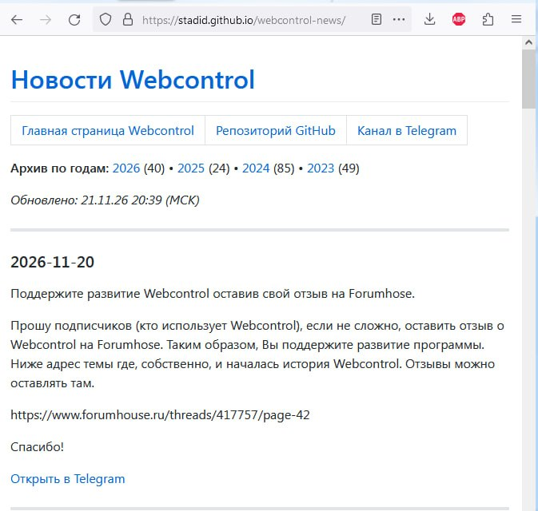

[Открыть в Telegram](https://t.me/webcontrol_app/288)

---

### 2026-11-20

Поддержите развитие Webcontrol оставив свой отзыв на Forumhose.

Прошу подписчиков (кто использует Webcontrol), если не сложно, оставить отзыв о Webcontrol на  Forumhose.  Таким образом, Вы поддержите развитие программы.  Ниже  адрес темы где, собственно, и началась история Webcontrol.  Отзывы можно оставлять там. 

https://www.forumhouse.ru/threads/417757/page-42

Спасибо!

[Открыть в Telegram](https://t.me/webcontrol_app/287)

---

### 2026-11-18

Недоступность сервиса vLink из-за кибератаки

Как следует из баннера на сайте. https://vaillant.com.ru  

Некоторые сервисы VG RUSSIA временно недоступны для пользователей. Ведутся технические работы. 

Вот прямая ссылка на документ:
https://vaillant.com.ru/upload/%D0%9F%D1%80%D0%B5%D1%81%D1%81-%D1%80%D0%B5%D0%BB%D0%B8%D0%B7%20%D0%BA%D0%B8%D0%B1%D0%B5%D1%80%D0%B0%D1%82%D0%B0%D0%BA%D0%B0.pdf

Вроде должны уже были починить.  

Комментировать не стану, но хочу выразить свое личное мнение, что делать в текущих условиях ставку на облачные сервисы, при наличии локально работающих альтернатив как минимум легкомысленно.

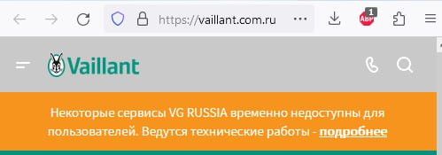

[Открыть в Telegram](https://t.me/webcontrol_app/286)

---

### 2026-11-16

Доступен образ Webcontrol для запуска в различных средах виртуализации

https://github.com/stadid/webcontrol/releases/download/v2026.11.14_VM_image/Webcontrol_VM_image.zip

Архив по ссылке содержит образ  в формате *.ova для импорта и запуска в доступной среде виртуализации (VirtualBox, Proxmox и т.д.). После запуска ВМ, веб-интерфейс программы будет доступен на 80-м порту (http). По умолчанию Webcontrol настроен на автоматическое получение IP адреса (DHCP). 

Поскольку по умолчанию Webcontrol настроен на использование USB EBUS адаптера, непосредственно подключаемого к ПК с Webcontrol и определяемого как /dev/ttyUSB0, то при использовании USB EBUS адаптера необходимо обеспечить видимость данного адаптера внутри виртуальной машины и изменить имя устройства в параметрах EBUSD, если это требуется. Также можно использовать ЛЮБОЙ ДРУГОЙ EBUS адаптер совместимый с EBUSD версии 23.3, изменив тип используемого адаптера в настройках EBUSD через веб-интерфейс Webcontrol.

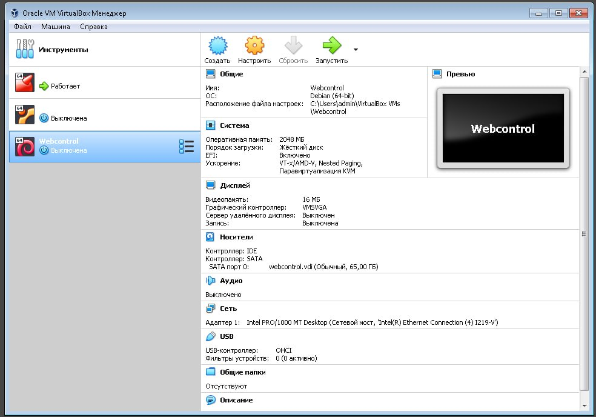

[Открыть в Telegram](https://t.me/webcontrol_app/285)

---

### 2026-11-14

Обновление Webcontrol до версии 2026.11.14

Для 700-х регуляторов на страницу "Состояние" добавлено отображение напоминания о техобслуживании (настраивается в регуляторе в разделе "Уровень специалиста" - "Сервисная информация" - "Дата техобслуживания"). 

Также добавлена настройка для данного напоминания, включая отправку сообщений через Telegram и NTFY.

Как будет возможность - добавлю такую же опцию для 720-го.

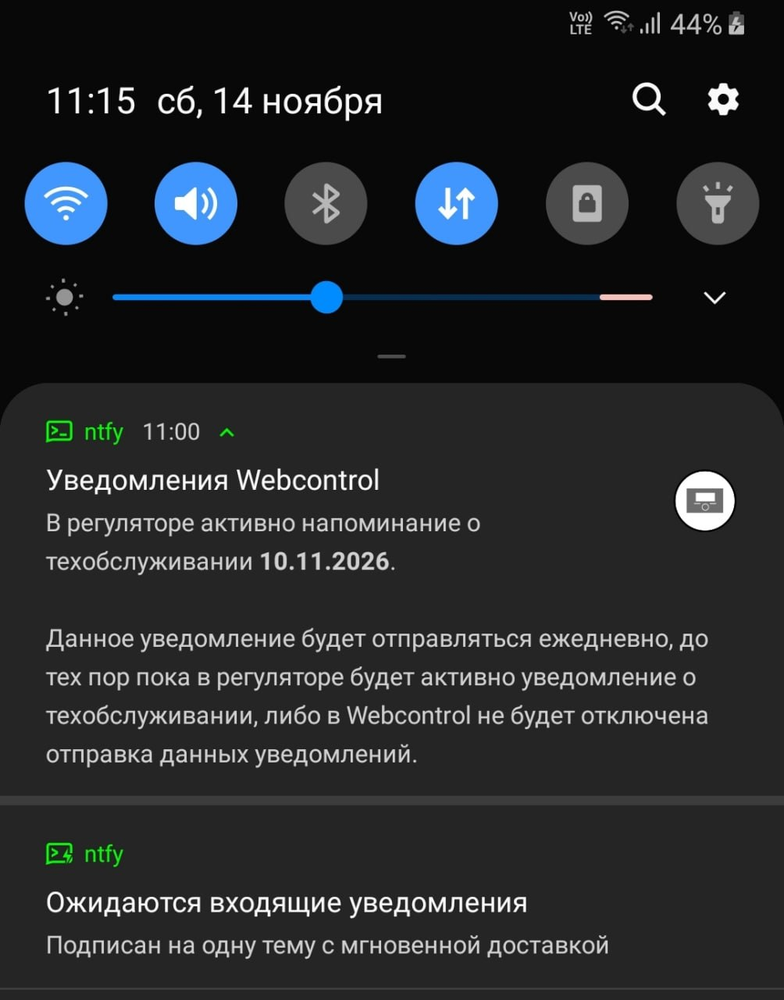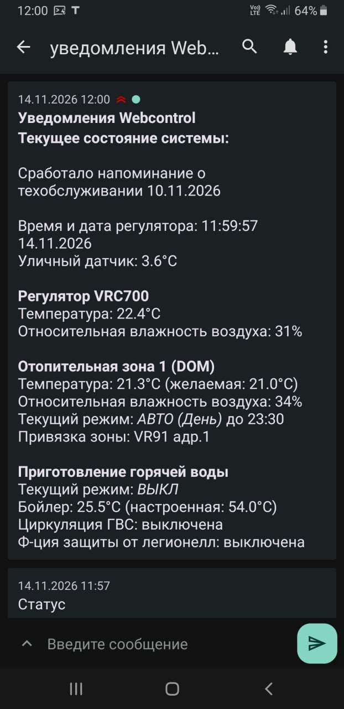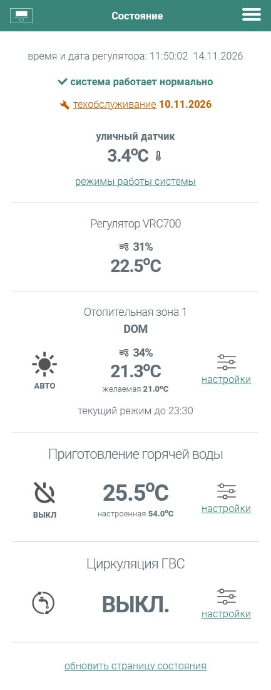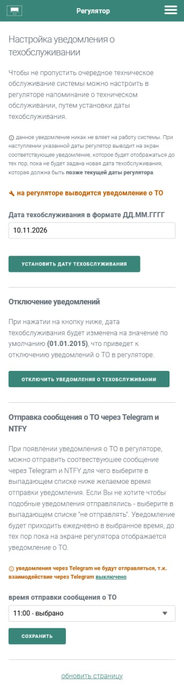

[Открыть в Telegram](https://t.me/webcontrol_app/281)

---

### 2026-10-11

Сервисы VPNKI.ru временно недоступны.

В связи с авариями в дата-центрах Яндекс, серверы VPNKI временно недоступны. К сожалению, восстановить работоспособность нашей системы на другой площадке затруднительно из-за технических особенностей.
Восстановление работы VPNKI зависит от устранения аварии на площадках Яндекса.

Для тех кто пользуется их услугами в связке с Webcontrol это означает кирдык удаленому доступу и уведомлениям через их NTFY.

Как альтернатива - попробуйте настроить NTFY через ntfy.sh - у кого более или менее стабильно он работает.

Также призываю всех настроить передачу параметров на narodmon.ru - это бесплатно и позволяет мониторить хотя бы температуру помещения. Инструкции по настройке у меня пока нет.  Но если будут силы - сделаю. 

Не забывайте про СМС уведомления. Лучше настроить, т.к. чем больше способов получить извещения от системы тем спокойнее.

Пользователям, у которых  старые версии без всех новых способов уведомления - устанавливайте новую версию из образа.
Потом ставьте самое последнее обновление из  zip файла. 
Лицензионные ключи я вам предоставлю бесплатно. 

Присылайте идентификаторы для лицензионного ключа в личку (для тех, с кем общался напрямую), или в сообщения каналу.

[Открыть в Telegram](https://t.me/webcontrol_app/280)

---

### 2026-10-05

Чем Webcontrol отличается от связки Home Assistant (HA) + EBUSD

Мне кажется, что стоит внести ясность в этот вопрос, чтобы правильно понять круг задач, которые решает HA и Webcontrol. И то и другое построено на основе EBUSD, так в чем разница?

Итак, HA – это больше про интеграцию системы отопления в свой “умный дом” или мониторинг параметров системы отопления. Управление отопительными системами на основе регуляторов Vaillant не комплексное (просто чтение /запись одного или небольшого кол-ва параметров).   Доступно подготовленным пользователям, т.к. требует настройки HA/EBUSD и понимания как работает управление оборудованием Vaillant.

Webcontrol – полностью готовое решения ориентированное на конечных пользователей. Т.е. купил рекомендуемый мини-ПК и адаптер, залил “прошивку” (установочный образ), настройка понятная и примитивная (надо поставить несколько галочек). Есть подробное описание производимых настроек. Я всегда писал, что Webcontrol изначально создавался как замена родной системы управления, только полностью находящейся под контролем пользователя. У Webcontrol своя конфигурация EBUSD, управление регулятором комплексное (т.е. перед изменением параметров регулятора производится анализ его состояния). У Webcontrol практически отсутствует интеграция с “умным домом”, т.к. для этого уже существует HA. 

Как показала практика, можно использовать и Webcontrol и HA одновременно, [подключив их к одной системе отопления](https://t.me/webcontrol_app/268).

[Открыть в Telegram](https://t.me/webcontrol_app/279)

---

### 2026-09-12

На Aliexpress появились ebus адаптеры из проекта EBUSD
https://adapter.ebusd.eu/index.en.html

Ниже ссылки на карточки товара: 

eBUS Adapter Stick C6
https://aliexpress.ru/item/1005010435831535.html?sku_id=12000052397914140

eBUS adapter Shield C6
https://aliexpress.ru/item/1005011868010866.html

Это поколение имеет на борту esp c wifi и опционально к некоторым можно подключить Ethernet. По большей части такая сложная конструкция адаптера служит двум целям:

- физически отвязать адаптер от мини-пк с ebusd, сохраняя стабильность обмена по шине.

- следующий шаг на пути проекта к micro-ebusd

Как лично мне кажется проект ebusd сдвигается в сторону micro-ebusd с привязкой к облаку и платной подпиской на micro-ebusd (см. https://token.ebusd.eu/).

[Открыть в Telegram](https://t.me/webcontrol_app/278)

---

### 2026-08-09

(Продолжение)
В Webcontrol это приводит к тому, что температура зоны отображается как 0.0 (см. скриншот). Однако в процессе моих исследований по взаимодействию между VR91 и VRC700 мне удалось найти адреса регистров, из которых данные температуры можно читать напрямую.  Но включение прямого вывода показаний из VRC700 в Webcontrol также не дало результата (также видно из скриншота). Видимо, данные датчика не только не попадают в управляющий алгоритм, но и блокируются программно на более низком уровне.  

Как мне видится, сделано это до безобразия просто. Два контакта в соединителе, о котором я говорил выше, отведены под шину EBUS, а третий контакт - сигнальный, говорит регулятору о том, что он установлен в котел.

В рамках Webcontrol было бы здорово определять, что регулятор установлен в котел, чтобы выводить соответствующее сообщение вместо “0.0”, но такого регистра в сообществе EBUSD никто не искал (по крайней мере, я не нашел упоминаний). Можно это сделать по косвенным признакам, но это не 100% надежно, и я не сторонник таких “костылей”.

[Открыть в Telegram](https://t.me/webcontrol_app/277)

---

### 2026-08-09

Особенности отображения температур в Webcontrol в случае если регулятор 700 серии установлен в котле.

Пополняем копилку знаний по работе Webcontrol с разными конфигурациями отопительных систем. 

Не так давно у Webcontrol появился новый пользователь с редко встречающейся конфигурацией системы – у него регулятор 700-й серии установлен (штатно) прямо в котел. Некоторые модели теплогенераторов предыдущих поколений это позволяют – у них предусмотрена заглушка на передней панели под регулятор, а в комплекте 700-го регулятора идет специальный трех-штыревой соединитель для подключения регулятора к плате котла. Покопался у себя в закромах и даже нашел его чтобы проиллюстрировать этот пост.

Если регулятор установлен в котел, то его внутренний датчик температуры аппаратно отключается и данные температуры не используются для расчета температуры соответствующего контура, даже если регулятор привязан к одной из зон. Учитывается только уличная температура.

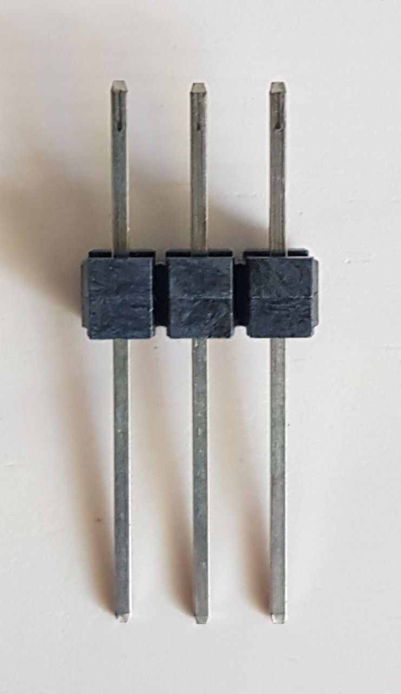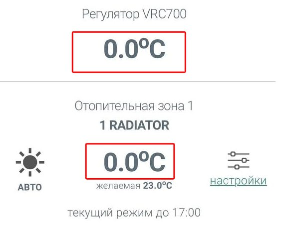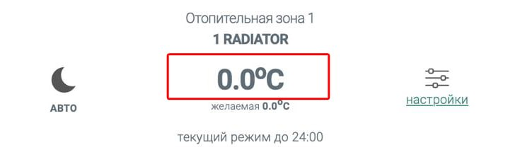

[Открыть в Telegram](https://t.me/webcontrol_app/274)

---

### 2026-07-20

Продолжение (начало в предыдущем сообщении)
 
В моей же программе эти значения отображаются “как есть” т.е. “желаемая температура 0.0”. 
Это вызывало недоумение у некоторых пользователей, особенно если учесть, что о параметре “отключение по НТ” знают далеко не все. Чтобы приблизить отображение в программе, к тому что пользователи видят на экране регулятора было принято решение в веб интерфейсе программы для отопительных зон в случае если зона отключается убрать надпись “желаемая температура 0.0”. Обновление Webcontrol до версии 2026.07.20 вносит эти изменения.
Что касается расчетной температуры контуров, то тут все очевидно: если контур не задействован, то расчетный алгоритм не работает, и расчетная температура контура отображается как “0.0”.

[Открыть в Telegram](https://t.me/webcontrol_app/273)

---

### 2026-07-20

К вопросу об интерпретации значений температуры “0.0” в регуляторах Vaillant 700-й и 720-й серий.

Наверняка, многие пользователи Webcontrol в процессе использования программы встречались со значениями “0.0” выводимых для желаемых температур отопительных зон и расчётных температур контуров. Но задумывались ли вы, почему и, главное, при каких состояниях регулятора эти температуры принимают такие значения. На мой взгляд, ответ прост – это специальные значения (возможно, значения по умолчанию), говорящие о том, что управляющий алгоритм определяющий целевую температуру не активен для той или иной части системы.

Например, для отопительных зон, если текущая уличная температура превышает настроенную температуру в параметре “отключение по НТ (наружной температуре)” для соответствующего контура, это приводит к отключению зоны, при этом визуально на табло регулятора (для 700-й серии) в основном экране пропадает текст “желаемая температура” с указанием значения.

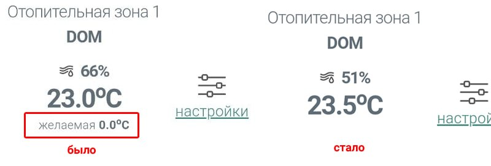

[Открыть в Telegram](https://t.me/webcontrol_app/272)

---

### 2026-07-16

Как вам такое будущее?

Лично мне не нравится. Автоматизация всего и вся должна быть разумной. При усложнении системы возрастает вероятность отказа. А если учесть ориентированность любого производителя на увеличение продаж и прибыли и наши трудности с запасными частями, то риски остаться без отопления в случае отказа только возрастают. 

Я не против прогресса, и по мнению людей, с большим опытом работы с Vaillant, серия конденсатников CS очень хороша в автоматической адаптации к системе отопления, но такое ставить лично себе в текущих условиях  я бы категорически не стал.

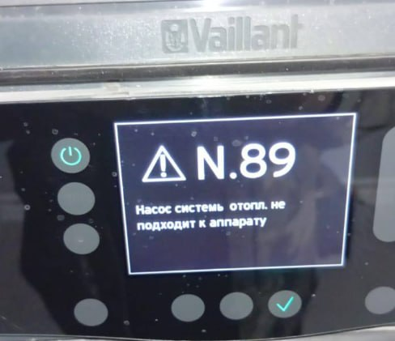

[Открыть в Telegram](https://t.me/webcontrol_app/271)

---

### 2026-05-30

О возможности совместного использования Home Assistant и Webcontrol (продолжение)

Однако после попытки обновления Webcontrol до последней версии все конечно-же поломалось, т.к. новая версия не совместима по обновлениям с первыми версиями (что, кстати, указано в Changelog) перед ним встала проблема что делать. Решение пользователь придумал оригинальное: установил на мини ПК последнюю версию Webcontrol, и чтобы не потерять автоматизацию также установил EBUSD непосредственно в HA и физически подключил этот EBUSD через второй ebus - адаптер к шине.  Таким образом, на шине ebus одновременно работают два EBUSD. 

А теперь техническая часть

Ситуация экзотическая, но возможная.  Около года назад я случайно одновременно подключил два комплекта Webcontrol к своей системе, и когда понял, что сделал проверил работу каждого из комплектов. На удивление, все не поломалось: насколько я помню, каждый из комплектов Webcontrol нормально читал параметры системы, если только этого не делать одновременно. При попытке одновременного чтения появлялись ошибки чтения. 

Тут также важно понимать, что по умолчанию (если специально не сконфигурирован через параметр строки запуска -- address) ebusd присваивает себе фиксированные адреса по шине 31/36 (master/slave, HEX) что, кстати, хорошо видно на диагностике: 
address 31: master #8, ebusd 
address 36: slave #8, ebusd

Когда на шине один EBUSD никаких проблем не возникает, но если два ebusd окажутся на шине одновременно они будут пытаться занять одни и те же адреса что приведет к конфликту:
address 31: master #8, ebusd, conflict
address 36: slave #8, ebusd

Чтобы все заработало – надо принудительно поменять адрес одного из ebusd, что пользователь и сделал, поменяв адрес ebusd, установленного в HA на 37 (см. фото настроек ebusd в HA из предыдущего поста). 

Сейчас идет тестирование, но, по моему мнению, такая связка вполне работоспособна, главное не допускать одновременного интенсивного обмена между HA / Webcontrol и регулятором (или теплогенератором).

[Открыть в Telegram](https://t.me/webcontrol_app/270)

---

### 2026-05-30

О возможности совместного использования Home Assistant и Webcontrol

Данный вопрос очень специфичный и вряд ли будет интересен большинству, но информация интересная, поэтому решил поделится.

Предыстория. 

У одного из первых пользователей Webcontrol (обладателя одной из ранних версий) была необходимость дополнительной автоматизации его системы отопления через уже существующий у него Home Assistant (HA). Поскольку первые версии Webcontrol шли без защиты кода и окружения от изменения, то пользователь установил версию EBUSD с поддержкой MQTT (версия EBUSD, входящая в состав Webcontrol MQTT не поддерживает). После чего благополучно долгое время эксплуатировал эту связку без каких-либо проблем. (Для справки: HA размещался на отдельном компьютере, не на мини-ПК с Webcontrol).

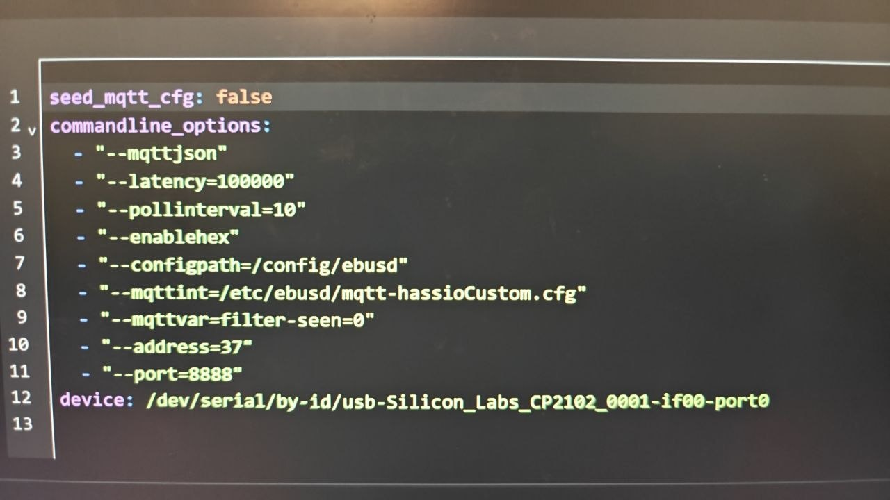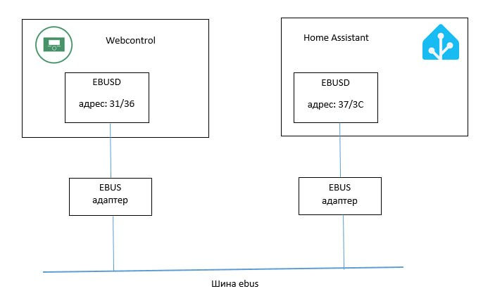

[Открыть в Telegram](https://t.me/webcontrol_app/268)

---

### 2026-04-15

Использует ли кто - нибудь из подписчиков VRT380?

[Открыть в Telegram](https://t.me/webcontrol_app/266)

---

### 2026-04-12

Обновление Webcontrol до версии 2026.04.12

Давно обещанное мною обновление, и первое действительно крупное обновление после окончания активной разработки Webcontrol.

Данное обновление добавляет два новых способа получать уведомления при наступлении аварийных ситуаций: в виде SMS-сообщений и уведомлений через любой доступный сервис NTFY. 

Так что на данный момент Webcontrol находится вне конкуренции среди вообще всех существующих в мире решений удаленного управления для Vaillant по количеству и разнообразию способов организации уведомлений (Telegram, Narodmon, SMS, NTFY, email через Narodmon или NTFY).

Отдельно хочу поблагодарить два отечественных сервиса без которых добавление этого функционала не имело бы большого смысла: SMSPILOT.ru и VPNKI.ru.

Благодаря им мы все получаем возможность получать уведомления от наших систем отопления, даже если интернет будет сильно фрагментирован.  По нынешним временам это дорогого стоит.

[Открыть в Telegram](https://t.me/webcontrol_app/265)

---

### 2026-04-12

Инструкция - настройка получения уведомлений и управления системой через NTFY сервис VPNKI.ru

Внимание!
Из за наплыва пользователей пытающихся обойти блокировки при помощи VPNKI.ru (для чего он совершенно не предназначен), регистрация новых пользователей требует подтверждения администрации (несмотря на грозное сообщение у них на сайте что регистрация новых пользователей временно не доступна).   

Для пользователей Webcontrol процедура такова: Вы регистрируетесь в системе VPNKI и отправляете мне (можно через сообщения каналу) Ваше имя пользователя в системе VPNKI, я связываюсь с VPNKI и Вашу учетную запись активируют.

📎 **Вложение:** [ntfy_config_VPNKI.pdf](./files/264_ntfy_config_VPNKI.pdf)

[Открыть в Telegram](https://t.me/webcontrol_app/264)

---

### 2026-04-11

Инструкция - Настройка получения уведомлений и управления системой через сервис NTFY.sh

Прошу прочесть и если есть непонятные места или что-то на Ваш взгляд надо изменить/дополнить то отпишитесь  в комментариях.

Спасибо!

📎 **Вложение:** [ntfy_setup.pdf](./files/263_ntfy_setup.pdf)

[Открыть в Telegram](https://t.me/webcontrol_app/263)

---

### 2026-04-11

У Webcontrol появилось сообщество  в VK

https://vk.com/webcontrol_app

Все желающие могут подписаться.  Пока что там пусто. Cо временем скопирую туда все материалы с boosty (видео, инструкции и т.д.). 

Есть мысль написать небольшую обзорную статью по классификации всех систем удаленного регуляторного управления для Vaillant. Это если будет возможность и не пропадет желание)))).

[Открыть в Telegram](https://t.me/webcontrol_app/262)

---

### 2026-04-01

Webcontrol теперь на сайте SMSPILOT.ru в разделе "Программы и плагины SMSPILOT".

https://smspilot.ru/software.php#webcontrol

Обновление добавляющее поддержу отправки SMS пока тестируется и скоро выйдет.

[Открыть в Telegram](https://t.me/webcontrol_app/261)

---

### 2026-03-29

Инструкция по настройке в Webcontrol отправки SMS  при помощи сервиса smspilot.

Посмотрите пожалуйста, и если есть непонятные места или появились вопросы, то напишите в комментариях к этому посту.

Спасибо!

ОБНОВЛЕНИЕ: файл изменен, т.к. оказалось что пополнение счета для отправки нескольких тестовых SMS не требуется.

📎 **Вложение:** [SMSPILOT_setup.pdf](./files/260_SMSPILOT_setup.pdf)

[Открыть в Telegram](https://t.me/webcontrol_app/260)

---

### 2026-03-27

В Webcontrol добавлена интеграция с серверами NTFY

Кто не знает что это такое  - рекомендую почитать на https://ntfy.sh. 

Если коротко и просто - то для Webcontrol это полноценная замена уведомлениям и управлению через Telegram - бота.

Не все идеально, но на весьма хорошем уровне. Есть клиенты под android/ios. Также работает (даже на парковке) в современных браузерах.

Возможно, скоро в России появится свой общедоступный NTFY сервер. Но не будем забегать вперед.))))

В Webcontrol можно теперь одновременно получать уведомления как через Telegram, так и через NTFY сервер, но управление будет работать только через что-то одно - либо через Telegram, либо через NTFY.

Сейчас  тестирую NTFY, потом передам обновление на тестирование сторонним пользователям и если у них все заработает штатно, то выпущу обновление.

Мне еще и инструкции ко всему этому писать.....

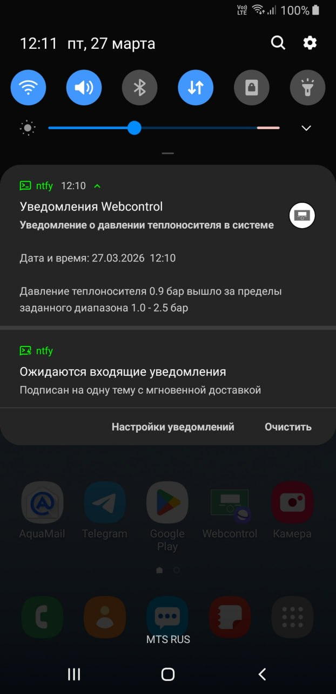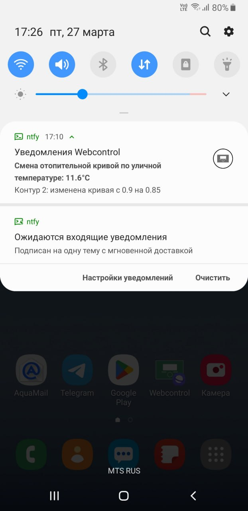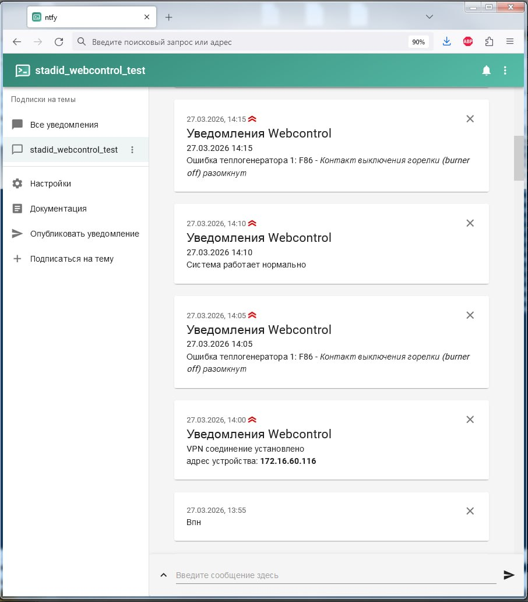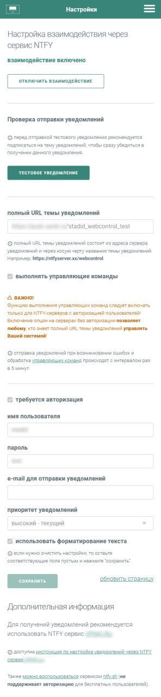

[Открыть в Telegram](https://t.me/webcontrol_app/256)

---

### 2026-03-20

Обновление по новым функциям.

Полностью сделал отправку SMS (интерфейс настроек + очередь отправки). Сегодня начал тестирование.  Осталось только написать инструкцию.

Начал делать интеграцию с NTFY. Потом сразу все включу в одно обновление. Очень много возни, т.к. раньше был один транспорт (Telegram), а теперь их три. И у каждого свои особенности реализации очереди отправки.

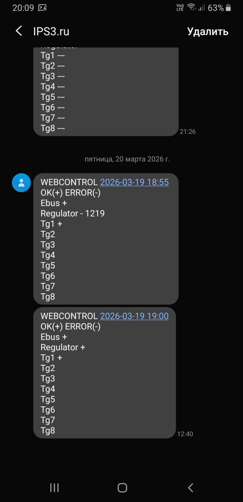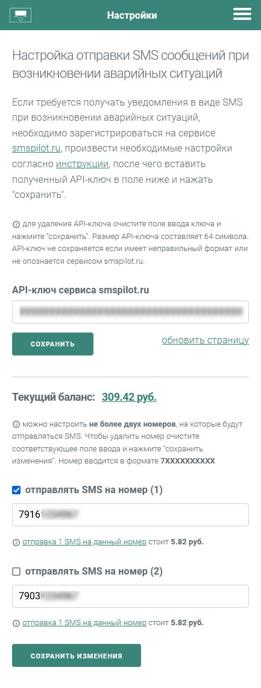

[Открыть в Telegram](https://t.me/webcontrol_app/254)

---

### 2026-03-16

Рекомендации по настройке взаимодействия Webcontrol с Telegram в текущих условиях.

Поскольку на данный момент прямой доступ к api.telegram.org (API для телеграм-ботов) невозможен, рекомендую всем пользователям, которые не могут самостоятельно обеспечить мини-ПК с Webcontrol такой доступ  отключить в настройках Webcontrol  взаимодействие через Telegram.

Это делается в разделе "Настройки" -> "Настройка взаимодействия через Telegram-бота".

Также всем настоятельно рекомендую зарегистрироваться на narodmon.ru и настроить в Webcontrol передачу хотя бы одного параметра.  Таким образом, Вы сможете косвенно контролировать состояние своей системы без телеграм.

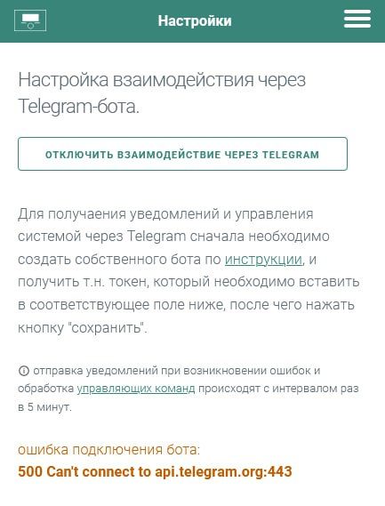

[Открыть в Telegram](https://t.me/webcontrol_app/253)

---

### 2026-03-14

Объявление  и планы.

Пока не наступила полночь и карета телега окончательно не превратилась в тыкву, хочу поделится планами на ближайшее будущее. 

Итак: сейчас работаю над добавлением поддержки отправки смс, в случае если происходит критическая ситуация в системе отопления. 

После того. как работа над смс будет завершена, займусь добавлением поддержки уведомлений используя решение от ntfy.sh возможно, что даже появится локальный сервер NTFY в РФ.

Также, скорее всего, появится сообщество Webcontrol вконтакте, как заменитель данного телеграм-канала. 

Следите за новостями.

[Открыть в Telegram](https://t.me/webcontrol_app/252)

---

### 2026-03-02

Итоги проведенного конкурса (пояснения к тексту SMS).

Поскольку из пояснений выше понятно, что мы будем отправлять SMS, то становится ясно, почему используется латиница (т.к. за одну SMS можно отправить 160 латинских символов и только 70 кириллицей).  Также нам требуется достичь максимального соотношения информативность / объем сообщения.  Немаловажным фактором служит и то, что по условиям сервиса отправки смс мы можем использовать только предопределенный шаблон сообщения в который можем вставлять лишь цифры и ряд спецсимволов. Исходя из этих требований и был создан шаблон уведомления. Приступим к его разбору.

WEBCONTROL 2026-02-25 16:05

Тут понятно – название программы и дата / время возникновения ошибки или изменения состояния системы.

OK(+) ERROR(-)

Пояснительная строка, которая указывает, что все компоненты системы ниже со знаком (+) работают нормально, а со знаком (-) не работают нормально или находятся в ошибке. Логика выбора символов такова: (+) – положительный, хороший, хорошо работает, (-) – отрицательный плохой, раз сломался.

Далее идет список всех компонентов системы начиная с соединения по шине Ebus. Выделено в отдельную строку чтобы можно было легко увидеть, что снято питание с системы отопления или что-то не так с самой шиной/ebusd.

Ebus +

Соединение по шине установлено – все работает нормально

Regulator +

Регулятор работает нормально

Далее идут состояния теплогенераторов в системе (сокращено до Tg). Поскольку в системе возможно максимально 8 теплогенераторов, а шаблон универсальный, то указываем их все. Значения для неиспользуемых теплогенераторов остаются пустыми показывая что этих компонентов в системе нет.

Tg1 – 28

Основной теплогенератор (теплогенератор 1) находится в ошибке F28. На это указывает минус справа от Tg1 и код ошибки после минуса

Tg2 +

Второй теплогенератор работает нормально, что видно по знаку (+).

Tg3 - <!>

А вот с третьим теплогенератором ошибка (на это указывает минус), конструкция <!> сделана такой для привлечения внимания, и для всех теплогенраторов и регулятора показывает, что не удалось считать состояние соответствующего устройства. Т.е. тут главный символ — это восклицательный знак.

Tg4
Tg5
Tg6
Tg7
Tg8 

Тут пусто т.к. этих теплогенератров нет в системе, но исключить из универсального шаблона их нельзя.

Для справки. Если что-то происходит с соединением по ebus шине – то соответствующая строка в SMS будет выглядеть так:

Ebus - <!>

[Открыть в Telegram](https://t.me/webcontrol_app/251)

---

### 2026-03-02

Итоги проведенного конкурса (вступление).

Давайте подведем итоги: большинство откликнувшихся и предложивших свои варианты ответа -   это старые подписчики канала и пользователи Webcontrol. Они сообща за несколько часов почти разгадали задачку, в то время как большая часть подписчиков отдыхала (в том числе и умственно) на выходных)))).

Для пояснения необходимо понимать контекст задачи. Поскольку будущее Телеграм сейчас не определено, необходимо предусмотреть альтернативные способы уведомлений пользователей об ошибках. К сожалению, самый очевидный способ – через narodmon не подходит, т.к. невозможно передать через narodmon текст уведомления в том виде, как требуется. Поэтому было выбрано уведомление через отправку SMS при возникновении критических ошибок (как один из способов с высокой вероятностью доставки уведомления). 

Надо отметить, что отправку SMS через интернет от частного лица сейчас очень непросто реализовать, т.к. много злонамеренных личностей использует этот вид коммуникации совсем не в созидательных целях и многие сервисы по отправке смс просто не работают с “физиками”. Однако, мне удалось найти сервис [smspilot.ru](https://smspilot.ru/?r=44063), который позволяет это сделать (с рядом ограничений), и благодаря тесному техническому взаимодействию с данным сервисом удалось проделать значительную часть работы по добавлению отправки SMS уведомлений из Webcontrol.  Если кому-то из подписчиков вдруг понадобятся SMS-уведомления в свой проект – рекомендую.  Отправка, естественно, не бесплатна (цена SMS зависит от Вашего оператора), но при условии, что аварийные уведомления случаются нечасто (если конечно Ваша система в хорошем состоянии и своевременно обслуживается) использование данного сервиса не должно сильно обременять Ваш кошелек.)))))

[Открыть в Telegram](https://t.me/webcontrol_app/250)

---

### 2026-03-01

Внимание конкурс!

Разыгрывается одна лицензия на Webcontrol.
Тот из подписчиков канала, кто первый наиболее полно сможет объяснить назначение и подробно расшифровать приведенный ниже текст получит в качестве приза лицензию Webcontrol. 

WEBCONTROL 2026-02-25 16:05
OK(+) ERROR(-)
Ebus +
Regulator +
Tg1 - 28
Tg2 +
Tg3 - <!>
Tg4
Tg5
Tg6
Tg7
Tg8

Свои варианты ответа оставляйте в комментариях к этому сообщению.

[Открыть в Telegram](https://t.me/webcontrol_app/249)

---

### 2026-02-12

Обновление Webcontrol до версии 2026.02.12

Техническое обновление для владельцев 720-го регулятора. Забыл обновить один шаблон интерфейса (не отображалась ссылка настройки уведомления о давлении на странице "Параметры"). Это обновление исправляет этот недочет. 

Владельцам 700-го обновляться необязательно. Для них ничего не поменялось кроме номера версии))))

[Открыть в Telegram](https://t.me/webcontrol_app/248)

---

### 2026-02-11

Обновление Webcontrol до версии 2026.02.10

Добавлена отправка Telegram уведомлений при выходе давления теплоносителя в системе из заданного пользователем диапазона.

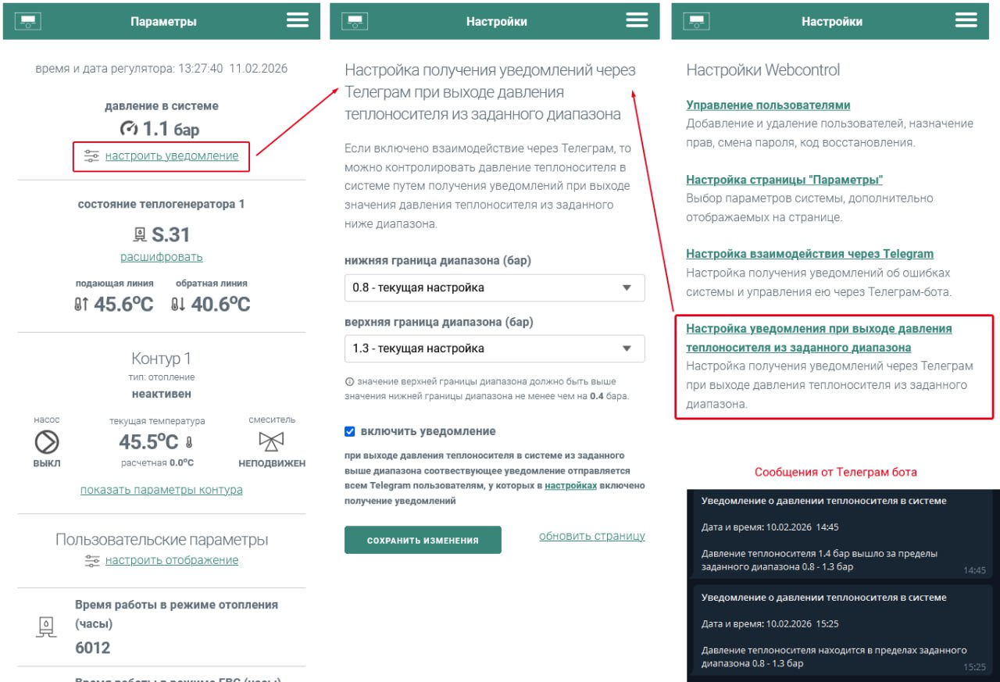

[Открыть в Telegram](https://t.me/webcontrol_app/247)

---

### 2026-02-07

Обновление Webcontrol до версии 2026.02.06

Поскольку появился первый пользователь Webcontrol использующий котел Protherm Ray совместно с регулятором Vaillant в программу добавлена расшифровка кодов состояния и ошибок для линейки котлов Ray Protherm.

Ray Protherm 6 KE /14 RU, UA арт. 0010023646
Ray Protherm 9 KE /14 RU, UA арт. 0010023647
Ray Protherm 12 KE /14 RU, UA  арт. 0010023648
Ray Protherm 14 KE /14 RU, UA арт. 0010023649 
Ray Protherm 18 KE /14 RU, UA  арт. 0010023650
Ray Protherm 21 KE /14 RU, UA арт. 0010023651
Ray Protherm 24 KE /14 RU, UA арт. 0010023652
Ray Protherm 28 KE /14 RU, UA арт. 0010023653

Необычное сочетание компонентов двух марок, но если работает, то почему бы и нет, тем более что, судя по инструкциям к обоим котлам, Eloblock отличается от Ray только платой дисплея.  Конечно, возможны незначительные различия на программном уровне, но платформа то все равно одна.

[Открыть в Telegram](https://t.me/webcontrol_app/246)

---

### 2026-02-05

Относительно добавления поддержки не поддерживаемых  в настоящий момент моделей регуляторов.

Недавно один из потенциальных пользователей Webcontrol узнавал, поддерживает ли программа VRC470. К сожалению, на данный момент - нет. И появление такой поддержки целиком и полностью завит от пользователей, т.е. от Вас.

Условно, регуляторы можно разделить на две группы: для первой группы поддержка добавляется относительно легко, и вторая группа, которая требует значительного времени и ресурсов.

К первым относятся все беспроводные варианты VRC700 и VRC720 - модели с индексом f мало распространенные у нас (VRC700f, VRC720f), а также VRT380.

Ко вторым можно отнести VRT370, VRC470, VRC630 – их поддержка требует времени и наличия у меня самого регулятора, для проведения анализа его работы и конфигурации ebusd. Также необходимо потратить значительное время на создание интерфейса и написание отдельной ветки кода для конкретного регулятора.

Феерическая эпопея с добавлением поддержки VRC720 отучила меня разменивать собственное время и здоровье на “просто спасибо” от пользователей. Поэтому добавление поддержки регуляторов из второй группы будет осуществляться только на платной основе при значительном количестве пользователей, заинтересованных в добавлении той или иной модели регулятора или готовых целиком оплатить разработку.

[Открыть в Telegram](https://t.me/webcontrol_app/245)

---

### 2026-02-02

Схема подключения Webcontrol к отопительной системе  (пример).

Для тех,  кому возня с проводами дается нелегко.

Это упрощенный пример - он может не соответствовать конфигурации Вашей системы. Назначение этого изображения - облегчить  пользователю понимание как  подключить Webcontrol к своей системе.

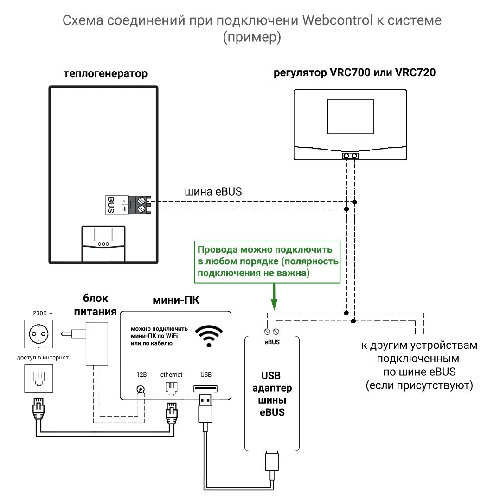

[Открыть в Telegram](https://t.me/webcontrol_app/244)

---

### 2026-02-01

Обновление Webcontrol до версии 2026.01.31

Благодаря одному из первых подписчиков канала недавно обновившемуся на последнюю версию удалось обнаружить и исправить неприятный нюанс отображения температуры обратной линии теплогенератора.

Дело в том, что до текущего момента Webcontrol не проверял состояние датчиков температуры подающей и обратной линии, а просто читал их значения. Для тех котлов, у которых нет датчика обратной линии (например, серии Elobloсk) чтение данного параметра вызывало ошибку и корректно обрабатывалось программой. Однако у подписчика датчик обратной линии предусмотрен в конструкции (и прошивке), но не установлен на заводе (опционален). В результате Webcontrol считывал некоторое случайное значение, не имеющее к реальности никакого отношения.   Собственно, текущее обновление и исправляет такое вводящее в заблуждение пользователя поведение программы.

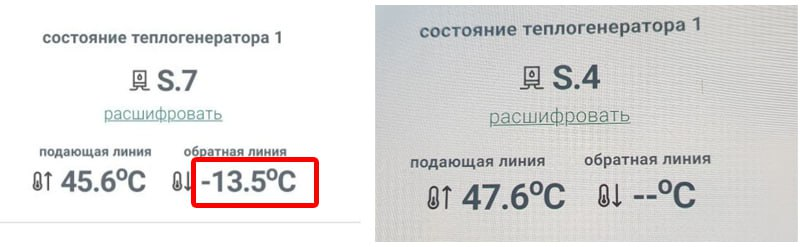

[Открыть в Telegram](https://t.me/webcontrol_app/243)

---

### 2026-01-28

ВСЕМ подписчикам проголосовавшим за канал  в течении сегодняшнего дня (28.01.2026) - лицензионный ключ в подарок. 

Пожалуйста свяжитесь со мной в комментариях к этому сообщению.

Напоминаю, я не могу выдать лицензионный ключ "заранее".  У Вас должен быть уже установлен Webcontrol одной из свежих версий, чтобы Вы могли мне прислать Ваш идентификатор для формирования лицензионного ключа.

[Открыть в Telegram](https://t.me/webcontrol_app/242)

---

### 2026-01-28

Спасибо большое всем проголосовавшим за канал!

За счет всего 3-х подписчиков удалось достичь необходимого уровня и включить перевод сообщений.

Вот так все и происходит в нашей жизни: единицы неравнодушных что-то делают, а остальные запаслись попкорном и смотрят на это ))))))

[Открыть в Telegram](https://t.me/webcontrol_app/241)

---

### 2026-01-28

Просьба к Premium-подписчикам Telegram проголосовать за канал.

Уважаемые подписчики!
Необходима Ваша поддержка.

Поскольку наш канал стали просматривать не-русскоязычные пользователи, я бы хотел включить для канала возможность переводить сообщения, что возможно только при определенном уровне проголосовавших за канал Premium - подписчиков Telegram.

Ссылка для голосования: https://t.me/boost/webcontrol_app

[Открыть в Telegram](https://t.me/webcontrol_app/240)

---

### 2026-01-26

Год непрерывной работы мини-ПК с Webcontrol  и обновление Webcontrol до версии 2026.01.22

Как можно увидеть на изображении, на данный момент время непрерывной работы моего мини-ПК составляет ровно 1 год. Вообще-то, это не самое длительное время: предыдущий период составил где-то год и 2 месяца, но умершие в ИБП батареи поставили крест на идее довести это время до 2-х лет.

Также на изображении можно увидеть новую функцию, добавленную в Webcontrol по просьбе одного из “старых” пользователей – кнопку перезагрузки мини-ПК. 

Помимо этого, в версии 2026.01.22 исправлено обновление через интернет. По рассеянности в мае прошлого года я исправил только один из этапов обновления (проверка на новую версию), а второй этап где осуществляется загрузка файла обновления – забыл исправить.  В этом обновлении эта досадная оплошность исправлена.

Так что это обновление необходимо будет установить вручную через zip файл. [Скачать файл.](https://disk.yandex.ru/d/rdZbEPWTJkDPvw)

Кстати, это обновление предназначено для версии Webcontrol не ниже 2024.08.15

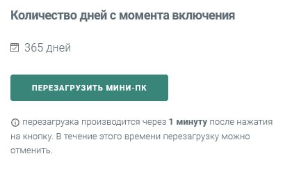

[Открыть в Telegram](https://t.me/webcontrol_app/239)

---

### 2026-01-19

Обновление Webcontrol до версии 2026.01.19

Из основного - теперь можно изменять настройки функции защиты от легионелл (в предыдущих версиях данные настройки просто отображались без возможности их изменения).

Обновление затрагивает как 700-й, так и 720-й регулятор.

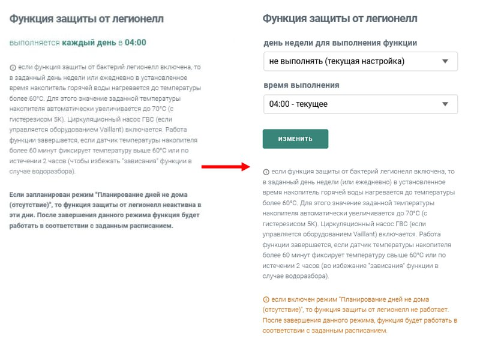

[Открыть в Telegram](https://t.me/webcontrol_app/238)

---

### 2026-01-16

У Webcontrol появилась страница на GitHub

Преследуемый навязчивой мыслью “a чего добру пропадать” решился все-таки сделать страницу Webcontrol на GitHub. Сделал красивую англоязычную WiKi, дальше все будет зависеть от интереса пользователей. Совершенно непонятно что из этого получится и получится ли что-нибудь вообще, т.к. у зарубежных пользователей и набор используемого оборудования другой и сервисы наши там не актуальны. К тому же Webcontrol архитектурно не создавался под многоязыковой интерфейс и объем перевода там тоже немаленький…

https://github.com/stadid/webcontrol

В связи с этим у меня просьба - уважаемые подписчики и читатели канала, если у Вас есть учетная запись на GitHub и вы считаете Webcontrol достойным - поставьте репозиторию звезд. Таким образом вы поддержите разработку. 

Спасибо!

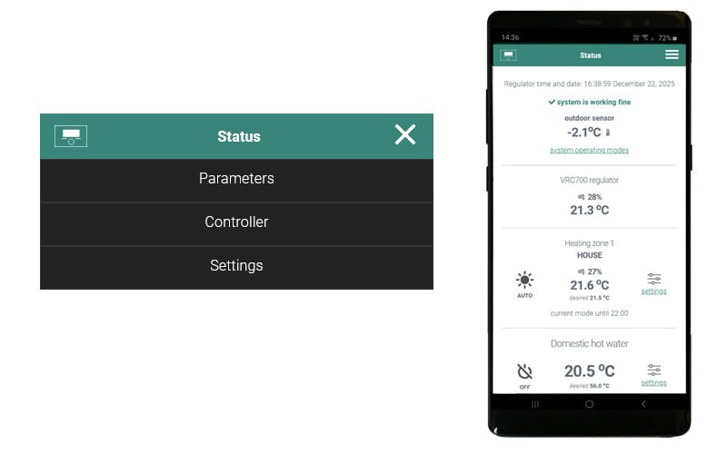

[Открыть в Telegram](https://t.me/webcontrol_app/237)

---

**Архив по годам:** **2026 (42)** • [2025](./2025.html) (24) • [2024](./2024.html) (85) • [2023](./2023.html) (49)

  &times;
  

