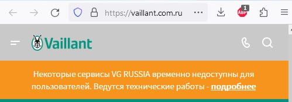
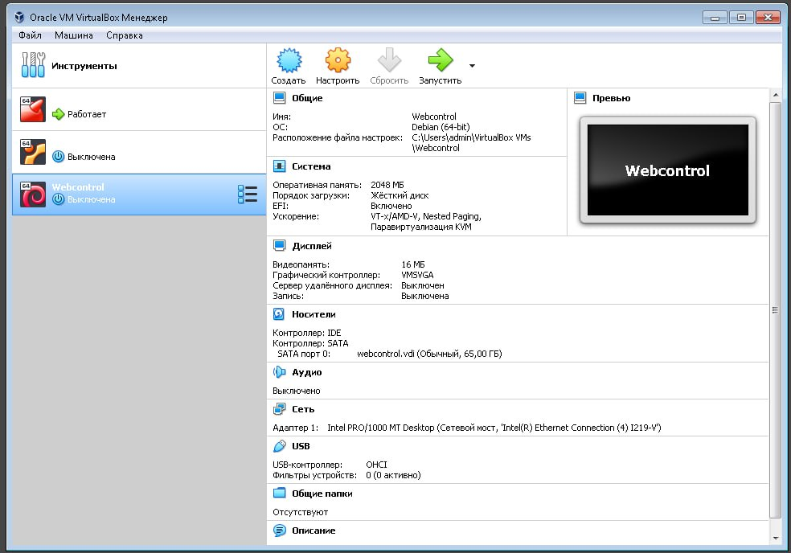
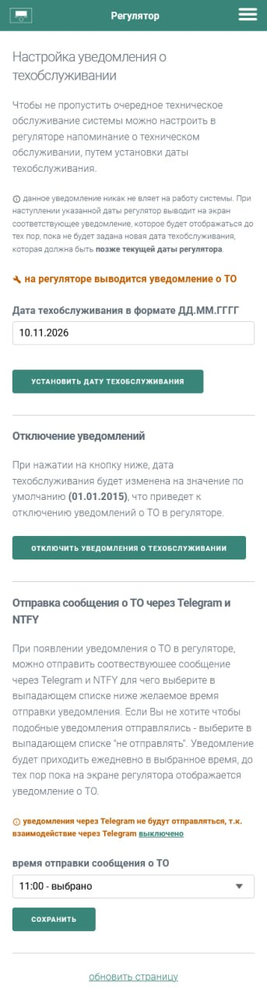
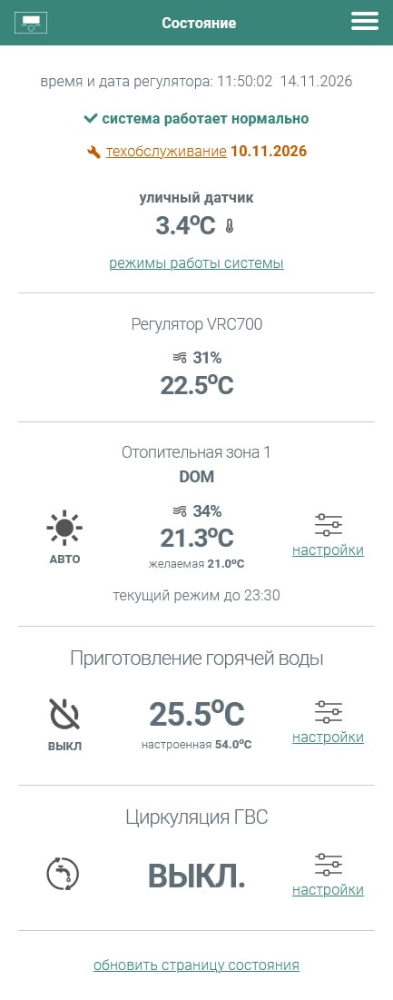
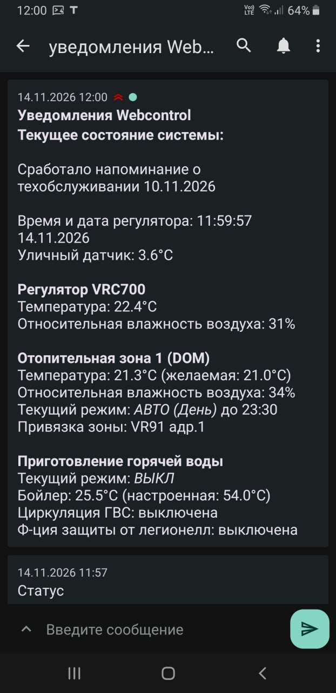
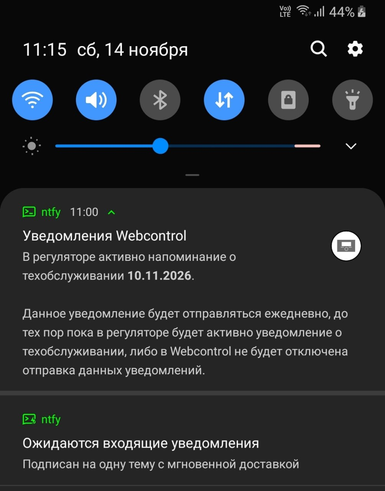
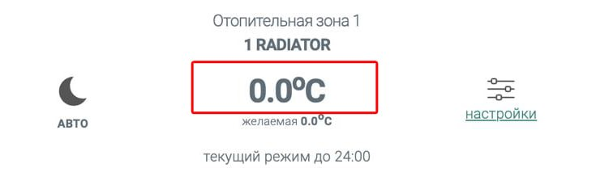
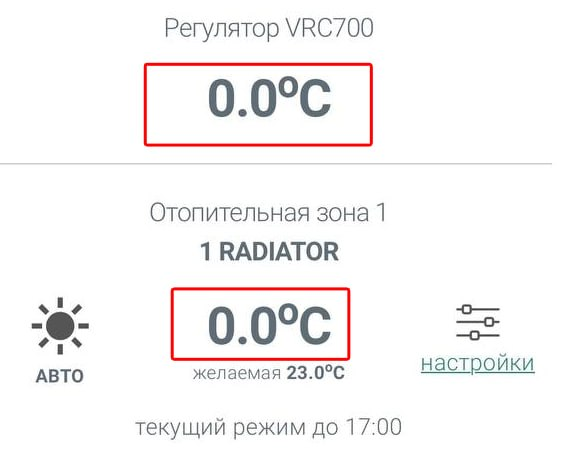
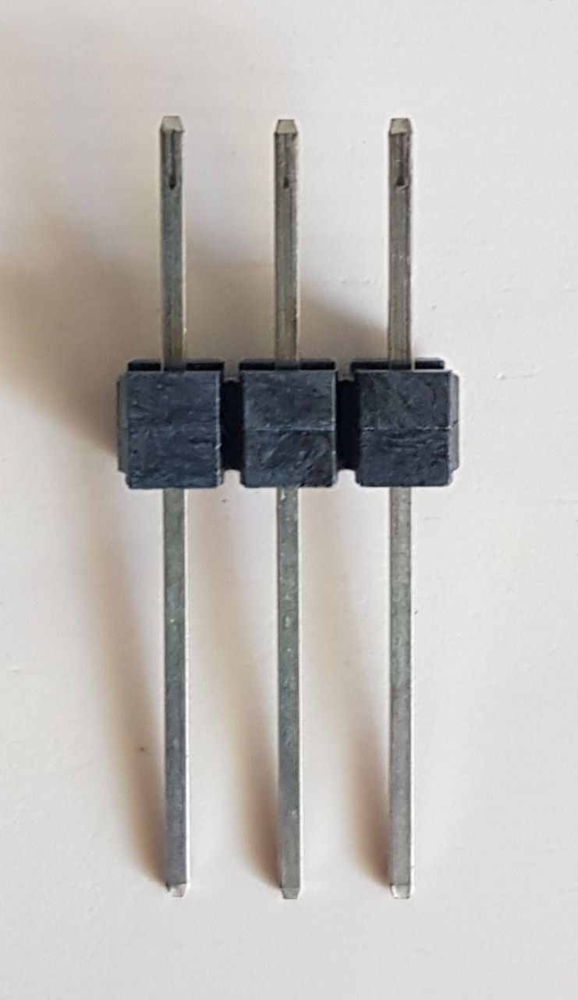

# Новости и обновления Webcontrol

[Главная страница Webcontrol](https://stadid.github.io/webcontrol/) | [Репозиторий GitHub](https://github.com/stadid/webcontrol) | [Канал в Telegram](https://t.me/webcontrol_app)

**Архив по годам:** [2026](./2026.html) (50) • [2025](./2025.html) (40) • [2024](./2024.html) (99) • [2023](./2023.html) (49)

---

### 2026-11-20

Поддержите развитие Webcontrol оставив свой отзыв на Forumhose.

Прошу подписчиков (кто использует Webcontrol), если не сложно, оставить отзыв о Webcontrol на  Forumhose.  Таким образом, Вы поддержите развитие программы.  Ниже  адрес темы где, собственно, и началась история Webcontrol.  Отзывы можно оставлять там. 

https://www.forumhouse.ru/threads/417757/page-42

Спасибо!

[Открыть в Telegram](https://t.me/webcontrol_app/287)

---

### 2026-11-18

Недоступность сервиса vLink из-за кибератаки

Как следует из баннера на сайте. https://vaillant.com.ru  

Некоторые сервисы VG RUSSIA временно недоступны для пользователей. Ведутся технические работы. 

Вот прямая ссылка на документ:
https://vaillant.com.ru/upload/%D0%9F%D1%80%D0%B5%D1%81%D1%81-%D1%80%D0%B5%D0%BB%D0%B8%D0%B7%20%D0%BA%D0%B8%D0%B1%D0%B5%D1%80%D0%B0%D1%82%D0%B0%D0%BA%D0%B0.pdf

Вроде должны уже были починить.  

Комментировать не стану, но хочу выразить свое личное мнение, что делать в текущих условиях ставку на облачные сервисы, при наличии локально работающих альтернатив как минимум легкомысленно.

[Открыть в Telegram](https://t.me/webcontrol_app/286)

---

### 2026-11-16

Доступен образ Webcontrol для запуска в различных средах виртуализации

https://github.com/stadid/webcontrol/releases/download/v2026.11.14_VM_image/Webcontrol_VM_image.zip

Архив по ссылке содержит образ  в формате *.ova для импорта и запуска в доступной среде виртуализации (VirtualBox, Proxmox и т.д.). После запуска ВМ, веб-интерфейс программы будет доступен на 80-м порту (http). По умолчанию Webcontrol настроен на автоматическое получение IP адреса (DHCP). 

Поскольку по умолчанию Webcontrol настроен на использование USB EBUS адаптера, непосредственно подключаемого к ПК с Webcontrol и определяемого как /dev/ttyUSB0, то при использовании USB EBUS адаптера необходимо обеспечить видимость данного адаптера внутри виртуальной машины и изменить имя устройства в параметрах EBUSD, если это требуется. Также можно использовать ЛЮБОЙ ДРУГОЙ EBUS адаптер совместимый с EBUSD версии 23.3, изменив тип используемого адаптера в настройках EBUSD через веб-интерфейс Webcontrol.

[Открыть в Telegram](https://t.me/webcontrol_app/285)

---

### 2026-11-14

[Открыть в Telegram](https://t.me/webcontrol_app/284)

---

### 2026-11-14

[Открыть в Telegram](https://t.me/webcontrol_app/283)

---

### 2026-11-14

[Открыть в Telegram](https://t.me/webcontrol_app/282)

---

### 2026-11-14

Обновление Webcontrol до версии 2026.11.14

Для 700-х регуляторов на страницу "Состояние" добавлено отображение напоминания о техобслуживании (настраивается в регуляторе в разделе "Уровень специалиста" - "Сервисная информация" - "Дата техобслуживания"). 

Также добавлена настройка для данного напоминания, включая отправку сообщений через Telegram и NTFY.

Как будет возможность - добавлю такую же опцию для 720-го.

[Открыть в Telegram](https://t.me/webcontrol_app/281)

---

### 2026-10-11

Сервисы VPNKI.ru временно недоступны.

В связи с авариями в дата-центрах Яндекс, серверы VPNKI временно недоступны. К сожалению, восстановить работоспособность нашей системы на другой площадке затруднительно из-за технических особенностей.
Восстановление работы VPNKI зависит от устранения аварии на площадках Яндекса.

Для тех кто пользуется их услугами в связке с Webcontrol это означает кирдык удаленому доступу и уведомлениям через их NTFY.

Как альтернатива - попробуйте настроить NTFY через ntfy.sh - у кого более или менее стабильно он работает.

Также призываю всех настроить передачу параметров на narodmon.ru - это бесплатно и позволяет мониторить хотя бы температуру помещения. Инструкции по настройке у меня пока нет.  Но если будут силы - сделаю. 

Не забывайте про СМС уведомления. Лучше настроить, т.к. чем больше способов получить извещения от системы тем спокойнее.

Пользователям, у которых  старые версии без всех новых способов уведомления - устанавливайте новую версию из образа.
Потом ставьте самое последнее обновление из  zip файла. 
Лицензионные ключи я вам предоставлю бесплатно. 

Присылайте идентификаторы для лицензионного ключа в личку (для тех, с кем общался напрямую), или в сообщения каналу.

[Открыть в Telegram](https://t.me/webcontrol_app/280)

---

### 2026-10-05

Чем Webcontrol отличается от связки Home Assistant (HA) + EBUSD

Мне кажется, что стоит внести ясность в этот вопрос, чтобы правильно понять круг задач, которые решает HA и Webcontrol. И то и другое построено на основе EBUSD, так в чем разница?

Итак, HA – это больше про интеграцию системы отопления в свой “умный дом” или мониторинг параметров системы отопления. Управление отопительными системами на основе регуляторов Vaillant не комплексное (просто чтение /запись одного или небольшого кол-ва параметров).   Доступно подготовленным пользователям, т.к. требует настройки HA/EBUSD и понимания как работает управление оборудованием Vaillant.

Webcontrol – полностью готовое решения ориентированное на конечных пользователей. Т.е. купил рекомендуемый мини-ПК и адаптер, залил “прошивку” (установочный образ), настройка понятная и примитивная (надо поставить несколько галочек). Есть подробное описание производимых настроек. Я всегда писал, что Webcontrol изначально создавался как замена родной системы управления, только полностью находящейся под контролем пользователя. У Webcontrol своя конфигурация EBUSD, управление регулятором комплексное (т.е. перед изменением параметров регулятора производится анализ его состояния). У Webcontrol практически отсутствует интеграция с “умным домом”, т.к. для этого уже существует HA. 

Как показала практика, можно использовать и Webcontrol и HA одновременно, [подключив их к одной системе отопления](https://t.me/webcontrol_app/268).

[Открыть в Telegram](https://t.me/webcontrol_app/279)

---

### 2026-09-12

На Aliexpress появились ebus адаптеры из проекта EBUSD
https://adapter.ebusd.eu/index.en.html

Ниже ссылки на карточки товара: 

eBUS Adapter Stick C6
https://aliexpress.ru/item/1005010435831535.html?sku_id=12000052397914140

eBUS adapter Shield C6
https://aliexpress.ru/item/1005011868010866.html

Это поколение имеет на борту esp c wifi и опционально к некоторым можно подключить Ethernet. По большей части такая сложная конструкция адаптера служит двум целям:

- физически отвязать адаптер от мини-пк с ebusd, сохраняя стабильность обмена по шине.

- следующий шаг на пути проекта к micro-ebusd

Как лично мне кажется проект ebusd сдвигается в сторону micro-ebusd с привязкой к облаку и платной подпиской на micro-ebusd (см. https://token.ebusd.eu/).

[Открыть в Telegram](https://t.me/webcontrol_app/278)

---

### 2026-08-09

(Продолжение)
В Webcontrol это приводит к тому, что температура зоны отображается как 0.0 (см. скриншот). Однако в процессе моих исследований по взаимодействию между VR91 и VRC700 мне удалось найти адреса регистров, из которых данные температуры можно читать напрямую.  Но включение прямого вывода показаний из VRC700 в Webcontrol также не дало результата (также видно из скриншота). Видимо, данные датчика не только не попадают в управляющий алгоритм, но и блокируются программно на более низком уровне.  

Как мне видится, сделано это до безобразия просто. Два контакта в соединителе, о котором я говорил выше, отведены под шину EBUS, а третий контакт - сигнальный, говорит регулятору о том, что он установлен в котел.

В рамках Webcontrol было бы здорово определять, что регулятор установлен в котел, чтобы выводить соответствующее сообщение вместо “0.0”, но такого регистра в сообществе EBUSD никто не искал (по крайней мере, я не нашел упоминаний). Можно это сделать по косвенным признакам, но это не 100% надежно, и я не сторонник таких “костылей”.

[Открыть в Telegram](https://t.me/webcontrol_app/277)

---

### 2026-08-09

[Открыть в Telegram](https://t.me/webcontrol_app/276)

---

### 2026-08-09

[Открыть в Telegram](https://t.me/webcontrol_app/275)

---

### 2026-08-09

Особенности отображения температур в Webcontrol в случае если регулятор 700 серии установлен в котле.

Пополняем копилку знаний по работе Webcontrol с разными конфигурациями отопительных систем. 

Не так давно у Webcontrol появился новый пользователь с редко встречающейся конфигурацией системы – у него регулятор 700-й серии установлен (штатно) прямо в котел. Некоторые модели теплогенераторов предыдущих поколений это позволяют – у них предусмотрена заглушка на передней панели под регулятор, а в комплекте 700-го регулятора идет специальный трех-штыревой соединитель для подключения регулятора к плате котла. Покопался у себя в закромах и даже нашел его чтобы проиллюстрировать этот пост.

Если регулятор установлен в котел, то его внутренний датчик температуры аппаратно отключается и данные температуры не используются для расчета температуры соответствующего контура, даже если регулятор привязан к одной из зон. Учитывается только уличная температура.

[Открыть в Telegram](https://t.me/webcontrol_app/274)

---

### 2026-07-20

Продолжение (начало в предыдущем сообщении)
 
В моей же программе эти значения отображаются “как есть” т.е. “желаемая температура 0.0”. 
Это вызывало недоумение у некоторых пользователей, особенно если учесть, что о параметре “отключение по НТ” знают далеко не все. Чтобы приблизить отображение в программе, к тому что пользователи видят на экране регулятора было принято решение в веб интерфейсе программы для отопительных зон в случае если зона отключается убрать надпись “желаемая температура 0.0”. Обновление Webcontrol до версии 2026.07.20 вносит эти изменения.
Что касается расчетной температуры контуров, то тут все очевидно: если контур не задействован, то расчетный алгоритм не работает, и расчетная температура контура отображается как “0.0”.

[Открыть в Telegram](https://t.me/webcontrol_app/273)

---

### Полный архив публикаций

**Архив по годам:** [2026](./2026.html) (50) • [2025](./2025.html) (40) • [2024](./2024.html) (99) • [2023](./2023.html) (49)
